
<picture><source media="(prefers-color-scheme: dark)" srcset="diagrams/banners/hero-dark.svg">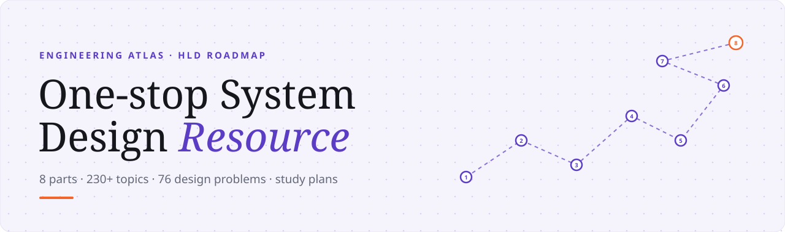</picture>

<h1 align="center">One-stop System Design Resource</h1>

<b>Learn system design (HLD) in the right order: what each idea is, why it matters, and where to go deeper.</b>

<a href="#part-i-engineering-foundations"><picture><source media="(prefers-color-scheme: dark)" srcset="diagrams/banners/btn-start-dark.svg"></picture></a>&nbsp;
<a href="#pick-your-plan"><picture><source media="(prefers-color-scheme: dark)" srcset="diagrams/banners/btn-plan-dark.svg"></picture></a>&nbsp;
<a href="#part-vii-system-design-interview-questions-with-solutions"><picture><source media="(prefers-color-scheme: dark)" srcset="diagrams/banners/btn-problems-dark.svg"></picture></a>

<a href="#part-vii-system-design-interview-questions-with-solutions"><picture><source media="(prefers-color-scheme: dark)" srcset="diagrams/tags/questions-dark.svg"></picture></a>

&nbsp;&nbsp;&nbsp; © 2026 Engineering Atlas · <a href="https://creativecommons.org/licenses/by-nc-sa/4.0/">CC BY-NC-SA 4.0</a> · Share with credit, not for commercial use

## What is system design?

System design is deciding how the parts of a software system fit together so it does its job for real users, at real scale, when things go wrong. You pick the components (servers, databases, caches, queues), decide how data flows between them, and choose which trade-offs to accept: speed against cost, freshness against availability, simplicity against flexibility.

A design is good when it meets its requirements and you can explain why each piece is there. That is also what a design interview checks.

> [!NOTE]
> **HLD vs LLD.** High-level design (this guide) is about services, data stores and how they talk across machines. Low-level design is about the classes and code inside one service.

## Start with the core components

Almost every design is built from the same twelve parts. Learn these first. Each name opens the lesson on Engineering Atlas; the chapter link jumps to it in this guide.

| | | |
|---|---|---|
| **01 · [Load balancer](https://engineering-atlas.in/system-design/networking/load-balancing/?utm_source=github&utm_medium=roadmap&utm_campaign=load-balancing)** Spreads traffic across servers [Chapter 14](#14-load-balancing) | **02 · [API gateway](https://engineering-atlas.in/system-design/networking/api-gateway/?utm_source=github&utm_medium=roadmap&utm_campaign=api-gateway)** One front door for services [Chapter 05](#05-backend-architecture-fundamentals) | **03 · [CDN](https://engineering-atlas.in/system-design/caching/cdn/?utm_source=github&utm_medium=roadmap&utm_campaign=cdn)** Serves files near the user [Chapter 16](#16-content-delivery-networks) |
| **04 · [Cache](https://engineering-atlas.in/system-design/caching/caching-101/?utm_source=github&utm_medium=roadmap&utm_campaign=caching-101)** Fast copies of hot data [Chapter 15](#15-caching) | **05 · [SQL vs NoSQL](https://engineering-atlas.in/system-design/database-fundamentals/sql-vs-nosql/?utm_source=github&utm_medium=roadmap&utm_campaign=sql-vs-nosql)** Pick the store that fits [Chapter 04](#04-database-fundamentals) | **06 · [Sharding](https://engineering-atlas.in/system-design/databases/sharding/?utm_source=github&utm_medium=roadmap&utm_campaign=sharding)** Split data across machines [Chapter 17](#17-database-scaling) |
| **07 · [Replication](https://engineering-atlas.in/system-design/database-fundamentals/data-replication/?utm_source=github&utm_medium=roadmap&utm_campaign=data-replication)** Copies for reads and failover [Chapter 17](#17-database-scaling) | **08 · [Message queue](https://engineering-atlas.in/system-design/async/message-queues/?utm_source=github&utm_medium=roadmap&utm_campaign=message-queues)** Decouple work, absorb spikes [Chapter 19](#19-message-queues-and-streams) | **09 · [Rate limiter](https://engineering-atlas.in/system-design/networking/rate-limiting/?utm_source=github&utm_medium=roadmap&utm_campaign=rate-limiting)** Stop one client hogging it [Chapter 21](#21-rate-limiting) |
| **10 · [DNS](https://engineering-atlas.in/system-design/networking/dns/?utm_source=github&utm_medium=roadmap&utm_campaign=dns)** Turns a name into an address [Chapter 01](#01-how-the-internet-works) | **11 · [Reverse proxy](https://engineering-atlas.in/system-design/networking/proxy-vs-reverse-proxy/?utm_source=github&utm_medium=roadmap&utm_campaign=proxy-vs-reverse-proxy)** TLS, caching, routing up front [Chapter 02](#02-networking-fundamentals) | **12 · [Consistent hashing](https://engineering-atlas.in/system-design/core-concepts/consistent-hashing/?utm_source=github&utm_medium=roadmap&utm_campaign=consistent-hashing)** Add nodes, move few keys [Chapter 30](#30-partitioning-strategies) |

### Where each one sits

A request flows left to right through edge, entry, compute and data; async work and streams run underneath; platform services support everything. Numbered badges match the table above.

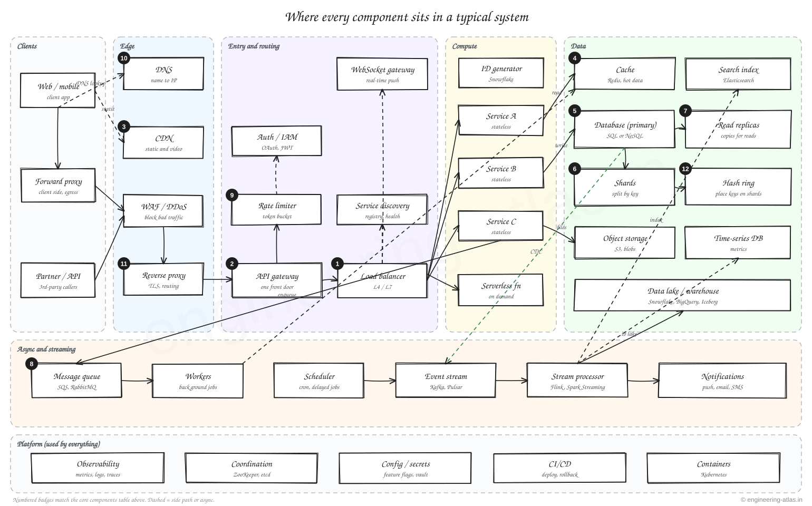

## How the course is organised

This follows the [HLD course on Engineering Atlas](https://engineering-atlas.in/system-design/?utm_source=github&utm_medium=roadmap&utm_campaign=system-design): start with the interview, learn the concepts module by module, then practise designs by domain. Use it to find a topic fast.

**[1. Start here](#1-start-here)** &nbsp;·&nbsp; **[2. Learn the concepts](#2-learn-the-concepts)** &nbsp;·&nbsp; **[3. Practise real designs](#3-practise-real-designs)** &nbsp;·&nbsp; **[4. Full roadmap](#4-full-roadmap)**

### 1. Start here

How a design round runs and the framework to use in it.

- **The round:** [How a system design interview works](https://engineering-atlas.in/system-design/interview/how-the-interview-works/?utm_source=github&utm_medium=roadmap&utm_campaign=how-the-interview-works) · [The delivery framework: from prompt to deep dives](https://engineering-atlas.in/system-design/interview/delivery-framework/?utm_source=github&utm_medium=roadmap&utm_campaign=delivery-framework) · [Back-of-envelope estimation](https://engineering-atlas.in/system-design/interview/back-of-envelope-estimation/?utm_source=github&utm_medium=roadmap&utm_campaign=back-of-envelope-estimation) · [Numbers to know](https://engineering-atlas.in/system-design/interview/numbers-to-know/?utm_source=github&utm_medium=roadmap&utm_campaign=numbers-to-know) · [Common mistakes that sink design rounds](https://engineering-atlas.in/system-design/interview/common-mistakes/?utm_source=github&utm_medium=roadmap&utm_campaign=common-mistakes)

### 2. Learn the concepts

14 modules in course order. Open one to see its topic groups and lessons.

<b>01. Core concepts</b>

| Topic group | Lessons |
|---|---|
| **Scale and performance** | • [Scalability](https://engineering-atlas.in/system-design/core-concepts/scalability/?utm_source=github&utm_medium=roadmap&utm_campaign=scalability) • [Performance vs scalability](https://engineering-atlas.in/system-design/core-concepts/performance-vs-scalability/?utm_source=github&utm_medium=roadmap&utm_campaign=performance-vs-scalability) • [Stateful vs stateless design](https://engineering-atlas.in/system-design/core-concepts/stateful-vs-stateless/?utm_source=github&utm_medium=roadmap&utm_campaign=stateful-vs-stateless) • [Latency vs throughput vs bandwidth](https://engineering-atlas.in/system-design/core-concepts/latency-throughput-bandwidth/?utm_source=github&utm_medium=roadmap&utm_campaign=latency-throughput-bandwidth) |
| **Reliability** | • [Reliability: SLIs, SLOs and error budgets](https://engineering-atlas.in/system-design/core-concepts/reliability/?utm_source=github&utm_medium=roadmap&utm_campaign=reliability) • [Availability and the nines](https://engineering-atlas.in/system-design/core-concepts/availability/?utm_source=github&utm_medium=roadmap&utm_campaign=availability) • [Single point of failure (SPOF)](https://engineering-atlas.in/system-design/core-concepts/single-point-of-failure/?utm_source=github&utm_medium=roadmap&utm_campaign=single-point-of-failure) • [Failover](https://engineering-atlas.in/system-design/core-concepts/failover/?utm_source=github&utm_medium=roadmap&utm_campaign=failover) • [Fault tolerance](https://engineering-atlas.in/system-design/core-concepts/fault-tolerance/?utm_source=github&utm_medium=roadmap&utm_campaign=fault-tolerance) • [Reliability patterns cheat sheet](https://engineering-atlas.in/system-design/core-concepts/reliability-patterns/?utm_source=github&utm_medium=roadmap&utm_campaign=reliability-patterns) |
| **Spreading data across machines** | • [Consistent hashing](https://engineering-atlas.in/system-design/core-concepts/consistent-hashing/?utm_source=github&utm_medium=roadmap&utm_campaign=consistent-hashing) • [CAP theorem and PACELC](https://engineering-atlas.in/system-design/core-concepts/cap-theorem/?utm_source=github&utm_medium=roadmap&utm_campaign=cap-theorem) |
| **Design principles** | • [Ten principles senior engineers design by](https://engineering-atlas.in/system-design/core-concepts/design-principles/?utm_source=github&utm_medium=roadmap&utm_campaign=design-principles) • [Cloud design patterns cheat sheet](https://engineering-atlas.in/system-design/core-concepts/cloud-design-patterns/?utm_source=github&utm_medium=roadmap&utm_campaign=cloud-design-patterns) |

<b>02. Networking and APIs</b>

| Topic group | Lessons |
|---|---|
| **How a request travels** | • [Client-server architecture](https://engineering-atlas.in/system-design/networking/client-server/?utm_source=github&utm_medium=roadmap&utm_campaign=client-server) • [Domain Name System (DNS)](https://engineering-atlas.in/system-design/networking/dns/?utm_source=github&utm_medium=roadmap&utm_campaign=dns) • [IP addresses](https://engineering-atlas.in/system-design/networking/ip-addresses/?utm_source=github&utm_medium=roadmap&utm_campaign=ip-addresses) • [The OSI model](https://engineering-atlas.in/system-design/networking/osi-model/?utm_source=github&utm_medium=roadmap&utm_campaign=osi-model) • [TCP vs UDP](https://engineering-atlas.in/system-design/networking/tcp-vs-udp/?utm_source=github&utm_medium=roadmap&utm_campaign=tcp-vs-udp) • [HTTP and HTTPS](https://engineering-atlas.in/system-design/networking/http-and-https/?utm_source=github&utm_medium=roadmap&utm_campaign=http-and-https) • [TLS and the handshake](https://engineering-atlas.in/system-design/networking/tls-handshake/?utm_source=github&utm_medium=roadmap&utm_campaign=tls-handshake) • [What happens when you open a URL](https://engineering-atlas.in/system-design/networking/what-happens-when-you-open-a-url/?utm_source=github&utm_medium=roadmap&utm_campaign=what-happens-when-you-open-a-url) • [Proxy vs reverse proxy](https://engineering-atlas.in/system-design/networking/proxy-vs-reverse-proxy/?utm_source=github&utm_medium=roadmap&utm_campaign=proxy-vs-reverse-proxy) • [Load balancing: L4 vs L7](https://engineering-atlas.in/system-design/networking/load-balancing/?utm_source=github&utm_medium=roadmap&utm_campaign=load-balancing) • [Sticky sessions](https://engineering-atlas.in/system-design/networking/sticky-sessions/?utm_source=github&utm_medium=roadmap&utm_campaign=sticky-sessions) • [Checksums](https://engineering-atlas.in/system-design/networking/checksums/?utm_source=github&utm_medium=roadmap&utm_campaign=checksums) |
| **API styles** | • [What is an API?](https://engineering-atlas.in/system-design/networking/apis/?utm_source=github&utm_medium=roadmap&utm_campaign=apis) • [REST vs GraphQL vs gRPC](https://engineering-atlas.in/system-design/networking/rest-vs-graphql/?utm_source=github&utm_medium=roadmap&utm_campaign=rest-vs-graphql) • [Real-time connections: long polling, SSE and WebSockets](https://engineering-atlas.in/system-design/networking/websockets/?utm_source=github&utm_medium=roadmap&utm_campaign=websockets) • [Webhooks](https://engineering-atlas.in/system-design/networking/webhooks/?utm_source=github&utm_medium=roadmap&utm_campaign=webhooks) • [Pagination: offset vs cursor](https://engineering-atlas.in/system-design/networking/pagination/?utm_source=github&utm_medium=roadmap&utm_campaign=pagination) • [Filtering and sorting in APIs](https://engineering-atlas.in/system-design/networking/filtering-and-sorting/?utm_source=github&utm_medium=roadmap&utm_campaign=filtering-and-sorting) • [Serialization and schema evolution](https://engineering-atlas.in/system-design/networking/schema-evolution/?utm_source=github&utm_medium=roadmap&utm_campaign=schema-evolution) • [API design for system design interviews](https://engineering-atlas.in/system-design/api-design/?utm_source=github&utm_medium=roadmap&utm_campaign=api-design) • [API composition: aggregation, BFF and GraphQL federation](https://engineering-atlas.in/system-design/networking/api-composition/?utm_source=github&utm_medium=roadmap&utm_campaign=api-composition) • [HTTP API implementation gotchas](https://engineering-atlas.in/system-design/networking/http-api-gotchas/?utm_source=github&utm_medium=roadmap&utm_campaign=http-api-gotchas) |
| **Protecting the API** | • [API gateway](https://engineering-atlas.in/system-design/networking/api-gateway/?utm_source=github&utm_medium=roadmap&utm_campaign=api-gateway) • [Idempotency](https://engineering-atlas.in/system-design/networking/idempotency/?utm_source=github&utm_medium=roadmap&utm_campaign=idempotency) • [Rate limiting](https://engineering-atlas.in/system-design/networking/rate-limiting/?utm_source=github&utm_medium=roadmap&utm_campaign=rate-limiting) |

<b>03. Data and storage</b>

| Topic group | Lessons |
|---|---|
| **Choosing a database** | • [SQL vs NoSQL and database types](https://engineering-atlas.in/system-design/database-fundamentals/sql-vs-nosql/?utm_source=github&utm_medium=roadmap&utm_campaign=sql-vs-nosql) • [PostgreSQL vs MySQL](https://engineering-atlas.in/system-design/database-fundamentals/postgresql-vs-mysql/?utm_source=github&utm_medium=roadmap&utm_campaign=postgresql-vs-mysql) • [Database architectures](https://engineering-atlas.in/system-design/database-fundamentals/database-architectures/?utm_source=github&utm_medium=roadmap&utm_campaign=database-architectures) • [OLTP vs OLAP: warehouses and columnar storage](https://engineering-atlas.in/system-design/database-fundamentals/oltp-vs-olap/?utm_source=github&utm_medium=roadmap&utm_campaign=oltp-vs-olap) |
| **Schema design** | • [Data modeling: normalization vs denormalization](https://engineering-atlas.in/system-design/database-fundamentals/normalization-vs-denormalization/?utm_source=github&utm_medium=roadmap&utm_campaign=normalization-vs-denormalization) • [Database constraints and foreign keys](https://engineering-atlas.in/system-design/database-fundamentals/database-constraints/?utm_source=github&utm_medium=roadmap&utm_campaign=database-constraints) |
| **Transactions and concurrency** | • [ACID transactions](https://engineering-atlas.in/system-design/database-fundamentals/acid-transactions/?utm_source=github&utm_medium=roadmap&utm_campaign=acid-transactions) • [Isolation levels and anomalies: dirty reads, lost updates, phantoms](https://engineering-atlas.in/system-design/databases/isolation-levels/?utm_source=github&utm_medium=roadmap&utm_campaign=isolation-levels) • [MVCC, vacuum and bloat](https://engineering-atlas.in/system-design/database-fundamentals/mvcc/?utm_source=github&utm_medium=roadmap&utm_campaign=mvcc) • [Optimistic vs pessimistic locking](https://engineering-atlas.in/distributed-systems/concurrency-control.html?utm_source=github&utm_medium=roadmap&utm_campaign=concurrency-control) • [Storage engines: WAL, B-trees and LSM trees](https://engineering-atlas.in/system-design/search/reads-and-writes/?utm_source=github&utm_medium=roadmap&utm_campaign=reads-and-writes) |
| **Query performance** | • [Database indexes: clustered, composite and covering](https://engineering-atlas.in/system-design/databases/indexes/?utm_source=github&utm_medium=roadmap&utm_campaign=indexes) • [Query plans: index scan vs full table scan](https://engineering-atlas.in/system-design/database-fundamentals/query-execution-plans/?utm_source=github&utm_medium=roadmap&utm_campaign=query-execution-plans) • [The N+1 query problem](https://engineering-atlas.in/system-design/database-fundamentals/n-plus-one-queries/?utm_source=github&utm_medium=roadmap&utm_campaign=n-plus-one-queries) • [Connection pooling](https://engineering-atlas.in/system-design/database-fundamentals/connection-pooling/?utm_source=github&utm_medium=roadmap&utm_campaign=connection-pooling) |
| **Scaling the data layer** | • [Table partitioning](https://engineering-atlas.in/system-design/database-fundamentals/table-partitioning/?utm_source=github&utm_medium=roadmap&utm_campaign=table-partitioning) • [Database sharding](https://engineering-atlas.in/system-design/databases/sharding/?utm_source=github&utm_medium=roadmap&utm_campaign=sharding) • [Secondary indexes on sharded data: local vs global](https://engineering-atlas.in/system-design/database-fundamentals/secondary-indexes-sharded/?utm_source=github&utm_medium=roadmap&utm_campaign=secondary-indexes-sharded) • [Data replication: leaders, followers and replication lag](https://engineering-atlas.in/system-design/database-fundamentals/data-replication/?utm_source=github&utm_medium=roadmap&utm_campaign=data-replication) • [Quorums and leaderless replication](https://engineering-atlas.in/system-design/database-fundamentals/quorums/?utm_source=github&utm_medium=roadmap&utm_campaign=quorums) |
| **Data structures at scale** | • [Bloom filters](https://engineering-atlas.in/system-design/database-fundamentals/bloom-filters/?utm_source=github&utm_medium=roadmap&utm_campaign=bloom-filters) • [Count-min sketch and HyperLogLog](https://engineering-atlas.in/system-design/database-fundamentals/count-min-and-hyperloglog/?utm_source=github&utm_medium=roadmap&utm_campaign=count-min-and-hyperloglog) • [Geospatial indexes: geohash, quadtrees, S2 and H3](https://engineering-atlas.in/system-design/database-fundamentals/geospatial-indexes/?utm_source=github&utm_medium=roadmap&utm_campaign=geospatial-indexes) |
| **Deep dives** | • [Databases for system design interviews](https://engineering-atlas.in/system-design/databases/?utm_source=github&utm_medium=roadmap&utm_campaign=databases) • [ACID vs BASE (video)](https://engineering-atlas.in/system-design/databases/acid-vs-base/?utm_source=github&utm_medium=roadmap&utm_campaign=acid-vs-base) • [How search engines work](https://engineering-atlas.in/system-design/search/how-search-engines-work/?utm_source=github&utm_medium=roadmap&utm_campaign=how-search-engines-work) |

<b>04. Caching fundamentals</b>

| Topic group | Lessons |
|---|---|
| **Caching** | • [Caching 101](https://engineering-atlas.in/system-design/caching/caching-101/?utm_source=github&utm_medium=roadmap&utm_campaign=caching-101) • [Caching strategies: cache-aside, read-through, write-through](https://engineering-atlas.in/system-design/caching/caching-strategies/?utm_source=github&utm_medium=roadmap&utm_campaign=caching-strategies) • [Cache eviction policies](https://engineering-atlas.in/system-design/caching/cache-eviction-policies/?utm_source=github&utm_medium=roadmap&utm_campaign=cache-eviction-policies) • [Distributed caching](https://engineering-atlas.in/system-design/caching/distributed-caching/?utm_source=github&utm_medium=roadmap&utm_campaign=distributed-caching) • [Hot keys, cache stampede and invalidation](https://engineering-atlas.in/system-design/caching/hot-keys-and-cache-stampede/?utm_source=github&utm_medium=roadmap&utm_campaign=hot-keys-and-cache-stampede) • [Content delivery network (CDN)](https://engineering-atlas.in/system-design/caching/cdn/?utm_source=github&utm_medium=roadmap&utm_campaign=cdn) |

<b>05. Messaging and streams</b>

| Topic group | Lessons |
|---|---|
| **Queues and topics** | • [Message queues](https://engineering-atlas.in/system-design/async/message-queues/?utm_source=github&utm_medium=roadmap&utm_campaign=message-queues) • [Publish/subscribe (pub/sub)](https://engineering-atlas.in/system-design/async/pub-sub/?utm_source=github&utm_medium=roadmap&utm_campaign=pub-sub) • [Delivery guarantees: at-least-once, exactly-once and DLQs](https://engineering-atlas.in/system-design/async/delivery-guarantees/?utm_source=github&utm_medium=roadmap&utm_campaign=delivery-guarantees) • [Message ordering: per-key queues and the sequential convoy](https://engineering-atlas.in/system-design/async/message-ordering/?utm_source=github&utm_medium=roadmap&utm_campaign=message-ordering) • [Backpressure and load shedding](https://engineering-atlas.in/system-design/async/backpressure/?utm_source=github&utm_medium=roadmap&utm_campaign=backpressure) • [Effectively-once: idempotent consumers and the inbox pattern](https://engineering-atlas.in/system-design/async/idempotent-consumers/?utm_source=github&utm_medium=roadmap&utm_campaign=idempotent-consumers) |
| **Data in motion** | • [Transactional outbox](https://engineering-atlas.in/system-design/async/transactional-outbox/?utm_source=github&utm_medium=roadmap&utm_campaign=transactional-outbox) • [Event sourcing and CQRS](https://engineering-atlas.in/system-design/async/event-sourcing-and-cqrs/?utm_source=github&utm_medium=roadmap&utm_campaign=event-sourcing-and-cqrs) • [Stream processing: event time, windows and joins](https://engineering-atlas.in/system-design/async/stream-processing/?utm_source=github&utm_medium=roadmap&utm_campaign=stream-processing) Coming soon: Change data capture (CDC) |

<b>06. Distributed coordination</b>

| Topic group | Lessons |
|---|---|
| **Agreeing and finding each other** | • [Heartbeats, timeouts and partial failures](https://engineering-atlas.in/system-design/distributed-systems/heartbeats/?utm_source=github&utm_medium=roadmap&utm_campaign=heartbeats) • [Service discovery](https://engineering-atlas.in/system-design/distributed-systems/service-discovery/?utm_source=github&utm_medium=roadmap&utm_campaign=service-discovery) • [Gossip protocol](https://engineering-atlas.in/system-design/distributed-systems/gossip-protocol/?utm_source=github&utm_medium=roadmap&utm_campaign=gossip-protocol) • [Consensus and leader election](https://engineering-atlas.in/system-design/distributed-systems/consensus-algorithms/?utm_source=github&utm_medium=roadmap&utm_campaign=consensus-algorithms) • [Distributed locking](https://engineering-atlas.in/system-design/distributed-systems/distributed-locking/?utm_source=github&utm_medium=roadmap&utm_campaign=distributed-locking) |
| **Transactions and ordering** | • [Consistency models: linearizable, causal and eventual](https://engineering-atlas.in/system-design/distributed-systems/consistency-models/?utm_source=github&utm_medium=roadmap&utm_campaign=consistency-models) • [Read-your-writes consistency](https://engineering-atlas.in/system-design/distributed-systems/read-your-writes/?utm_source=github&utm_medium=roadmap&utm_campaign=read-your-writes) • [Strong vs eventual consistency](https://engineering-atlas.in/system-design/distributed-systems/strong-vs-eventual-consistency/?utm_source=github&utm_medium=roadmap&utm_campaign=strong-vs-eventual-consistency) • [Distributed transactions: two-phase commit vs sagas](https://engineering-atlas.in/system-design/distributed-systems/distributed-transactions/?utm_source=github&utm_medium=roadmap&utm_campaign=distributed-transactions) • [Clocks, ordering and conflict resolution](https://engineering-atlas.in/system-design/distributed-systems/clocks-and-ordering/?utm_source=github&utm_medium=roadmap&utm_campaign=clocks-and-ordering) |

<b>07. Running in production</b>

| Topic group | Lessons |
|---|---|
| **Resilience and recovery** | • [Disaster recovery](https://engineering-atlas.in/system-design/production/disaster-recovery/?utm_source=github&utm_medium=roadmap&utm_campaign=disaster-recovery) • [Multi-region and active-active](https://engineering-atlas.in/system-design/production/multi-region/?utm_source=github&utm_medium=roadmap&utm_campaign=multi-region) • [Backend failure modes](https://engineering-atlas.in/distributed-systems/backend-failure-modes.html?utm_source=github&utm_medium=roadmap&utm_campaign=backend-failure-modes) • [Cell-based architecture: deployment stamps and geodes](https://engineering-atlas.in/system-design/production/cell-based-architecture/?utm_source=github&utm_medium=roadmap&utm_campaign=cell-based-architecture) Coming soon: Health checks done right |
| **Observability** | Coming soon: Observability: logs, metrics and traces |
| **Scaling the fleet** | • [Autoscaling done right](https://engineering-atlas.in/system-design/production/autoscaling/?utm_source=github&utm_medium=roadmap&utm_campaign=autoscaling) • [Autoscaling in Kubernetes: pods and nodes](https://engineering-atlas.in/system-design/production/autoscaling-kubernetes/?utm_source=github&utm_medium=roadmap&utm_campaign=autoscaling-kubernetes) • [Autoscaling databases](https://engineering-atlas.in/system-design/production/autoscaling-databases/?utm_source=github&utm_medium=roadmap&utm_campaign=autoscaling-databases) • [Autoscaling queue workers](https://engineering-atlas.in/system-design/production/autoscaling-queue-workers/?utm_source=github&utm_medium=roadmap&utm_campaign=autoscaling-queue-workers) • [Capacity planning](https://engineering-atlas.in/system-design/production/capacity-planning/?utm_source=github&utm_medium=roadmap&utm_campaign=capacity-planning) |
| **Shipping safely** | • [Migrating a legacy system: strangler fig and anti-corruption layer](https://engineering-atlas.in/system-design/production/legacy-migration/?utm_source=github&utm_medium=roadmap&utm_campaign=legacy-migration) Coming soon: Deployment strategies: canary, blue-green and feature flags, Online schema and data migrations, Cost-aware design |

<b>08. Why is it slow? Performance anti-patterns</b>

| Topic group | Lessons |
|---|---|
| **Performance anti-patterns** | • [Why is it slow? Anti-patterns in how you talk to storage](https://engineering-atlas.in/system-design/anti-patterns/storage-anti-patterns/?utm_source=github&utm_medium=roadmap&utm_campaign=storage-anti-patterns) • [Blocked threads and wasted objects: synchronous I/O, busy front end, improper instantiation](https://engineering-atlas.in/system-design/anti-patterns/thread-and-resource-anti-patterns/?utm_source=github&utm_medium=roadmap&utm_campaign=thread-and-resource-anti-patterns) • [Under pressure: retry storms and noisy neighbors](https://engineering-atlas.in/system-design/anti-patterns/retry-storms-and-noisy-neighbors/?utm_source=github&utm_medium=roadmap&utm_campaign=retry-storms-and-noisy-neighbors) |

<b>09. Security</b>

| Topic group | Lessons |
|---|---|
| **Identity and access** | • [Authentication: sessions, tokens and JWT](https://engineering-atlas.in/system-design/security/authentication/?utm_source=github&utm_medium=roadmap&utm_campaign=authentication) • [OAuth 2.0 and OpenID Connect](https://engineering-atlas.in/system-design/security/oauth-and-oidc/?utm_source=github&utm_medium=roadmap&utm_campaign=oauth-and-oidc) • [Auth at the edge](https://engineering-atlas.in/system-design/security/auth-at-the-edge/?utm_source=github&utm_medium=roadmap&utm_campaign=auth-at-the-edge) • [Service-to-service auth and mTLS](https://engineering-atlas.in/system-design/security/service-auth-mtls/?utm_source=github&utm_medium=roadmap&utm_campaign=service-auth-mtls) |
| **Protecting data** | • [Encryption and key management](https://engineering-atlas.in/system-design/security/encryption-and-keys/?utm_source=github&utm_medium=roadmap&utm_campaign=encryption-and-keys) |

<b>10. Multi-tenant SaaS</b>

Part of the Engineering Atlas pass. Free reads for these topics are in the full roadmap below.

| Topic group | Lessons |
|---|---|
| **Tenancy** | • What a tenant is, and the silo, pool and bridge models • Control plane vs data plane |
| **Serving tenants** | • Routing requests and isolating tenant data • Noisy neighbours and fairness • Metering and usage-based billing |

<b>11. Architecture styles</b>

Part of the Engineering Atlas pass. Free reads for these topics are in the full roadmap below.

| Topic group | Lessons |
|---|---|
| **Architecture styles** | • Monolith vs microservices • Serverless architecture • Event-driven architecture • Peer-to-peer (P2P) architecture |
| **Designing services** | • Choosing an architecture style • Finding service boundaries with DDD • Sidecar, ambassador and service mesh |

<b>12. System design trade-offs</b>

Part of the Engineering Atlas pass. Free reads for these topics are in the full roadmap below.

| Topic group | Lessons |
|---|---|
| **Trade-offs** | • Vertical vs horizontal scaling • Synchronous vs asynchronous communication • Push vs pull architecture • Batch vs stream processing |

<b>13. Key technologies</b>

| Topic group | Lessons |
|---|---|
| **Data stores** | • [PostgreSQL](https://engineering-atlas.in/system-design/key-technologies/postgresql/?utm_source=github&utm_medium=roadmap&utm_campaign=postgresql) • [Cassandra, part 1: how it stores and spreads data](https://engineering-atlas.in/system-design/key-technologies/cassandra-architecture/?utm_source=github&utm_medium=roadmap&utm_campaign=cassandra-architecture) • [Cassandra, part 2: consistency, failures and data modeling](https://engineering-atlas.in/system-design/key-technologies/cassandra-data-modeling/?utm_source=github&utm_medium=roadmap&utm_campaign=cassandra-data-modeling) • [Aerospike: how it powers ad tech](https://engineering-atlas.in/system-design/key-technologies/aerospike-for-ad-tech/?utm_source=github&utm_medium=roadmap&utm_campaign=aerospike-for-ad-tech) • [Elasticsearch](https://engineering-atlas.in/system-design/search/elasticsearch/?utm_source=github&utm_medium=roadmap&utm_campaign=elasticsearch) • [Blob storage (Amazon S3)](https://engineering-atlas.in/system-design/key-technologies/blob-storage-s3/?utm_source=github&utm_medium=roadmap&utm_campaign=blob-storage-s3) Coming soon: Redis, DynamoDB, Vector databases |
| **Plumbing** | • [AWS SQS (Simple Queue Service)](https://engineering-atlas.in/system-design/key-technologies/aws-sqs/?utm_source=github&utm_medium=roadmap&utm_campaign=aws-sqs) • [Flink and stream processing](https://engineering-atlas.in/system-design/key-technologies/flink-and-stream-processing/?utm_source=github&utm_medium=roadmap&utm_campaign=flink-and-stream-processing) • [MapReduce and Spark](https://engineering-atlas.in/system-design/key-technologies/mapreduce-and-spark/?utm_source=github&utm_medium=roadmap&utm_campaign=mapreduce-and-spark) Coming soon: Kafka, ZooKeeper and etcd, Workflow engines (Temporal) |
| **AI building blocks** | Coming soon: Embeddings and semantic search, LLM inference serving |

<b>14. Common patterns</b>

| Topic group | Lessons |
|---|---|
| **Scaling reads and writes** | • [Reads and writes at every layer](https://engineering-atlas.in/system-design/common-patterns/reads-and-writes-end-to-end/?utm_source=github&utm_medium=roadmap&utm_campaign=reads-and-writes-end-to-end) • [Scaling reads: indexes, caches, replicas and CDNs](https://engineering-atlas.in/system-design/common-patterns/scaling-reads/?utm_source=github&utm_medium=roadmap&utm_campaign=scaling-reads) • [Scaling reads beyond the cache: read models, fan-out and far-away users](https://engineering-atlas.in/system-design/common-patterns/read-models-and-fan-out/?utm_source=github&utm_medium=roadmap&utm_campaign=read-models-and-fan-out) • [Scaling writes: batching, queues, LSM trees and sharding](https://engineering-atlas.in/system-design/common-patterns/scaling-writes/?utm_source=github&utm_medium=roadmap&utm_campaign=scaling-writes) • [Writes you can trust: durability, retries, replication and multi-region](https://engineering-atlas.in/system-design/common-patterns/reliable-writes-at-scale/?utm_source=github&utm_medium=roadmap&utm_campaign=reliable-writes-at-scale) • [Reads vs writes: choosing the architecture](https://engineering-atlas.in/system-design/common-patterns/reads-vs-writes-decisions/?utm_source=github&utm_medium=roadmap&utm_campaign=reads-vs-writes-decisions) |
| **Patterns** | • [Real-time updates](https://engineering-atlas.in/system-design/common-patterns/real-time-updates/?utm_source=github&utm_medium=roadmap&utm_campaign=real-time-updates) • [Proximity search](https://engineering-atlas.in/system-design/common-patterns/proximity-search/?utm_source=github&utm_medium=roadmap&utm_campaign=proximity-search) • [Multi-step workflows: orchestration vs choreography](https://engineering-atlas.in/system-design/common-patterns/multi-step-workflows/?utm_source=github&utm_medium=roadmap&utm_campaign=multi-step-workflows) Coming soon: Contention and double booking, Long-running jobs, Large file uploads |

### 3. Practise real designs

Design questions by domain. Easy to hard tiers are in Part VII below.

| Domain | Design questions |
|---|---|
| **Infrastructure** | • [a distributed message queue (Kafka)](https://engineering-atlas.in/system-design/infrastructure/design-a-distributed-message-queue/?utm_source=github&utm_medium=roadmap&utm_campaign=design-a-distributed-message-queue) • [a rate limiter](https://engineering-atlas.in/system-design/infrastructure/design-a-rate-limiter/?utm_source=github&utm_medium=roadmap&utm_campaign=design-a-rate-limiter) • [a CDN like Cloudflare](https://engineering-atlas.in/system-design/infrastructure/design-a-cdn/?utm_source=github&utm_medium=roadmap&utm_campaign=design-a-cdn) • [a distributed cache](https://engineering-atlas.in/system-design/infrastructure/design-a-distributed-cache/?utm_source=github&utm_medium=roadmap&utm_campaign=design-a-distributed-cache) • [a key-value store](https://engineering-atlas.in/system-design/infrastructure/design-a-key-value-store/?utm_source=github&utm_medium=roadmap&utm_campaign=design-a-key-value-store) • [a unique ID generator](https://engineering-atlas.in/system-design/infrastructure/design-a-unique-id-generator/?utm_source=github&utm_medium=roadmap&utm_campaign=design-a-unique-id-generator) • [a workflow engine (Temporal)](https://engineering-atlas.in/system-design/infrastructure/design-a-workflow-engine/?utm_source=github&utm_medium=roadmap&utm_campaign=design-a-workflow-engine) Coming soon: a job scheduler, a notification system, a distributed lock |
| **Search & discovery** | • [typeahead (autocomplete)](https://engineering-atlas.in/system-design/search-discovery/design-typeahead/?utm_source=github&utm_medium=roadmap&utm_campaign=design-typeahead) • [product search for an online store](https://engineering-atlas.in/system-design/search-discovery/design-product-search/?utm_source=github&utm_medium=roadmap&utm_campaign=design-product-search) • [a web crawler](https://engineering-atlas.in/system-design/search-discovery/design-web-crawler/?utm_source=github&utm_medium=roadmap&utm_campaign=design-web-crawler) Coming soon: a search engine like Google, post search (Twitter / Facebook), a news aggregator (Google News) |
| **Storage & media** | • [a URL shortener (and Pastebin)](https://engineering-atlas.in/system-design/storage-media/design-a-url-shortener/?utm_source=github&utm_medium=roadmap&utm_campaign=design-a-url-shortener) • [Dropbox / Google Drive](https://engineering-atlas.in/system-design/storage-media/design-dropbox-google-drive/?utm_source=github&utm_medium=roadmap&utm_campaign=design-dropbox-google-drive) • [YouTube](https://engineering-atlas.in/system-design/storage-media/design-youtube/?utm_source=github&utm_medium=roadmap&utm_campaign=design-youtube) • [Spotify](https://engineering-atlas.in/system-design/storage-media/design-spotify/?utm_source=github&utm_medium=roadmap&utm_campaign=design-spotify) • [GTA 6](https://engineering-atlas.in/system-design/storage-media/design-gta-6/?utm_source=github&utm_medium=roadmap&utm_campaign=design-gta-6) Coming soon: an object store like S3, Netflix |
| **Social & feeds** | • [live comments](https://engineering-atlas.in/system-design/social-feeds/design-live-comments/?utm_source=github&utm_medium=roadmap&utm_campaign=design-live-comments) Coming soon: a news feed, Twitter, Instagram, TikTok, Reddit, Tinder, People You May Know |
| **Real-time & collaboration** | • [a live leaderboard](https://engineering-atlas.in/system-design/real-time/design-a-live-leaderboard/?utm_source=github&utm_medium=roadmap&utm_campaign=design-a-live-leaderboard) • [a real-time updates platform (Ably / Pusher)](https://engineering-atlas.in/system-design/real-time/design-a-realtime-updates-platform/?utm_source=github&utm_medium=roadmap&utm_campaign=design-a-realtime-updates-platform) Coming soon: WhatsApp, Slack / Discord, Zoom, Google Docs, an email service (Gmail), an online chess game |
| **Location & maps** | • [Uber](https://engineering-atlas.in/system-design/location/design-uber/?utm_source=github&utm_medium=roadmap&utm_campaign=design-uber) • [food delivery (DoorDash / Swiggy)](https://engineering-atlas.in/system-design/location/design-food-delivery/?utm_source=github&utm_medium=roadmap&utm_campaign=design-food-delivery) • [Strava](https://engineering-atlas.in/system-design/location/design-strava/?utm_source=github&utm_medium=roadmap&utm_campaign=design-strava) Coming soon: nearby places search (Yelp), Google Maps, Nearby Friends |
| **E-commerce & booking** | • [BookMyShow (Ticketmaster)](https://engineering-atlas.in/system-design/ecommerce/design-ticketmaster-bookmyshow/?utm_source=github&utm_medium=roadmap&utm_campaign=design-ticketmaster-bookmyshow) • [a hotel booking system (Airbnb)](https://engineering-atlas.in/system-design/ecommerce/design-a-hotel-booking-system/?utm_source=github&utm_medium=roadmap&utm_campaign=design-a-hotel-booking-system) Coming soon: an online store (Amazon), checkout and cart, a flash sale, an online auction (eBay), a price tracker |
| **Payments & fintech** | • [a payment system](https://engineering-atlas.in/system-design/payments/design-a-payment-system/?utm_source=github&utm_medium=roadmap&utm_campaign=design-a-payment-system) • [a stock trading app (Zerodha, Groww, Robinhood)](https://engineering-atlas.in/system-design/payments/design-a-stock-trading-app/?utm_source=github&utm_medium=roadmap&utm_campaign=design-a-stock-trading-app) • [a KYC system (Aadhaar, PAN, V-CIP, screening)](https://engineering-atlas.in/system-design/payments/design-a-kyc-system/?utm_source=github&utm_medium=roadmap&utm_campaign=design-a-kyc-system) Coming soon: a double-entry ledger, a digital wallet, a stock exchange |
| **Data, analytics & monitoring** | • [an ad click aggregator](https://engineering-atlas.in/system-design/data-analytics/design-an-ad-click-aggregator/?utm_source=github&utm_medium=roadmap&utm_campaign=design-an-ad-click-aggregator) • [top-K trending](https://engineering-atlas.in/system-design/data-analytics/design-top-k-trending/?utm_source=github&utm_medium=roadmap&utm_campaign=design-top-k-trending) • [a distributed logging system](https://engineering-atlas.in/system-design/data-analytics/design-a-distributed-logging-system/?utm_source=github&utm_medium=roadmap&utm_campaign=design-a-distributed-logging-system) • [change data capture (CDC)](https://engineering-atlas.in/system-design/data-analytics/design-change-data-capture/?utm_source=github&utm_medium=roadmap&utm_campaign=design-change-data-capture) Coming soon: web analytics (Google Analytics), a recommendation feed, metrics, monitoring and alerting |
| **Developer platforms** | Coming soon: an online judge (LeetCode), a CI/CD deployment system, a webhook delivery service, a multi-tenant SaaS platform, usage metering and billing |
| **AI & LLM systems** | Coming soon: ChatGPT, RAG search over company documents, an LLM inference service, an LLM gateway, a GPU job scheduler, an AI agent platform |

### 4. Full roadmap

The long-form roadmap follows: eight parts with a reason for every topic, free reads, diagrams and self-checks.

## How to use this roadmap

1. **Pick a plan** that fits your time (below).
2. **Follow the parts in order.** Read the short explanation, then the lesson or free read when you want depth.
3. **Test yourself.** Each part ends with "Can you answer these?" If you can answer them out loud, move on.

New to this? Start at Part I. Preparing for an interview? Pick a plan below. Experienced? Read each chapter's "ready to move on" line and stop where you can't answer it.

Each topic carries a level: <picture><source media="(prefers-color-scheme: dark)" srcset="diagrams/tags/beginner-dark.svg"></picture> <picture><source media="(prefers-color-scheme: dark)" srcset="diagrams/tags/intermediate-dark.svg"></picture> <picture><source media="(prefers-color-scheme: dark)" srcset="diagrams/tags/advanced-dark.svg"></picture>. Topics without a link are lessons still being written.

### Track your prep

Each part moves you closer to interview ready. The weights follow how often each part comes up in real rounds, so Part III and the practice problems count for more.

| When you finish | You are about |
|---|---|
| Part I: Foundations |  |
| Part II: Core principles |  |
| Part III: Building blocks |  |
| Part IV: Distributed systems |  |
| Part V: Production |  |
| Part VI: Architecture |  |
| Part VII: Practice problems |  |
| Part VIII: The interview |  |

## Roadmap at a glance

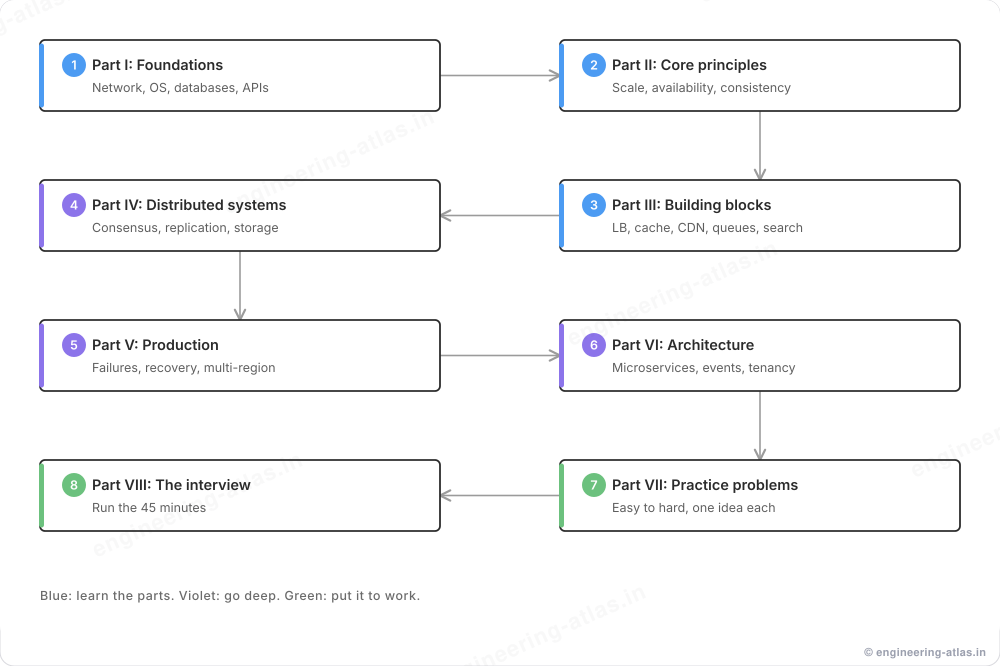

| Part | What you learn | Start here |
|---|---|---|
| [I. Foundations](#part-i-engineering-foundations) | How one machine and one network behave | 01 How the Internet works |
| [II. Core principles](#part-ii-core-system-design-principles) | Scale, availability, consistency, trade-offs | 07 Scalability |
| [III. Building blocks](#part-iii-building-blocks) | Load balancers, caches, CDNs, databases, queues | 14 Load balancing |
| [IV. Distributed systems](#part-iv-distributed-systems-engineering) | Consensus, replication, partitioning, storage engines | 25 Coordination |
| [V. Production](#part-v-resilience-recovery-and-production) | Failure, recovery, multi-region, observability | 35 Failure modes |
| [VI. Architecture](#part-vi-architecture-patterns) | Monoliths, microservices, events, tenancy | 47 Monolith |
| [VII. Interview questions with solutions](#part-vii-system-design-interview-questions-with-solutions) | Easy to hard designs, one idea each | URL shortener |
| [VIII. The interview](#part-viii-system-design-interview-preparation) | Running the 45 minutes | The delivery framework |

## Contents

<b>Open the full table of contents</b> (every part and chapter)

- [Part I: Engineering foundations](#part-i-engineering-foundations)
  - [01. How the Internet Works](#01-how-the-internet-works)
  - [02. Networking Fundamentals](#02-networking-fundamentals)
  - [03. Operating Systems Fundamentals](#03-operating-systems-fundamentals)
  - [04. Database Fundamentals](#04-database-fundamentals)
  - [05. Backend Architecture Fundamentals](#05-backend-architecture-fundamentals)
  - [06. Performance Fundamentals](#06-performance-fundamentals)
- [Part II: Core system design principles](#part-ii-core-system-design-principles)
  - [07. Scalability](#07-scalability)
  - [08. Availability and Reliability](#08-availability-and-reliability)
  - [09. Fault Tolerance](#09-fault-tolerance)
  - [10. Consistency Models](#10-consistency-models)
  - [11. CAP and PACELC](#11-cap-and-pacelc)
  - [12. Distributed Systems Fundamentals](#12-distributed-systems-fundamentals)
  - [13. System Design Trade-offs](#13-system-design-trade-offs)
  - [13b. Back-of-the-envelope Estimation](#13b-back-of-the-envelope-estimation)
- [Part III: Building blocks](#part-iii-building-blocks)
  - [14. Load Balancing](#14-load-balancing)
  - [15. Caching](#15-caching)
  - [16. Content Delivery Networks](#16-content-delivery-networks)
  - [17. Database Scaling](#17-database-scaling)
  - [18. Storage Systems](#18-storage-systems)
  - [19. Message Queues and Streams](#19-message-queues-and-streams)
  - [20. API Design in Practice](#20-api-design-in-practice)
  - [21. Rate Limiting](#21-rate-limiting)
  - [22. Search Systems](#22-search-systems)
  - [23. Distributed Scheduling and Workflows](#23-distributed-scheduling-and-workflows)
  - [24. Real-time Communication](#24-real-time-communication)
  - [24b. IDs, Location and Time-series](#24b-ids-location-and-time-series)
- [Part IV: Distributed systems engineering](#part-iv-distributed-systems-engineering)
  - [25. Distributed Coordination](#25-distributed-coordination)
  - [26. Consensus](#26-consensus)
  - [27. Distributed Transactions](#27-distributed-transactions)
  - [28. Replication Internals](#28-replication-internals)
  - [29. Distributed Consistency](#29-distributed-consistency)
  - [30. Partitioning Strategies](#30-partitioning-strategies)
  - [31. Gossip Protocols](#31-gossip-protocols)
  - [32. Distributed Computing](#32-distributed-computing)
  - [33. Stream Processing](#33-stream-processing)
  - [34. Storage Engines and Probabilistic Structures](#34-storage-engines-and-probabilistic-structures)
- [Part V: Resilience, recovery and production](#part-v-resilience-recovery-and-production)
  - [35. Failure Modes](#35-failure-modes)
  - [36. Circuit Breakers](#36-circuit-breakers)
  - [37. Retry Engineering](#37-retry-engineering)
  - [38. Bulkheads and Isolation](#38-bulkheads-and-isolation)
  - [39. Health Checks Done Right](#39-health-checks-done-right)
  - [40. Disaster Recovery](#40-disaster-recovery)
  - [41. Multi-region and Active-Active](#41-multi-region-and-active-active)
  - [42. Cell-based Architecture](#42-cell-based-architecture)
  - [43. Observability](#43-observability)
  - [44. Capacity Planning and Autoscaling](#44-capacity-planning-and-autoscaling)
  - [45. Security Architecture](#45-security-architecture)
  - [46. Deployment Architecture](#46-deployment-architecture)
- [Part VI: Architecture patterns](#part-vi-architecture-patterns)
  - [47. Monolith and Modular Monolith](#47-monolith-and-modular-monolith)
  - [48. Microservices](#48-microservices)
  - [49. Event-driven Architecture](#49-event-driven-architecture)
  - [50. CQRS and Event Sourcing](#50-cqrs-and-event-sourcing)
  - [51. Serverless](#51-serverless)
  - [52. Service Mesh](#52-service-mesh)
  - [53. Multi-tenancy](#53-multi-tenancy)
- [Part VII: System design interview questions with solutions](#part-vii-system-design-interview-questions-with-solutions)
  - [What a full solution looks like: Design Uber](#what-a-full-solution-looks-like-design-uber)
  - [Solution outlines for ten classic questions](#solution-outlines-for-ten-classic-questions)
  - [Infrastructure](#infrastructure)
  - [Search and discovery](#search-and-discovery)
  - [Storage and media](#storage-and-media)
  - [Social and feeds](#social-and-feeds)
  - [Real-time and collaboration](#real-time-and-collaboration)
  - [Location and maps](#location-and-maps)
  - [E-commerce and booking](#e-commerce-and-booking)
  - [Payments and fintech](#payments-and-fintech)
  - [Data, analytics and monitoring](#data-analytics-and-monitoring)
  - [Developer platforms](#developer-platforms)
  - [AI and LLM systems](#ai-and-llm-systems)
- [Part VIII: System design interview preparation](#part-viii-system-design-interview-preparation)
  - [The interview round](#the-interview-round)
- [How to answer a design interview question](#how-to-answer-a-design-interview-question)
- [Appendix: numbers cheat sheet](#appendix-numbers-cheat-sheet)
- [Glossary](#glossary)
- [Engineering blogs, explained](#engineering-blogs-explained)
- [Why Engineering Atlas](#why-engineering-atlas)
- [Contributing and licence](#contributing-and-licence)

## Pick your plan

Hours are a realistic weekly budget next to a full-time job. Chapter numbers point into the roadmap below.

<b>2-week crash plan</b> &nbsp;about 10 hours a week, breadth first

| Week | Read | Practise |
|---|---|---|
| 1 | Part II (07 to 13b), then 14, 15, 17, 19 | The six-step framework on a URL shortener |
| 2 | 16, 20, 21, 24, then 35 to 37 | Rate limiter, chat app, news feed, one timed mock |

<b>6-week plan</b> &nbsp;about 8 hours a week, interview ready

| Week | Read | Practise |
|---|---|---|
| 1 | Part I (01 to 06), skim what you know | Trace one request end to end on paper |
| 2 | Part II (07 to 13b) | Two estimation drills |
| 3 | 14 to 19 | URL shortener, rate limiter |
| 4 | 20 to 24b | Notification system, chat app, news feed |
| 5 | 26, 27, 30, 33, then 35 to 37, 41 | YouTube, ticket booking, payment system |
| 6 | Part VIII and the framework | Uber or a hard problem, plus one timed mock round |

<b>12-week plan</b> &nbsp;about 6 hours a week, deep and complete

| Week | Read | Practise |
|---|---|---|
| 1 | 01 to 03 | Request lifecycle drill |
| 2 | 04 to 06 | Model the tables for an online store |
| 3 | 07 to 10 | Availability math drill |
| 4 | 11 to 13b | Three estimation drills |
| 5 | 14 to 17 | URL shortener, key-value store |
| 6 | 18 to 21 | Rate limiter, Dropbox |
| 7 | 22 to 24b | Typeahead, chat app, proximity search |
| 8 | 25 to 29 | Payment system, one company blog case study |
| 9 | 30 to 34 | Ad click aggregator, one company blog case study |
| 10 | 35 to 40 | Notification system with failure scenarios |
| 11 | 41 to 46, then Part VI | Uber, one company blog case study, mock round 1 |
| 12 | Part VIII, revisit weak chapters | Two hard problems, mock round 2 |

## Pick your path by background

<table>
<tr><td width="50%"><a href="#part-i-engineering-foundations"><picture><source media="(prefers-color-scheme: dark)" srcset="diagrams/banners/card-beginner-dark.svg">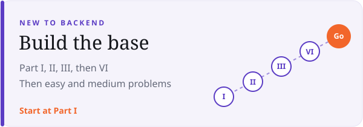</picture></a></td><td width="50%"><a href="#part-ii-core-system-design-principles"><picture><source media="(prefers-color-scheme: dark)" srcset="diagrams/banners/card-refresh-dark.svg">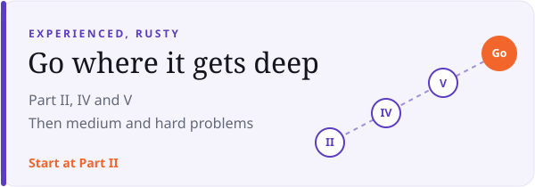</picture></a></td></tr>
<tr><td width="50%"><a href="#part-ii-core-system-design-principles"><picture><source media="(prefers-color-scheme: dark)" srcset="diagrams/banners/card-interview-dark.svg">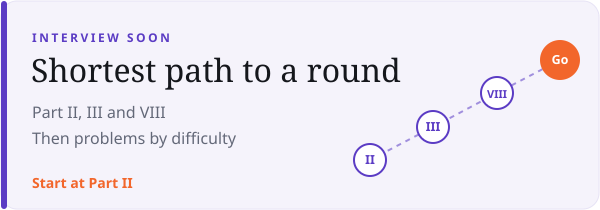</picture></a></td><td width="50%"><a href="#part-iv-distributed-systems-engineering"><picture><source media="(prefers-color-scheme: dark)" srcset="diagrams/banners/card-deep-dark.svg">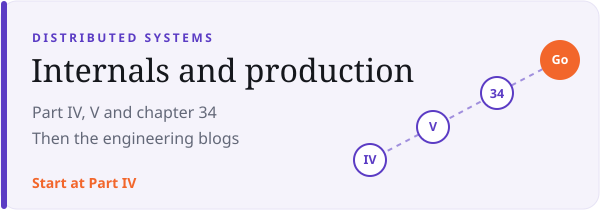</picture></a></td></tr>
</table>

---

## Part I: Engineering foundations

<picture><source media="(prefers-color-scheme: dark)" srcset="diagrams/banners/part-1-dark.svg">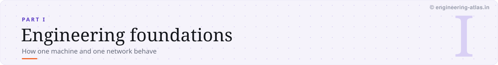</picture>

*Before you design for millions of users, know how one machine and one network behave.* Every box you draw later sits on top of DNS, TCP, a database and an operating system. When an interviewer asks "why is this slow?", the answer usually lives down here.

### 01. How the Internet Works

<picture><source media="(prefers-color-scheme: dark)" srcset="diagrams/banners/ch-01-dark.svg"></picture>

<a href="https://engineering-atlas.in/system-design/networking/?utm_source=github&utm_medium=roadmap&utm_campaign=networking"><picture><source media="(prefers-color-scheme: dark)" srcset="diagrams/banners/btn-chapter-dark.svg"></picture></a>

| | |
|---|---|
| **Why know this** | "What happens when you type a URL?" is still one of the most common warm-up questions, and every later chapter assumes you can trace a request from the browser to a server and back. |
| **What interviewers test** | Can you trace one request from the browser to the server and back, naming each hop and where the time goes? |
| **What you will cover** | Client-server model · DNS · IP addresses and routing · The OSI model · HTTP and HTTPS · TLS and the handshake · What happens when you open a URL |
| **Try this** | Run <code>curl -v https://example.com</code> and label each phase you see: DNS, TCP, TLS, HTTP request, response. |
| **Ready to move on when** | You can name each hop a request takes, and say roughly how many round trips happen before the first byte of HTML arrives. |

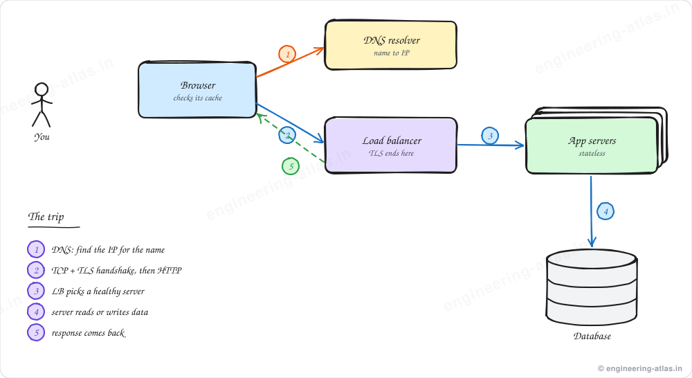

> [!TIP]
> **The 30-second answer.** The browser asks DNS for the server's IP, opens a TCP connection, runs a TLS handshake to agree on keys, then sends an HTTP request. A load balancer passes it to one app server, which reads or writes data and sends the response back on the same connection.

| Topic | What it is, and why it matters | Free read |
|---|---|---|
| <a href="https://engineering-atlas.in/system-design/networking/client-server/?utm_source=github&utm_medium=roadmap&utm_campaign=client-server">Client-server model</a> <picture><source media="(prefers-color-scheme: dark)" srcset="diagrams/tags/beginner-dark.svg"></picture> | Clients ask, servers answer, and the server owns the data. Almost every design you draw is this pattern repeated, with more servers in the middle. |  |
| <a href="https://engineering-atlas.in/system-design/networking/dns/?utm_source=github&utm_medium=roadmap&utm_campaign=dns">DNS</a> <picture><source media="(prefers-color-scheme: dark)" srcset="diagrams/tags/beginner-dark.svg"></picture> | The internet's phone book: it turns `flipkart.com` into an IP address, with caches at every level. DNS is also a traffic tool: short TTLs let you move users between regions. | <a href="https://www.cloudflare.com/learning/dns/what-is-dns/">Cloudflare Learning: What is DNS?</a> |
| <a href="https://engineering-atlas.in/system-design/networking/ip-addresses/?utm_source=github&utm_medium=roadmap&utm_campaign=ip-addresses">IP addresses and routing</a> <picture><source media="(prefers-color-scheme: dark)" srcset="diagrams/tags/beginner-dark.svg"></picture> | Every machine has an address, and routers forward packets hop by hop toward it. Private vs public addresses and NAT explain why your servers are reachable only through a load balancer. |  |
| <a href="https://engineering-atlas.in/system-design/networking/osi-model/?utm_source=github&utm_medium=roadmap&utm_campaign=osi-model">The OSI model</a> <picture><source media="(prefers-color-scheme: dark)" srcset="diagrams/tags/beginner-dark.svg"></picture> | Seven layers, of which four matter day to day: IP (3), TCP and UDP (4), TLS, and HTTP (7). The layer numbers are how people say "L4 load balancer" or "L7 firewall". |  |
| <a href="https://engineering-atlas.in/system-design/networking/http-and-https/?utm_source=github&utm_medium=roadmap&utm_campaign=http-and-https">HTTP and HTTPS</a> <picture><source media="(prefers-color-scheme: dark)" srcset="diagrams/tags/beginner-dark.svg"></picture> | The request-response protocol of the web: methods, status codes, headers, caching rules. HTTP/2 multiplexes many requests on one connection; HTTP/3 runs over QUIC on UDP. | <a href="https://developer.mozilla.org/en-US/docs/Web/HTTP/Overview">MDN: An overview of HTTP</a> |
| <a href="https://engineering-atlas.in/system-design/networking/tls-handshake/?utm_source=github&utm_medium=roadmap&utm_campaign=tls-handshake">TLS and the handshake</a> <picture><source media="(prefers-color-scheme: dark)" srcset="diagrams/tags/intermediate-dark.svg"></picture> | TLS proves the server is who it claims (certificates) and agrees on keys to encrypt traffic. TLS 1.3 needs one round trip for a new connection, which is why connection reuse matters. | <a href="https://www.cloudflare.com/learning/ssl/what-happens-in-a-tls-handshake/">Cloudflare Learning: What happens in a TLS handshake?</a> |
| <a href="https://engineering-atlas.in/system-design/networking/what-happens-when-you-open-a-url/?utm_source=github&utm_medium=roadmap&utm_campaign=what-happens-when-you-open-a-url">What happens when you open a URL</a> <picture><source media="(prefers-color-scheme: dark)" srcset="diagrams/tags/beginner-dark.svg"></picture> | The whole trip in one story, from the browser cache to the database and back. A good place to check you can connect every topic in this chapter. |  |

#### Explained: how a DNS lookup works

Your browser knows `flipkart.com`, but the network only routes to IP addresses. DNS turns one into the other. The browser first checks its own cache, then the operating system's. On a miss, it asks a **recursive resolver** (run by your ISP, or a public one like 8.8.8.8), which does the legwork.

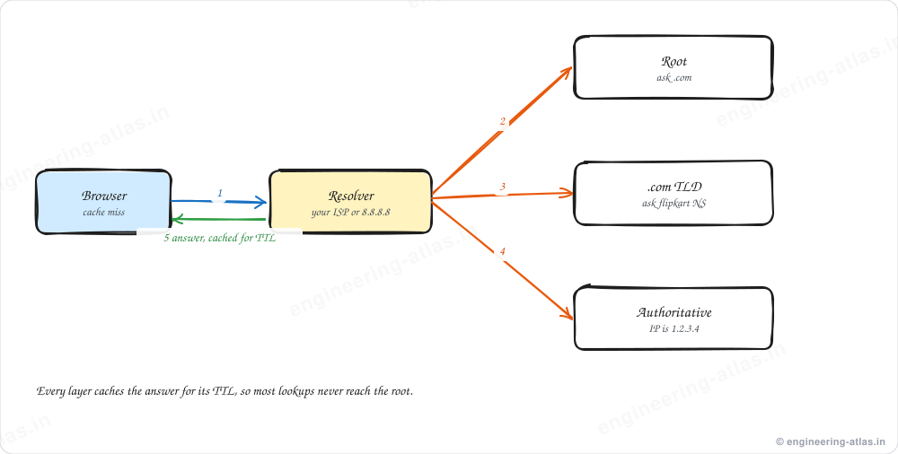

The resolver asks a **root server** where `.com` lives, asks the **.com servers** who is in charge of `flipkart.com`, then asks that **authoritative server** for the IP. Each answer comes with a **TTL** (time to live), and every layer caches it for that long. That's why most lookups take a few milliseconds and never reach the root.

Why this matters in design:

- **TTL is a dial.** Long TTLs mean fewer lookups but slow failover. Short TTLs let you move traffic between regions in seconds, at the cost of more DNS queries.
- **DNS can route traffic.** Weighted, latency-based and geographic DNS send users to the nearest or healthiest region.
- **DNS is a dependency.** If your DNS provider goes down, your site is unreachable even if every server is fine.

Go deeper: [Full lesson on Engineering Atlas](https://engineering-atlas.in/system-design/networking/dns/?utm_source=github&utm_medium=roadmap&utm_campaign=dns) &nbsp;·&nbsp; [Cloudflare: What is DNS?](https://www.cloudflare.com/learning/dns/what-is-dns/)

### 02. Networking Fundamentals

<picture><source media="(prefers-color-scheme: dark)" srcset="diagrams/banners/ch-02-dark.svg"></picture>

<a href="https://engineering-atlas.in/system-design/networking/?utm_source=github&utm_medium=roadmap&utm_campaign=networking"><picture><source media="(prefers-color-scheme: dark)" srcset="diagrams/banners/btn-chapter-dark.svg"></picture></a>

| | |
|---|---|
| **Why know this** | Connection setup, packet loss and proxies explain most of the latency and many of the outages you will reason about. You need TCP vs UDP and proxies before load balancers and real-time systems make sense. |
| **What interviewers test** | Can you pick TCP or UDP for a use case, and explain what a reverse proxy does in front of your servers? |
| **What you will cover** | TCP vs UDP (and the handshake) · Sockets · Connection pooling · Proxy vs reverse proxy · Checksums |
| **Try this** | Open your browser dev tools on any site and find one request that used HTTP/2 or HTTP/3. Note how many connections the page opened. |
| **Ready to move on when** | You can say why a video call uses UDP while a payment API uses TCP, and what a reverse proxy does that an app server should not. |

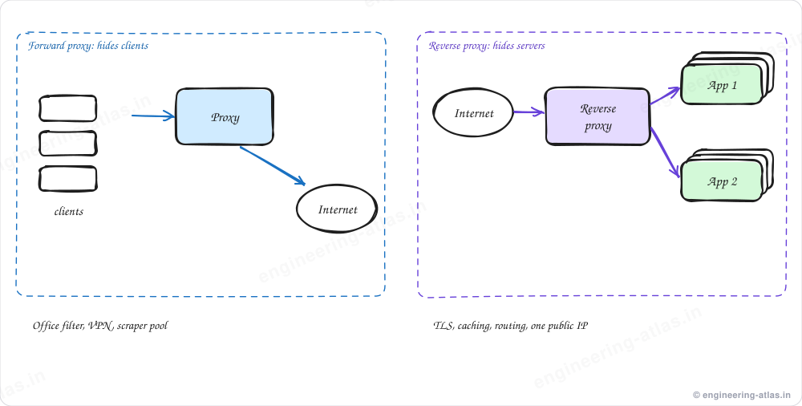

| Topic | What it is, and why it matters | Free read |
|---|---|---|
| <a href="https://engineering-atlas.in/system-design/networking/tcp-vs-udp/?utm_source=github&utm_medium=roadmap&utm_campaign=tcp-vs-udp">TCP vs UDP (and the handshake)</a> <picture><source media="(prefers-color-scheme: dark)" srcset="diagrams/tags/beginner-dark.svg"></picture> | TCP gives ordered, reliable delivery after a three-way handshake. UDP sends and forgets, so it is faster to start and never waits for a lost packet. Pick by whether late data is worse than lost data. |  |
| Sockets <picture><source media="(prefers-color-scheme: dark)" srcset="diagrams/tags/intermediate-dark.svg"></picture> | A socket is the operating system's handle for one end of a connection. Knowing that each open connection costs a file descriptor and memory explains connection limits on servers. | <a href="https://beej.us/guide/bgnet/html/">Beej's Guide to Network Programming</a> |
| <a href="https://engineering-atlas.in/system-design/database-fundamentals/connection-pooling/?utm_source=github&utm_medium=roadmap&utm_campaign=connection-pooling">Connection pooling</a> <picture><source media="(prefers-color-scheme: dark)" srcset="diagrams/tags/intermediate-dark.svg"></picture> | Opening a TCP plus TLS connection costs several round trips, so services keep a pool of open connections and reuse them. Pool size is a real tuning knob: too small queues requests, too large overloads the database. |  |
| <a href="https://engineering-atlas.in/system-design/networking/proxy-vs-reverse-proxy/?utm_source=github&utm_medium=roadmap&utm_campaign=proxy-vs-reverse-proxy">Proxy vs reverse proxy</a> <picture><source media="(prefers-color-scheme: dark)" srcset="diagrams/tags/beginner-dark.svg"></picture> | A forward proxy speaks for clients; a reverse proxy speaks for servers. Real systems usually have a reverse proxy in front, doing TLS, compression, caching and routing so app servers don't have to. | <a href="https://www.cloudflare.com/learning/cdn/glossary/reverse-proxy/">Cloudflare Learning: What is a reverse proxy?</a> |
| <a href="https://engineering-atlas.in/system-design/networking/checksums/?utm_source=github&utm_medium=roadmap&utm_campaign=checksums">Checksums</a> <picture><source media="(prefers-color-scheme: dark)" srcset="diagrams/tags/intermediate-dark.svg"></picture> | A small number computed from data, used to catch corruption on the wire or on disk. Storage systems and file sync tools rely on them to know two copies really match. |  |

#### Explained: TCP vs UDP

Both carry data between two machines, and they make opposite promises.

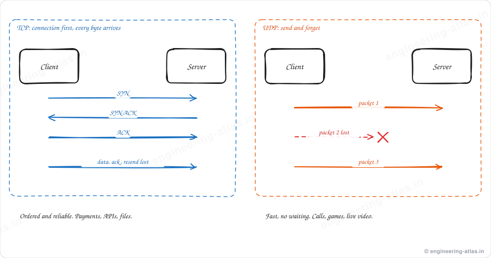

**TCP** sets up a connection with a three-way handshake (SYN, SYN-ACK, ACK), numbers every byte, and the receiver acknowledges what it gets. Lost data is sent again, out-of-order data is put back in order, and flow control and congestion control slow the sender down when the receiver or the network is overwhelmed. You get a reliable, ordered stream, and you pay with setup time and waiting when packets go missing.

**UDP** skips all of that. Each packet (datagram) is sent on its own, with no connection, no order and no resend. A lost packet is gone for good. That makes UDP fast and predictable, and leaves reliability to the application if it needs any. QUIC, which carries HTTP/3, is built on UDP and adds its own reliability on top.

**Use TCP when**

- every byte must arrive, in order: APIs, payments, database connections, file transfer;
- a short delay is fine but a gap is not.

**Use UDP when**

- late data is useless: voice and video calls, live game state, live streaming;
- you want the lowest latency and can handle loss yourself;
- you send small, independent messages, like DNS queries.

Go deeper: [Full lesson on Engineering Atlas](https://engineering-atlas.in/system-design/networking/tcp-vs-udp/?utm_source=github&utm_medium=roadmap&utm_campaign=tcp-vs-udp) &nbsp;·&nbsp; [Glenn Fiedler: UDP vs TCP](https://gafferongames.com/post/udp_vs_tcp/)

#### Explained: load balancer vs reverse proxy

The two overlap so much that the same software (NGINX, HAProxy, Envoy) often does both. A **reverse proxy** sits in front of your servers and handles requests on their behalf: it ends TLS, compresses responses, caches, and hides the servers' addresses. A **load balancer** spreads requests across many servers and stops sending to unhealthy ones.

You want a reverse proxy even with **one** server, for TLS, caching and security. You need a load balancer once you have **two or more**. In practice, one component in front of your fleet usually plays both roles.

Go deeper: [Full lesson on Engineering Atlas](https://engineering-atlas.in/system-design/networking/proxy-vs-reverse-proxy/?utm_source=github&utm_medium=roadmap&utm_campaign=proxy-vs-reverse-proxy)

### 03. Operating Systems Fundamentals

<picture><source media="(prefers-color-scheme: dark)" srcset="diagrams/banners/ch-03-dark.svg"></picture>

| | |
|---|---|
| **Why know this** | Threads, memory and disk I/O set the real limits of one server. When a design says "this service handles 10,000 connections", the operating system is what makes that true or false. |
| **What interviewers test** | Do you know what limits one server: threads, memory, context switches and when a write is really on disk? |
| **What you will cover** | Processes vs threads · Context switching · CPU scheduling · Memory and virtual memory · I/O, page cache and fsync |
| **Try this** | Write a program that spawns 10,000 threads, then the same with an async loop. Compare memory used by each. |
| **Ready to move on when** | You can explain why a thread-per-request server struggles at high concurrency, and why "the write returned" does not mean the data is on disk. |

| Topic | What it is, and why it matters | Free read |
|---|---|---|
| <a href="https://engineering-atlas.in/java/multithreading/processes-vs-threads/?utm_source=github&utm_medium=roadmap&utm_campaign=processes-vs-threads">Processes vs threads</a> <picture><source media="(prefers-color-scheme: dark)" srcset="diagrams/tags/beginner-dark.svg"></picture> | A process has its own memory; threads inside it share memory. Sharing is fast but needs locks. That one fact drives most concurrency bugs and most server designs. |  |
| Context switching <picture><source media="(prefers-color-scheme: dark)" srcset="diagrams/tags/intermediate-dark.svg"></picture> | The CPU saves one thread's state and loads another's. Each switch costs microseconds and cold caches, which is why thousands of busy threads can make a server slower, not faster. |  |
| CPU scheduling <picture><source media="(prefers-color-scheme: dark)" srcset="diagrams/tags/intermediate-dark.svg"></picture> | How the operating system decides which thread runs next. It explains noisy neighbours, CPU throttling in containers, and why tail latency rises when a machine runs hot. |  |
| Memory and virtual memory <picture><source media="(prefers-color-scheme: dark)" srcset="diagrams/tags/intermediate-dark.svg"></picture> | Each process sees its own address space, and the OS maps it to RAM page by page. Swapping and out-of-memory kills are what you see when this runs out. |  |
| <a href="https://engineering-atlas.in/system-design/search/disk-io-durability/?utm_source=github&utm_medium=roadmap&utm_campaign=disk-io-durability">I/O, page cache and fsync</a> <picture><source media="(prefers-color-scheme: dark)" srcset="diagrams/tags/advanced-dark.svg"></picture> | A write usually lands in the OS page cache first, not on disk. Only `fsync` forces it down. Databases are careful about this, and it is the root of "acknowledged but lost" bugs. | <a href="https://www.postgresql.org/docs/current/wal-reliability.html">PostgreSQL docs: Reliability and the write-ahead log</a> |

### 04. Database Fundamentals

<picture><source media="(prefers-color-scheme: dark)" srcset="diagrams/banners/ch-04-dark.svg"></picture>

<a href="https://engineering-atlas.in/system-design/database-fundamentals/?utm_source=github&utm_medium=roadmap&utm_campaign=database-fundamentals"><picture><source media="(prefers-color-scheme: dark)" srcset="diagrams/banners/btn-chapter-dark.svg"></picture></a>

| | |
|---|---|
| **Why know this** | The database is the hardest part of most systems to scale and the most expensive to get wrong. Picking a store, modelling data and understanding transactions come up in every design round. |
| **What interviewers test** | Can you pick a store from the access pattern, sketch the main tables, and name the isolation level you need? |
| **What you will cover** | SQL vs NoSQL and database types · Data modeling: normalization vs denormalization · Database indexes · ACID transactions · Isolation levels and anomalies · ACID vs BASE · Optimistic vs pessimistic locking · OLTP vs OLAP |
| **Try this** | Create a 1-million-row table, run one query with and without an index, and compare <code>EXPLAIN</code> output and time. |
| **Ready to move on when** | You can pick between PostgreSQL and a key-value store for a given feature, design the main tables, and say which isolation level you need and why. |

> [!WARNING]
> **Where candidates slip.** Saying "NoSQL because it scales" without naming the access pattern. Start from the queries: what you read, by which key, how often. The store choice follows from that.

| Topic | What it is, and why it matters | Free read |
|---|---|---|
| <a href="https://engineering-atlas.in/system-design/database-fundamentals/sql-vs-nosql/?utm_source=github&utm_medium=roadmap&utm_campaign=sql-vs-nosql">SQL vs NoSQL and database types</a> <picture><source media="(prefers-color-scheme: dark)" srcset="diagrams/tags/beginner-dark.svg"></picture> | Relational, key-value, document, wide-column, graph, search and time-series stores each fit a query shape. Most systems use more than one. |  |
| <a href="https://engineering-atlas.in/system-design/database-fundamentals/normalization-vs-denormalization/?utm_source=github&utm_medium=roadmap&utm_campaign=normalization-vs-denormalization">Data modeling: normalization vs denormalization</a> <picture><source media="(prefers-color-scheme: dark)" srcset="diagrams/tags/intermediate-dark.svg"></picture> | Normalize to keep one copy of each fact and avoid update bugs. Denormalize to make a hot read one lookup. Read-heavy systems often do both, in different tables. |  |
| <a href="https://engineering-atlas.in/system-design/databases/indexes/?utm_source=github&utm_medium=roadmap&utm_campaign=indexes">Database indexes</a> <picture><source media="(prefers-color-scheme: dark)" srcset="diagrams/tags/beginner-dark.svg"></picture> | An index is a sorted copy of some columns that turns a full scan into a quick lookup. Every index speeds reads and slows writes, so index for the queries you actually run. | <a href="https://use-the-index-luke.com/">Use The Index, Luke</a> |
| <a href="https://engineering-atlas.in/system-design/database-fundamentals/acid-transactions/?utm_source=github&utm_medium=roadmap&utm_campaign=acid-transactions">ACID transactions</a> <picture><source media="(prefers-color-scheme: dark)" srcset="diagrams/tags/beginner-dark.svg"></picture> | Atomic, consistent, isolated, durable: a group of writes either all happen or none do, and stay done after a crash. The reason money moves safely between two rows. |  |
| <a href="https://engineering-atlas.in/system-design/databases/isolation-levels/?utm_source=github&utm_medium=roadmap&utm_campaign=isolation-levels">Isolation levels and anomalies</a> <picture><source media="(prefers-color-scheme: dark)" srcset="diagrams/tags/advanced-dark.svg"></picture> | Read committed, repeatable read and serializable allow different anomalies: dirty reads, lost updates, write skew, phantoms. Double bookings usually come from the gap between them. | <a href="https://www.postgresql.org/docs/current/transaction-iso.html">PostgreSQL docs: Transaction isolation</a> |
| <a href="https://engineering-atlas.in/system-design/databases/acid-vs-base/?utm_source=github&utm_medium=roadmap&utm_campaign=acid-vs-base">ACID vs BASE</a> <picture><source media="(prefers-color-scheme: dark)" srcset="diagrams/tags/beginner-dark.svg"></picture> | BASE (basically available, soft state, eventually consistent) is the trade many NoSQL stores make: stay up and fast, accept that replicas catch up later. |  |
| <a href="https://engineering-atlas.in/distributed-systems/concurrency-control.html?utm_source=github&utm_medium=roadmap&utm_campaign=concurrency-control">Optimistic vs pessimistic locking</a> <picture><source media="(prefers-color-scheme: dark)" srcset="diagrams/tags/intermediate-dark.svg"></picture> | Pessimistic locks the row before changing it. Optimistic reads a version number and fails the write if someone else changed it first. Low contention favours optimistic. |  |
| <a href="https://engineering-atlas.in/system-design/database-fundamentals/oltp-vs-olap/?utm_source=github&utm_medium=roadmap&utm_campaign=oltp-vs-olap">OLTP vs OLAP</a> <picture><source media="(prefers-color-scheme: dark)" srcset="diagrams/tags/intermediate-dark.svg"></picture> | OLTP serves many small reads and writes for the app. OLAP scans huge tables for analytics, usually in a columnar warehouse. Mixing both on one database hurts both. |  |

#### Explained: database types at a glance

"SQL or NoSQL" is really a question about your **access pattern**: what you read, by which key, and how much you write. Each family is built for a shape of query.

| Type | Stores data as | Good at | Examples |
|---|---|---|---|
| Relational | Tables with rows, joins and transactions | Complex queries, strong consistency, money | PostgreSQL, MySQL |
| Key-value | One value per key | Very fast lookups by key, caching, sessions | Redis, DynamoDB |
| Document | JSON-like documents | Flexible fields, reading a whole object at once | MongoDB, Couchbase |
| Wide-column | Rows with many columns, grouped by partition key | Huge write volume, time-ordered data | Cassandra, HBase, Bigtable |
| Graph | Nodes and edges | Relationships many hops deep | Neo4j, Amazon Neptune |
| Search | Inverted index | Full-text search, filters, ranking | Elasticsearch, OpenSearch |
| Time-series | Points keyed by time | Metrics and events, rollups by time | Prometheus, InfluxDB, TimescaleDB |

**Start with a relational database when** your data has relationships, you need transactions or ad-hoc queries, or you aren't sure yet. It carries most products further than people expect.

**Reach for a NoSQL store when** one access pattern dominates and a relational database can't keep up with it: millions of writes per second, a simple key lookup at huge scale, or a schema that changes per record.

#### Explained: denormalization

Normalized data keeps each fact in one place, so updates are simple and safe. Reads then need joins, and joins get expensive at scale or impossible across shards. **Denormalization** copies data into the place it is read: store the author's name on each post so the feed doesn't need a join.

The price is that one change must now update several copies, and for a while they can disagree. Denormalize the hot read paths, keep a normalized source of truth, and update the copies from events or in the same transaction.

Go deeper: [Full lesson on Engineering Atlas](https://engineering-atlas.in/system-design/database-fundamentals/sql-vs-nosql/?utm_source=github&utm_medium=roadmap&utm_campaign=sql-vs-nosql)

### 05. Backend Architecture Fundamentals

<picture><source media="(prefers-color-scheme: dark)" srcset="diagrams/banners/ch-05-dark.svg"></picture>

<a href="https://engineering-atlas.in/system-design/networking/?utm_source=github&utm_medium=roadmap&utm_campaign=networking"><picture><source media="(prefers-color-scheme: dark)" srcset="diagrams/banners/btn-chapter-dark.svg"></picture></a>

| | |
|---|---|
| **Why know this** | APIs are the contract between every box in your design. Choosing REST, GraphQL or gRPC, and putting auth and a gateway in the right place, shapes how clients and services talk for years. |
| **What interviewers test** | Can you design clean endpoints, justify REST or gRPC, and say where authentication happens? |
| **What you will cover** | What is an API? · REST vs GraphQL vs gRPC · API gateway · Authentication: sessions, tokens and JWT · Authorization: OAuth 2.0 and OpenID Connect |
| **Try this** | Sketch a three-layer service (handler, service, repository) for "create order" and mark where validation, business rules and SQL live. |
| **Ready to move on when** | You can design the main endpoints for a feature, say why you picked the protocol, and explain where a token is checked. |

| Topic | What it is, and why it matters | Free read |
|---|---|---|
| <a href="https://engineering-atlas.in/system-design/networking/apis/?utm_source=github&utm_medium=roadmap&utm_campaign=apis">What is an API?</a> <picture><source media="(prefers-color-scheme: dark)" srcset="diagrams/tags/beginner-dark.svg"></picture> | A contract: what you can ask for, in what shape, and what comes back. Good APIs hide the internals so the service can change behind them. |  |
| <a href="https://engineering-atlas.in/system-design/networking/rest-vs-graphql/?utm_source=github&utm_medium=roadmap&utm_campaign=rest-vs-graphql">REST vs GraphQL vs gRPC</a> <picture><source media="(prefers-color-scheme: dark)" srcset="diagrams/tags/intermediate-dark.svg"></picture> | REST is simple and cache-friendly. GraphQL lets the client ask for exactly the fields it needs. gRPC is fast and typed for service-to-service calls. Many systems use REST at the edge and gRPC inside. | <a href="https://grpc.io/docs/what-is-grpc/introduction/">gRPC docs: Introduction</a> |
| <a href="https://engineering-atlas.in/system-design/networking/api-gateway/?utm_source=github&utm_medium=roadmap&utm_campaign=api-gateway">API gateway</a> <picture><source media="(prefers-color-scheme: dark)" srcset="diagrams/tags/intermediate-dark.svg"></picture> | One front door for many services: routing, auth, rate limits, request shaping. Useful, but it can become a bottleneck and a dumping ground for logic, so keep it thin. |  |
| <a href="https://engineering-atlas.in/system-design/security/authentication/?utm_source=github&utm_medium=roadmap&utm_campaign=authentication">Authentication: sessions, tokens and JWT</a> <picture><source media="(prefers-color-scheme: dark)" srcset="diagrams/tags/beginner-dark.svg"></picture> | Authentication proves who you are. Sessions keep state on the server; JWTs carry signed claims the server can check without a lookup, but are hard to revoke early. |  |
| <a href="https://engineering-atlas.in/system-design/security/oauth-and-oidc/?utm_source=github&utm_medium=roadmap&utm_campaign=oauth-and-oidc">Authorization: OAuth 2.0 and OpenID Connect</a> <picture><source media="(prefers-color-scheme: dark)" srcset="diagrams/tags/intermediate-dark.svg"></picture> | OAuth lets a user grant an app limited access without sharing a password. OpenID Connect adds a standard way to say who the user is. "Login with Google" is both. | <a href="https://oauth.net/2/">OAuth.net: OAuth 2.0</a> |

#### Explained: REST, RPC and GraphQL

All three let one program ask another for something over the network; they differ in what the contract looks like.

- **REST** models everything as **resources** with URLs (`/orders/42`) and uses HTTP methods (GET, POST, PUT, DELETE) as the verbs. It is simple, readable, and works with HTTP caching and every tool on the web.
- **RPC** (remote procedure call) models calls as **functions**: `getOrder(42)`. **gRPC** is the common modern form: a typed contract in Protocol Buffers, compact binary messages over HTTP/2, and generated client code. It is fast and strict, which suits service-to-service calls.
- **GraphQL** gives clients one endpoint and a query language to ask for exactly the fields they need, in one round trip. It suits apps that show data from many sources, and it needs care with caching and expensive queries.

**Use REST** for public APIs and anything browsers call directly. **Use gRPC** between your own services, where speed and strict contracts matter. **Use GraphQL** when many different clients need different shapes of the same data.

Go deeper: [Full lesson on Engineering Atlas](https://engineering-atlas.in/system-design/networking/rest-vs-graphql/?utm_source=github&utm_medium=roadmap&utm_campaign=rest-vs-graphql) &nbsp;·&nbsp; [gRPC: Introduction](https://grpc.io/docs/what-is-grpc/introduction/)

### 06. Performance Fundamentals

<picture><source media="(prefers-color-scheme: dark)" srcset="diagrams/banners/ch-06-dark.svg"></picture>

<a href="https://engineering-atlas.in/system-design/anti-patterns/?utm_source=github&utm_medium=roadmap&utm_campaign=anti-patterns"><picture><source media="(prefers-color-scheme: dark)" srcset="diagrams/banners/btn-chapter-dark.svg"></picture></a>

| | |
|---|---|
| **Why know this** | "Make it faster" is not a plan. Measuring the right thing (percentiles, not averages), finding the real bottleneck and knowing the common anti-patterns is what turns a guess into a fix. |
| **What interviewers test** | Do you talk in percentiles, find the real bottleneck before optimising, and know the common slow patterns? |
| **What you will cover** | Latency vs throughput vs bandwidth · Percentiles and tail latency · Measure first: a performance workflow · Little's law · The five bottlenecks · Storage anti-patterns: why is it slow? |
| **Try this** | Load-test a small endpoint at rising concurrency and plot p50, p99 and throughput. Find the point where p99 bends upward. |
| **Ready to move on when** | You can explain why p99 matters more than the average for a page that makes 20 backend calls, and name the first three things you would measure. |

| Topic | What it is, and why it matters | Free read |
|---|---|---|
| <a href="https://engineering-atlas.in/system-design/core-concepts/latency-throughput-bandwidth/?utm_source=github&utm_medium=roadmap&utm_campaign=latency-throughput-bandwidth">Latency vs throughput vs bandwidth</a> <picture><source media="(prefers-color-scheme: dark)" srcset="diagrams/tags/beginner-dark.svg"></picture> | Latency is how long one request takes. Throughput is how many finish per second. Bandwidth is the size of the pipe. Improving one can hurt another, as batching shows. |  |
| <a href="https://engineering-atlas.in/java/performance/percentiles-and-tail-latency/?utm_source=github&utm_medium=roadmap&utm_campaign=percentiles-and-tail-latency">Percentiles and tail latency</a> <picture><source media="(prefers-color-scheme: dark)" srcset="diagrams/tags/intermediate-dark.svg"></picture> | The average hides the slow requests users remember. If a page calls 20 services in parallel, about 1 in 5 page loads waits on at least one p99 response (1 - 0.99^20), so tail latency quickly becomes everyone's latency. | <a href="https://research.google/pubs/the-tail-at-scale/">Dean and Barroso: The Tail at Scale (CACM)</a> |
| <a href="https://engineering-atlas.in/java/performance/measure-first-a-performance-workflow/?utm_source=github&utm_medium=roadmap&utm_campaign=measure-first-a-performance-workflow">Measure first: a performance workflow</a> <picture><source media="(prefers-color-scheme: dark)" srcset="diagrams/tags/intermediate-dark.svg"></picture> | Reproduce, measure, find the bottleneck, change one thing, measure again. Skipping a step is how teams spend a week optimising code that was never slow. |  |
| Little's law <picture><source media="(prefers-color-scheme: dark)" srcset="diagrams/tags/intermediate-dark.svg"></picture> | Requests in the system = arrival rate x time each one spends inside. It tells you how many threads, connections or workers you need, and why slow responses fill every pool. |  |
| <a href="https://engineering-atlas.in/java/performance/the-five-bottlenecks-cpu-memory-i-o-locks-and-gc/?utm_source=github&utm_medium=roadmap&utm_campaign=the-five-bottlenecks-cpu-memory-i-o-locks-and-gc">The five bottlenecks</a> <picture><source media="(prefers-color-scheme: dark)" srcset="diagrams/tags/intermediate-dark.svg"></picture> | CPU, memory, I/O, locks and garbage collection. Every slow service is waiting on one of these, and each has its own tell-tale signs. |  |
| <a href="https://engineering-atlas.in/system-design/anti-patterns/storage-anti-patterns/?utm_source=github&utm_medium=roadmap&utm_campaign=storage-anti-patterns">Storage anti-patterns: why is it slow?</a> <picture><source media="(prefers-color-scheme: dark)" srcset="diagrams/tags/intermediate-dark.svg"></picture> | Chatty calls, N+1 queries, missing indexes, one hot row. The same handful of mistakes cause most slow pages, and they are easy to spot once you know them. |  |

### Can you answer these?

1. Walk through what happens between pressing Enter on `https://flipkart.com` and the first byte of HTML arriving. How many round trips is that?
2. A video call app and a payments API: which uses TCP and which UDP, and why?
3. Two users book the last seat at the same moment. Which isolation level or locking approach prevents a double booking?
4. Your service makes 20 downstream calls per page. Each has a p99 of 200 ms. What does that mean for the page's latency?
5. When would you pick gRPC over REST, and where would you still use REST?
6. A write returned success, the server crashed, and the data is gone. What happened?

> [!TIP]
> **Unlocked: you can now solve** <a href="https://engineering-atlas.in/system-design/storage-media/design-a-url-shortener/?utm_source=github&utm_medium=roadmap&utm_campaign=design-a-url-shortener">URL shortener (API and data model only)</a>

> [!NOTE]
> **Prep progress.** Finish this part and you are about **10%** of the way to interview ready.
>
> 

**Continue learning on Engineering Atlas:** [Networking and APIs module](https://engineering-atlas.in/system-design/networking/?utm_source=github&utm_medium=roadmap&utm_campaign=networking) · [Data and storage module](https://engineering-atlas.in/system-design/database-fundamentals/?utm_source=github&utm_medium=roadmap&utm_campaign=database-fundamentals) · [HLD roadmap](https://engineering-atlas.in/system-design/roadmap/?utm_source=github&utm_medium=roadmap&utm_campaign=roadmap)

<a href="#contents">Back to contents ↑</a>

## Part II: Core system design principles

<picture><source media="(prefers-color-scheme: dark)" srcset="diagrams/banners/part-2-dark.svg">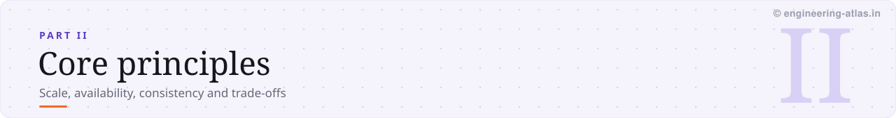</picture>

*This is where system design really starts.* Every design discussion uses the words in this part: scale, availability, consistency, trade-off. If you can explain each one with a small example and a number, the rest of the roadmap gets much easier.

### 07. Scalability

<picture><source media="(prefers-color-scheme: dark)" srcset="diagrams/banners/ch-07-dark.svg"></picture>

<a href="https://engineering-atlas.in/system-design/core-concepts/?utm_source=github&utm_medium=roadmap&utm_campaign=core-concepts"><picture><source media="(prefers-color-scheme: dark)" srcset="diagrams/banners/btn-chapter-dark.svg"></picture></a>

| | |
|---|---|
| **Why know this** | "How does this handle 10x traffic?" is the question behind almost every design round. Scalability is the plan for that day, and the first thing that plan needs is servers that hold no state of their own. |
| **What interviewers test** | Can you make the app tier stateless and say what stops scaling first when traffic grows 10x? |
| **What you will cover** | Scalability · Performance vs scalability · Vertical vs horizontal scaling · Stateful vs stateless design · Scaling reads · Scaling writes |
| **Try this** | Take a single-server app at 500 requests per second. Write the three changes, in order, that get it to 50,000. |
| **Ready to move on when** | You can say why a stateless app tier scales out easily while the database does not, and name two ways to take load off the database. |

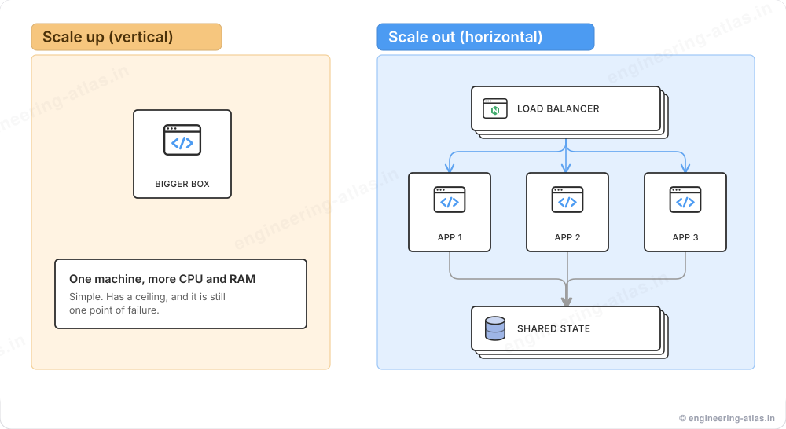

| Topic | What it is, and why it matters | Free read |
|---|---|---|
| <a href="https://engineering-atlas.in/system-design/core-concepts/scalability/?utm_source=github&utm_medium=roadmap&utm_campaign=scalability">Scalability</a> <picture><source media="(prefers-color-scheme: dark)" srcset="diagrams/tags/beginner-dark.svg"></picture> | A system scales when you can add resources and get roughly proportional capacity back. The work is finding the part that stops scaling first. |  |
| <a href="https://engineering-atlas.in/system-design/core-concepts/performance-vs-scalability/?utm_source=github&utm_medium=roadmap&utm_campaign=performance-vs-scalability">Performance vs scalability</a> <picture><source media="(prefers-color-scheme: dark)" srcset="diagrams/tags/beginner-dark.svg"></picture> | A performance problem makes the system slow for one user. A scalability problem makes it fast for one user and slow under load. They need different fixes. |  |
| <a href="https://engineering-atlas.in/system-design/trade-offs/vertical-vs-horizontal-scaling/?utm_source=github&utm_medium=roadmap&utm_campaign=vertical-vs-horizontal-scaling">Vertical vs horizontal scaling</a> <picture><source media="(prefers-color-scheme: dark)" srcset="diagrams/tags/beginner-dark.svg"></picture> | Scale up means a bigger machine: simple, but it has a ceiling and stays one point of failure. Scale out means more machines: no ceiling, but now you need load balancing and shared state. |  |
| <a href="https://engineering-atlas.in/system-design/core-concepts/stateful-vs-stateless/?utm_source=github&utm_medium=roadmap&utm_campaign=stateful-vs-stateless">Stateful vs stateless design</a> <picture><source media="(prefers-color-scheme: dark)" srcset="diagrams/tags/beginner-dark.svg"></picture> | When no request depends on memory in one particular server, any server can take any request. That one property is what makes scale-out, autoscaling and safe deploys possible. | <a href="https://12factor.net/processes">The Twelve-Factor App: Processes</a> |
| <a href="https://engineering-atlas.in/system-design/common-patterns/scaling-reads/?utm_source=github&utm_medium=roadmap&utm_campaign=scaling-reads">Scaling reads</a> <picture><source media="(prefers-color-scheme: dark)" srcset="diagrams/tags/intermediate-dark.svg"></picture> | Most systems read far more than they write. Indexes, caches, read replicas and CDNs each take a different slice of read load, in roughly that order of cost. |  |
| <a href="https://engineering-atlas.in/system-design/common-patterns/scaling-writes/?utm_source=github&utm_medium=roadmap&utm_campaign=scaling-writes">Scaling writes</a> <picture><source media="(prefers-color-scheme: dark)" srcset="diagrams/tags/intermediate-dark.svg"></picture> | Writes are harder because every write must land somewhere durable. Batching, queues, LSM-tree stores and sharding are the tools, and each one gives something up. |  |

Real-world: <a href="https://discord.com/blog/how-discord-stores-trillions-of-messages">Discord: How Discord stores trillions of messages</a>

### 08. Availability and Reliability

<picture><source media="(prefers-color-scheme: dark)" srcset="diagrams/banners/ch-08-dark.svg"></picture>

<a href="https://engineering-atlas.in/system-design/core-concepts/?utm_source=github&utm_medium=roadmap&utm_campaign=core-concepts"><picture><source media="(prefers-color-scheme: dark)" srcset="diagrams/banners/btn-chapter-dark.svg"></picture></a>

| | |
|---|---|
| **Why know this** | "Highly available" means nothing until you put a number on it. Interviewers want to hear the number, what it allows in downtime, and which component breaks it first. |
| **What interviewers test** | Can you put a number on availability, turn it into downtime, and find the single points of failure? |
| **What you will cover** | Availability and the nines · Reliability: SLIs, SLOs and error budgets · Single point of failure |
| **Try this** | Work out the yearly downtime for 99.9%, 99.99% and 99.999%. Then compute the availability of two 99.9% services called in series. |
| **Ready to move on when** | You can turn 99.9% into minutes of downtime per month, and explain how an error budget decides whether a team ships or slows down. |

| Availability | Downtime per year | Downtime per 30-day month |
|---|---|---|
| 99% | about 3.65 days | about 7.2 hours |
| 99.9% | about 8.8 hours | about 43 minutes |
| 99.99% | about 53 minutes | about 4.3 minutes |
| 99.999% | about 5.3 minutes | about 26 seconds |

| Topic | What it is, and why it matters | Free read |
|---|---|---|
| <a href="https://engineering-atlas.in/system-design/core-concepts/availability/?utm_source=github&utm_medium=roadmap&utm_campaign=availability">Availability and the nines</a> <picture><source media="(prefers-color-scheme: dark)" srcset="diagrams/tags/beginner-dark.svg"></picture> | Each extra nine cuts allowed downtime by 10x and costs far more than the last. Parts in series multiply: two 99.9% services in a chain give about 99.8%, not 99.9%. | <a href="https://sre.google/sre-book/embracing-risk/">Google SRE book: Embracing risk</a> |
| <a href="https://engineering-atlas.in/system-design/core-concepts/reliability/?utm_source=github&utm_medium=roadmap&utm_campaign=reliability">Reliability: SLIs, SLOs and error budgets</a> <picture><source media="(prefers-color-scheme: dark)" srcset="diagrams/tags/intermediate-dark.svg"></picture> | An SLI is what you measure (say, the share of requests under 300 ms). An SLO is the target. The error budget is the gap between the target and 100%, and you spend it on releases and experiments. | <a href="https://sre.google/sre-book/service-level-objectives/">Google SRE book: Service level objectives</a> |
| <a href="https://engineering-atlas.in/system-design/core-concepts/single-point-of-failure/?utm_source=github&utm_medium=roadmap&utm_campaign=single-point-of-failure">Single point of failure</a> <picture><source media="(prefers-color-scheme: dark)" srcset="diagrams/tags/beginner-dark.svg"></picture> | Any one box whose failure takes the system down. Finding them is the first review pass on any design: the database primary, a lone load balancer, one DNS provider, a config service. |  |

#### Explained: availability in numbers

Availability is the share of time a system works. Two rules let you estimate any design.

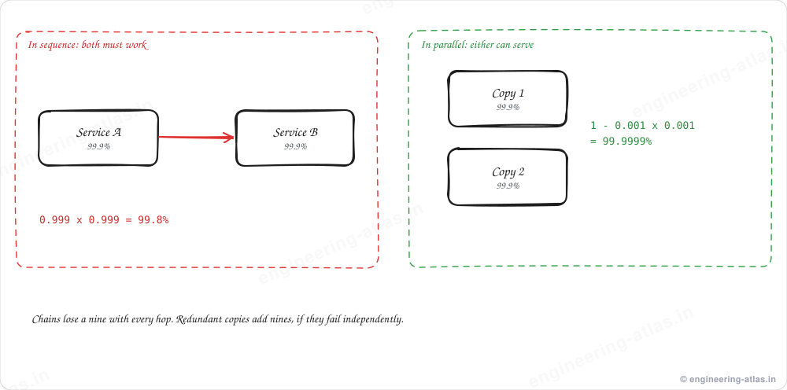

**In sequence, availability multiplies.** If a request needs service A **and** service B, both at 99.9%, the request succeeds 0.999 x 0.999 = 99.8% of the time. Ten services in a chain at 99.9% each give about 99%: adding hops alone costs you a nine.

**In parallel, failures multiply.** If either of two copies can serve, the request fails only when both fail: 1 - (0.001 x 0.001) = 99.9999%. That's why redundancy works, but only if the copies fail **independently**. Two copies in the same rack, on the same deploy, behind the same config, often fail together.

> [!TIP]
> **In the interview.** When you add a dependency on the request path, say what it does to availability. When you add a replica, say what failure it does **not** protect against.

Go deeper: [Full lesson on Engineering Atlas](https://engineering-atlas.in/system-design/core-concepts/availability/?utm_source=github&utm_medium=roadmap&utm_campaign=availability)

### 09. Fault Tolerance

<picture><source media="(prefers-color-scheme: dark)" srcset="diagrams/banners/ch-09-dark.svg"></picture>

<a href="https://engineering-atlas.in/system-design/core-concepts/?utm_source=github&utm_medium=roadmap&utm_campaign=core-concepts"><picture><source media="(prefers-color-scheme: dark)" srcset="diagrams/banners/btn-chapter-dark.svg"></picture></a>

| | |
|---|---|
| **Why know this** | At scale, something is always broken: a disk, a node, a zone. Fault tolerance is how the system keeps answering anyway, and it is the topic that most separates a junior answer from a senior one. |
| **What interviewers test** | Can you walk through a failure step by step and say what the user sees while the system recovers? |
| **What you will cover** | Fault tolerance · Failover · Reliability patterns cheat sheet · Graceful degradation and fallbacks |
| **Try this** | List every single point of failure in a web server, one database and one cache. Fix each with the smallest change. |
| **Ready to move on when** | You can walk through what happens, step by step, when the primary database dies, and say what a user sees during those seconds. |

| Topic | What it is, and why it matters | Free read |
|---|---|---|
| <a href="https://engineering-atlas.in/system-design/core-concepts/fault-tolerance/?utm_source=github&utm_medium=roadmap&utm_campaign=fault-tolerance">Fault tolerance</a> <picture><source media="(prefers-color-scheme: dark)" srcset="diagrams/tags/beginner-dark.svg"></picture> | Redundancy plus isolation: keep spare copies, and keep one failure from spreading to the rest. Without isolation, redundancy only gives you more things to fail together. |  |
| <a href="https://engineering-atlas.in/system-design/core-concepts/failover/?utm_source=github&utm_medium=roadmap&utm_campaign=failover">Failover</a> <picture><source media="(prefers-color-scheme: dark)" srcset="diagrams/tags/intermediate-dark.svg"></picture> | Moving work to a standby when the active node fails. The hard parts are detecting failure correctly, avoiding two nodes that both think they are primary, and the data the old primary had not copied yet. | <a href="https://aws.amazon.com/builders-library/static-stability-using-availability-zones/">AWS Builders' Library: Static stability using Availability Zones</a> |
| <a href="https://engineering-atlas.in/system-design/core-concepts/reliability-patterns/?utm_source=github&utm_medium=roadmap&utm_campaign=reliability-patterns">Reliability patterns cheat sheet</a> <picture><source media="(prefers-color-scheme: dark)" srcset="diagrams/tags/intermediate-dark.svg"></picture> | Timeouts, retries, circuit breakers, bulkheads, fallbacks and load shedding on one page: what each protects against, and when each one makes things worse. |  |
| <a href="https://engineering-atlas.in/distributed-systems/distributed-systems-patterns.html?utm_source=github&utm_medium=roadmap&utm_campaign=distributed-systems-patterns#fallback">Graceful degradation and fallbacks</a> <picture><source media="(prefers-color-scheme: dark)" srcset="diagrams/tags/intermediate-dark.svg"></picture> | When a dependency fails, serve a smaller answer instead of an error: cached results, a default list, a read-only mode. Fallbacks need testing too, because a fallback that runs rarely tends to break when you need it. | <a href="https://aws.amazon.com/builders-library/avoiding-fallback-in-distributed-systems/">AWS Builders' Library: Avoiding fallback in distributed systems</a> |

### 10. Consistency Models

<picture><source media="(prefers-color-scheme: dark)" srcset="diagrams/banners/ch-10-dark.svg"></picture>

<a href="https://engineering-atlas.in/system-design/distributed-systems/?utm_source=github&utm_medium=roadmap&utm_campaign=distributed-systems"><picture><source media="(prefers-color-scheme: dark)" srcset="diagrams/banners/btn-chapter-dark.svg"></picture></a>

| | |
|---|---|
| **Why know this** | As soon as data has two copies, a read can return an old value. Consistency models are the vocabulary for exactly which old values are allowed, and picking the right one per feature is a core design decision. |
| **What interviewers test** | Can you pick the weakest consistency each feature can live with, and defend it? |
| **What you will cover** | Consistency models: linearizable, causal, eventual · Strong vs eventual consistency · Read-your-writes consistency |
| **Try this** | Write to a primary and read from a lagging replica. Describe what the user sees, then fix it with read-your-writes. |
| **Ready to move on when** | You can pick a model for a bank balance, a like counter and a user's own profile edit, and defend each choice. |

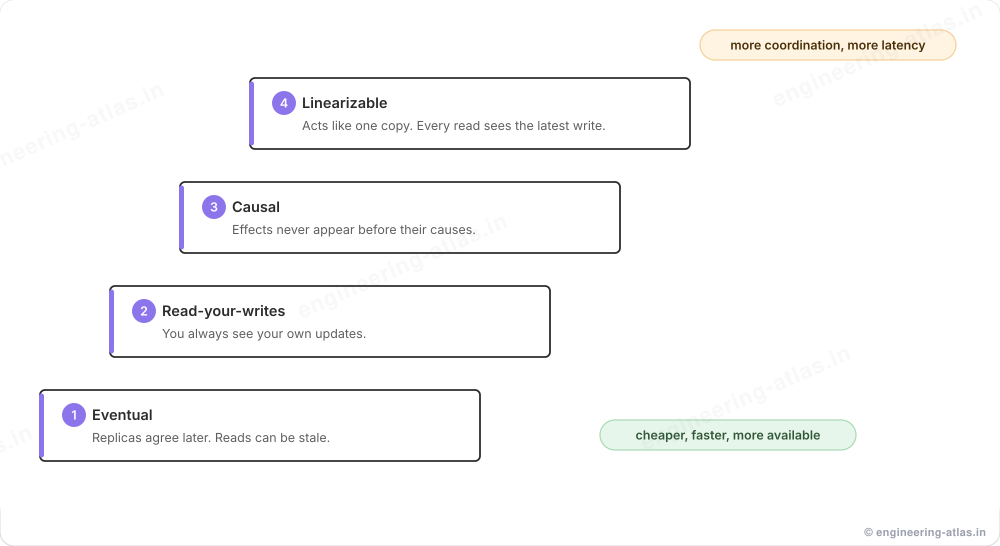

| Topic | What it is, and why it matters | Free read |
|---|---|---|
| <a href="https://engineering-atlas.in/system-design/distributed-systems/consistency-models/?utm_source=github&utm_medium=roadmap&utm_campaign=consistency-models">Consistency models: linearizable, causal, eventual</a> <picture><source media="(prefers-color-scheme: dark)" srcset="diagrams/tags/intermediate-dark.svg"></picture> | A ladder of promises. Linearizable acts like one copy of the data. Causal keeps cause before effect. Eventual only promises the copies agree in the end. Stronger promises need more coordination. | <a href="https://jepsen.io/consistency">Jepsen: Consistency models</a> |
| <a href="https://engineering-atlas.in/system-design/distributed-systems/strong-vs-eventual-consistency/?utm_source=github&utm_medium=roadmap&utm_campaign=strong-vs-eventual-consistency">Strong vs eventual consistency</a> <picture><source media="(prefers-color-scheme: dark)" srcset="diagrams/tags/beginner-dark.svg"></picture> | The everyday version of the ladder. Strong for money, stock counts and unique usernames. Eventual for feeds, counters and search, where a few seconds of staleness is fine. | <a href="https://www.allthingsdistributed.com/2008/12/eventually_consistent.html">Werner Vogels: Eventually consistent, revisited</a> |
| <a href="https://engineering-atlas.in/system-design/distributed-systems/read-your-writes/?utm_source=github&utm_medium=roadmap&utm_campaign=read-your-writes">Read-your-writes consistency</a> <picture><source media="(prefers-color-scheme: dark)" srcset="diagrams/tags/intermediate-dark.svg"></picture> | A user edits their profile, refreshes, and sees the old one because the read hit a lagging replica. Read-your-writes fixes exactly that, usually by routing that user's reads to the leader for a short time. | <a href="https://jepsen.io/consistency/models/read-your-writes">Jepsen: Read your writes</a> |

#### Explained: weak, eventual and strong consistency

Three everyday levels, from loosest to strictest:

- **Weak consistency.** After a write, reads may or may not see it, and there is no promise when. Fine for live video, game positions and VoIP, where a lost update is replaced by the next one anyway.
- **Eventual consistency.** After a write, reads may be stale for a while, but if writes stop, all copies converge. DNS, email, social feeds and like counters work this way.
- **Strong consistency.** After a write completes, every read sees it. Needed for balances, stock counts, unique usernames and anything where two readers must agree.

Most real systems mix them: strong for the money path, eventual for the feed, weak for the presence dot.

Go deeper: [Full lesson on Engineering Atlas](https://engineering-atlas.in/system-design/distributed-systems/strong-vs-eventual-consistency/?utm_source=github&utm_medium=roadmap&utm_campaign=strong-vs-eventual-consistency)

#### Deep dive: read-your-writes

You change your display name, the page reloads, and the old name is back. Nothing is broken. Your write went to the leader, and the reload was served by a follower that hadn't caught up yet. That gap is **replication lag**, usually milliseconds, sometimes seconds under load.

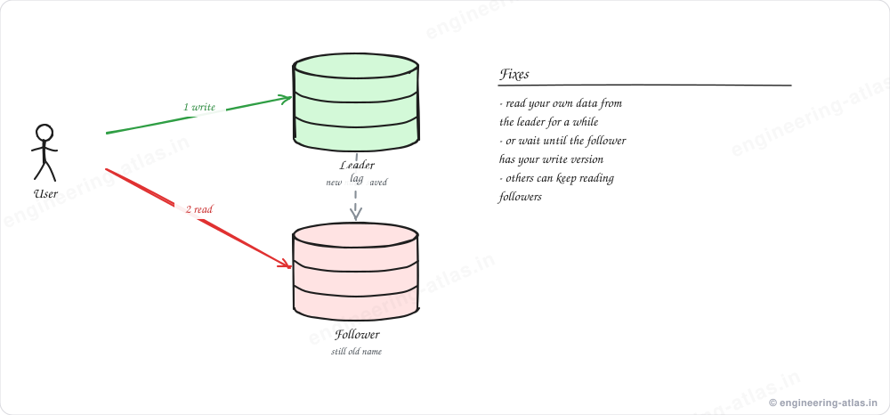

Read-your-writes is the promise that **you** always see your own changes, even if other people see them a moment later. The common fixes:

- **Read your own data from the leader** for a short window after you write (say 10 seconds), or always for data only you can edit, like your profile.
- **Track a version.** The write returns a version or log position; the read goes to a replica that has reached at least that position.
- **Keep the user on one replica** for their session, so they never jump to a more stale one.

> [!TIP]
> **In the interview.** When you add read replicas, say the lag out loud and name the fix before you are asked: "Profile edits read from the leader for a few seconds, everything else reads from replicas."

### 11. CAP and PACELC

<picture><source media="(prefers-color-scheme: dark)" srcset="diagrams/banners/ch-11-dark.svg"></picture>

<a href="https://engineering-atlas.in/system-design/core-concepts/cap-theorem/?utm_source=github&utm_medium=roadmap&utm_campaign=cap-theorem"><picture><source media="(prefers-color-scheme: dark)" srcset="diagrams/banners/btn-chapter-dark.svg"></picture></a>

| | |
|---|---|
| **Why know this** | CAP is the most quoted and most misquoted idea in system design. "Pick two of three" is wrong: partitions are not optional, so the real choice is what to do *during* one. PACELC adds the choice you make every day, when there is no partition. |
| **What interviewers test** | Do you explain CAP as a choice during a partition, and know the latency cost of consistency on normal days? |
| **What you will cover** | CAP theorem and PACELC |
| **Try this** | Classify five databases you know as CP or AP during a partition, and say what each trades for latency when there is none. |
| **Ready to move on when** | You can explain why "a CA system" makes no sense in a distributed setting, and name the latency cost of strong consistency on a normal day. |

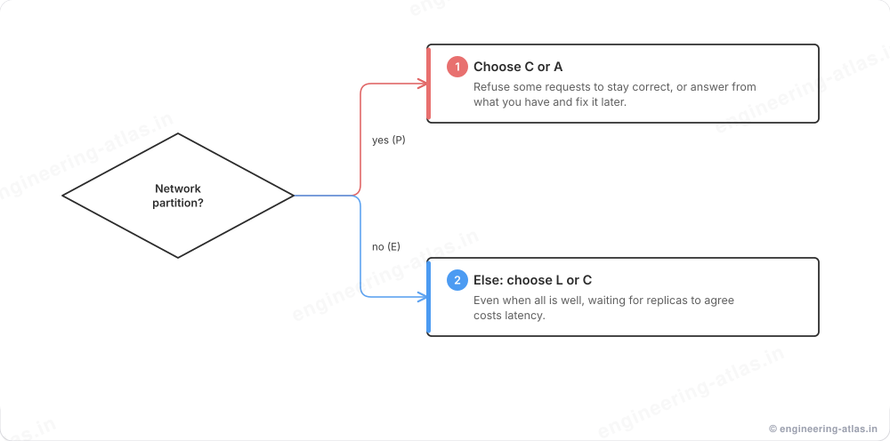

| Topic | What it is, and why it matters | Free read |
|---|---|---|
| <a href="https://engineering-atlas.in/system-design/core-concepts/cap-theorem/?utm_source=github&utm_medium=roadmap&utm_campaign=cap-theorem">CAP theorem and PACELC</a> <picture><source media="(prefers-color-scheme: dark)" srcset="diagrams/tags/intermediate-dark.svg"></picture> | During a network partition, a replica either refuses requests to stay correct (C) or answers with what it has (A). Else, with no partition, you still trade latency (L) against consistency (C) on every request. | <a href="https://www.cs.umd.edu/~abadi/papers/abadi-pacelc.pdf">Daniel Abadi: Consistency tradeoffs in modern distributed database design (PACELC paper)</a> |

#### Explained: CP and AP in practice

When a network partition splits replicas, each side must choose.

- **CP (consistent, partition-tolerant):** the side that can't reach a majority stops accepting writes, or reads, so it never returns wrong data. Users on that side see errors. Good fit: bookings, payments, inventory, leader election. Examples: etcd, ZooKeeper, a single-leader database that refuses writes without its leader.
- **AP (available, partition-tolerant):** both sides keep answering and accept writes, then reconcile after the partition heals. Users always get an answer, sometimes stale. Good fit: carts, feeds, likes, sessions. Examples: Cassandra and DynamoDB in their default settings.

Many databases let you choose **per request** (quorum sizes, read consistency levels), so the honest answer is often "CP for this table, AP for that one".

Go deeper: [Full lesson on Engineering Atlas](https://engineering-atlas.in/system-design/core-concepts/cap-theorem/?utm_source=github&utm_medium=roadmap&utm_campaign=cap-theorem)

Real-world: <a href="https://martin.kleppmann.com/2015/05/11/please-stop-calling-databases-cp-or-ap.html">Martin Kleppmann: Please stop calling databases CP or AP</a> · <a href="https://www.infoq.com/articles/cap-twelve-years-later-how-the-rules-have-changed/">Eric Brewer: CAP twelve years later</a>

### 12. Distributed Systems Fundamentals

<picture><source media="(prefers-color-scheme: dark)" srcset="diagrams/banners/ch-12-dark.svg"></picture>

<a href="https://engineering-atlas.in/system-design/distributed-systems/?utm_source=github&utm_medium=roadmap&utm_campaign=distributed-systems"><picture><source media="(prefers-color-scheme: dark)" srcset="diagrams/banners/btn-chapter-dark.svg"></picture></a>

| | |
|---|---|
| **Why know this** | On one machine, a call either works or throws. Across a network, a call can also hang, arrive twice, or succeed while the reply gets lost. Every pattern later in this roadmap exists because of that third case. |
| **What interviewers test** | Do you design for partial failure: timeouts, unknown outcomes and nodes that are slow, not dead? |
| **What you will cover** | Heartbeats, timeouts and partial failure · Service discovery · The fallacies of distributed computing |
| **Try this** | Explain why a timeout cannot tell you whether a remote call failed or succeeded. Design a retry that is safe either way. |
| **Ready to move on when** | You can explain why a timeout cannot tell "slow" from "dead", and what that means for retries. |

| Topic | What it is, and why it matters | Free read |
|---|---|---|
| <a href="https://engineering-atlas.in/system-design/distributed-systems/heartbeats/?utm_source=github&utm_medium=roadmap&utm_campaign=heartbeats">Heartbeats, timeouts and partial failure</a> <picture><source media="(prefers-color-scheme: dark)" srcset="diagrams/tags/intermediate-dark.svg"></picture> | Nodes prove they are alive by sending heartbeats. Miss enough of them and the node is presumed dead, which can be wrong. Choosing the timeout is a trade between slow detection and false alarms. | <a href="https://aws.amazon.com/builders-library/challenges-with-distributed-systems/">AWS Builders' Library: Challenges with distributed systems</a> |
| <a href="https://engineering-atlas.in/system-design/distributed-systems/service-discovery/?utm_source=github&utm_medium=roadmap&utm_campaign=service-discovery">Service discovery</a> <picture><source media="(prefers-color-scheme: dark)" srcset="diagrams/tags/intermediate-dark.svg"></picture> | Instances come and go with autoscaling and deploys, so callers cannot hard-code addresses. A registry plus health checks tells each caller where the healthy instances are right now. | <a href="https://developer.hashicorp.com/consul/docs/concepts/service-discovery">HashiCorp Consul: What is service discovery?</a> |
| The fallacies of distributed computing <picture><source media="(prefers-color-scheme: dark)" srcset="diagrams/tags/beginner-dark.svg"></picture> | Eight assumptions that feel true and are not: the network is reliable, latency is zero, bandwidth is infinite, and so on. A useful checklist when you review any design. | <a href="https://en.wikipedia.org/wiki/Fallacies_of_distributed_computing">Wikipedia: Fallacies of distributed computing</a> |

### 13. System Design Trade-offs

<picture><source media="(prefers-color-scheme: dark)" srcset="diagrams/banners/ch-13-dark.svg"></picture>

<a href="https://engineering-atlas.in/system-design/core-concepts/design-principles/?utm_source=github&utm_medium=roadmap&utm_campaign=design-principles"><picture><source media="(prefers-color-scheme: dark)" srcset="diagrams/banners/btn-chapter-dark.svg"></picture></a>

| | |
|---|---|
| **Why know this** | There is no best design, only designs that fit the requirements. Interviewers score how you choose: name the options, say what each costs, pick one for *this* problem and say what would change your mind. |
| **What interviewers test** | Do you name the options, state what each costs, and pick one for this problem with a reason? |
| **What you will cover** | Ten principles senior engineers design by · Synchronous vs asynchronous communication · Push vs pull · Batch vs stream processing · Reads vs writes: choosing the architecture |
| **Try this** | Pick one design you have built and write down three trade-offs you made, with what you gave up for each. |
| **Ready to move on when** | For each pair below, you can name one product where each side is the right call. |

| Topic | What it is, and why it matters | Free read |
|---|---|---|
| <a href="https://engineering-atlas.in/system-design/core-concepts/design-principles/?utm_source=github&utm_medium=roadmap&utm_campaign=design-principles">Ten principles senior engineers design by</a> <picture><source media="(prefers-color-scheme: dark)" srcset="diagrams/tags/intermediate-dark.svg"></picture> | The habits behind good answers: start simple, design for failure, keep the write path boring, measure before you optimise. A short list worth rereading before every interview. |  |
| <a href="https://engineering-atlas.in/system-design/trade-offs/sync-vs-async/?utm_source=github&utm_medium=roadmap&utm_campaign=sync-vs-async">Synchronous vs asynchronous communication</a> <picture><source media="(prefers-color-scheme: dark)" srcset="diagrams/tags/beginner-dark.svg"></picture> | Sync is simple and gives an answer now, but couples the caller to the callee's speed and uptime. Async through a queue absorbs spikes and failures, at the cost of eventual results and harder debugging. |  |
| <a href="https://engineering-atlas.in/system-design/trade-offs/push-vs-pull/?utm_source=github&utm_medium=roadmap&utm_campaign=push-vs-pull">Push vs pull</a> <picture><source media="(prefers-color-scheme: dark)" srcset="diagrams/tags/intermediate-dark.svg"></picture> | Push delivers fast but can overwhelm a slow receiver. Pull lets the receiver set the pace but adds delay and polling cost. Feeds, notifications and message brokers all pick a side, or mix both. | <a href="https://kafka.apache.org/documentation/#design_pull">Apache Kafka docs: Push vs pull</a> |
| <a href="https://engineering-atlas.in/system-design/trade-offs/batch-vs-stream-processing/?utm_source=github&utm_medium=roadmap&utm_campaign=batch-vs-stream-processing">Batch vs stream processing</a> <picture><source media="(prefers-color-scheme: dark)" srcset="diagrams/tags/intermediate-dark.svg"></picture> | Batch processes a bounded pile of data later, cheaply and with little machinery. Stream processes each event as it arrives, for fresh results, with harder questions about late and duplicate events. |  |
| <a href="https://engineering-atlas.in/system-design/common-patterns/reads-vs-writes-decisions/?utm_source=github&utm_medium=roadmap&utm_campaign=reads-vs-writes-decisions">Reads vs writes: choosing the architecture</a> <picture><source media="(prefers-color-scheme: dark)" srcset="diagrams/tags/intermediate-dark.svg"></picture> | The read-to-write ratio shapes the whole design. A 100:1 read-heavy feed and a write-heavy metrics pipeline end up with very different stores, caches and queues. |  |

### 13b. Back-of-the-envelope Estimation

<picture><source media="(prefers-color-scheme: dark)" srcset="diagrams/banners/ch-13b-dark.svg"></picture>

<a href="https://engineering-atlas.in/system-design/interview/back-of-envelope-estimation/?utm_source=github&utm_medium=roadmap&utm_campaign=back-of-envelope-estimation"><picture><source media="(prefers-color-scheme: dark)" srcset="diagrams/banners/btn-chapter-dark.svg"></picture></a>

| | |
|---|---|
| **Why know this** | Estimates decide the design. 100 writes a second fits on one database; 100,000 does not. A two-minute estimate tells you whether you need sharding, a cache or a CDN before you draw a single box. |
| **What interviewers test** | Can you turn users into requests per second, storage and bandwidth quickly, and let the numbers drive the design? |
| **What you will cover** | Back-of-envelope estimation · Numbers to know |
| **Try this** | Estimate peak QPS and 5-year storage for a photo app with 50 million daily users who each upload one 2 MB photo a week. |
| **Ready to move on when** | You can turn "10 million daily users" into requests per second, storage per year and peak bandwidth, out loud, in under three minutes. |

| Topic | What it is, and why it matters | Free read |
|---|---|---|
| <a href="https://engineering-atlas.in/system-design/interview/back-of-envelope-estimation/?utm_source=github&utm_medium=roadmap&utm_campaign=back-of-envelope-estimation">Back-of-envelope estimation</a> <picture><source media="(prefers-color-scheme: dark)" srcset="diagrams/tags/beginner-dark.svg"></picture> | A day has about 86,400 seconds, so 1 million requests a day is about 12 a second on average. Multiply by a peak factor, then by object size for bandwidth and by retention for storage. |  |
| <a href="https://engineering-atlas.in/system-design/interview/numbers-to-know/?utm_source=github&utm_medium=roadmap&utm_campaign=numbers-to-know">Numbers to know</a> <picture><source media="(prefers-color-scheme: dark)" srcset="diagrams/tags/beginner-dark.svg"></picture> | Memory reads take nanoseconds, a same-datacenter round trip well under a millisecond, a cross-continent round trip around 100 ms or more. Knowing the rough order of each lets you spot a design that cannot meet its latency goal. | <a href="https://colin-scott.github.io/personal_website/research/interactive_latency.html">Colin Scott: Latency numbers every programmer should know (interactive)</a> |

### Can you answer these?

1. Your API runs on 4 servers and keeps user sessions in local memory. What breaks when you add 4 more, and how do you fix it?
2. A checkout flow calls 5 services in a chain, each at 99.9% availability. Roughly what availability can checkout promise, and how would you raise it?
3. The primary database fails at peak. Walk through detection, failover and what users see. Where can you lose data?
4. Which consistency model would you choose for a bank transfer, a post's like count, and a user seeing their own new comment? Why?
5. Explain PACELC to someone who only knows "CAP: pick two". What does a strongly consistent database cost you on a normal day?
6. Estimate requests per second, storage per year and peak bandwidth for a photo app with 10 million daily users who each upload 2 photos and view 50.

> [!TIP]
> **Unlocked: you can now solve** <a href="https://engineering-atlas.in/system-design/storage-media/design-a-url-shortener/?utm_source=github&utm_medium=roadmap&utm_campaign=design-a-url-shortener">URL shortener</a> · <a href="https://engineering-atlas.in/system-design/infrastructure/design-a-unique-id-generator/?utm_source=github&utm_medium=roadmap&utm_campaign=design-a-unique-id-generator">Unique ID generator</a>

> [!NOTE]
> **Prep progress.** Finish this part and you are about **25%** of the way to interview ready.
>
> 

**Continue learning on Engineering Atlas:** [Core concepts module](https://engineering-atlas.in/system-design/core-concepts/?utm_source=github&utm_medium=roadmap&utm_campaign=core-concepts) · [Distributed systems module](https://engineering-atlas.in/system-design/distributed-systems/?utm_source=github&utm_medium=roadmap&utm_campaign=distributed-systems) · [HLD roadmap](https://engineering-atlas.in/system-design/roadmap/?utm_source=github&utm_medium=roadmap&utm_campaign=roadmap)

<a href="#contents">Back to contents ↑</a>

## Part III: Building blocks

<picture><source media="(prefers-color-scheme: dark)" srcset="diagrams/banners/part-3-dark.svg">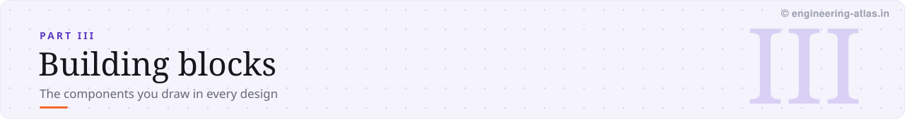</picture>

*The components you will draw in almost every design, and what each one costs you.* Learn what each block is for, its failure mode, and the one or two settings that matter. Then a design becomes picking blocks for a reason, not drawing them out of habit.

### 14. Load Balancing

<picture><source media="(prefers-color-scheme: dark)" srcset="diagrams/banners/ch-14-dark.svg"></picture>

<a href="https://engineering-atlas.in/system-design/networking/load-balancing/?utm_source=github&utm_medium=roadmap&utm_campaign=load-balancing"><picture><source media="(prefers-color-scheme: dark)" srcset="diagrams/banners/btn-chapter-dark.svg"></picture></a>

| | |
|---|---|
| **Why know this** | The load balancer is the first box after the client in nearly every design. Where it sits, what it can see and how it checks health decide how traffic spreads and how failures are hidden from users. |
| **What interviewers test** | Can you place the load balancer, choose L4 or L7, and explain health checks and session handling? |
| **What you will cover** | Load balancing: L4 vs L7 · Load-balancing algorithms · Sticky sessions |
| **Try this** | Put Nginx in front of three copies of a service. Kill one and watch how long until traffic stops reaching it. |
| **Ready to move on when** | You can explain when you would pick L7 over L4, and why sticky sessions make scaling and deploys harder. |

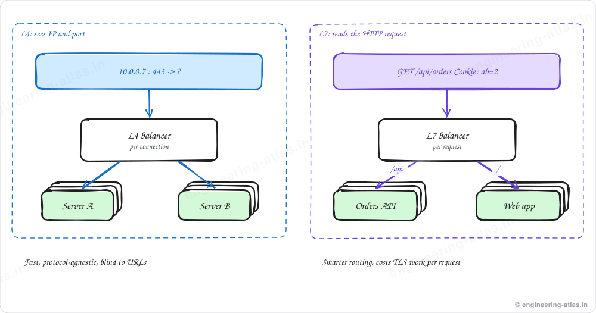

| Topic | What it is, and why it matters | Free read |
|---|---|---|
| <a href="https://engineering-atlas.in/system-design/networking/load-balancing/?utm_source=github&utm_medium=roadmap&utm_campaign=load-balancing">Load balancing: L4 vs L7</a> <picture><source media="(prefers-color-scheme: dark)" srcset="diagrams/tags/beginner-dark.svg"></picture> | L4 balances TCP connections by IP and port, fast and blind to content. L7 reads each HTTP request and can route by path, header or cookie, at the cost of more work per request. | <a href="https://docs.nginx.com/nginx/admin-guide/load-balancer/http-load-balancer/">NGINX docs: HTTP load balancing</a> |
| Load-balancing algorithms <picture><source media="(prefers-color-scheme: dark)" srcset="diagrams/tags/intermediate-dark.svg"></picture> | Round robin, least connections, weighted, and hashing by key. Least connections helps when requests vary a lot in cost; hashing keeps a user on the same server for cache hits. | <a href="https://docs.haproxy.org/2.8/configuration.html#4.2-balance">HAProxy docs: Configuration manual (balance)</a> |
| <a href="https://engineering-atlas.in/system-design/networking/sticky-sessions/?utm_source=github&utm_medium=roadmap&utm_campaign=sticky-sessions">Sticky sessions</a> <picture><source media="(prefers-color-scheme: dark)" srcset="diagrams/tags/intermediate-dark.svg"></picture> | Pinning a user to one server keeps local state working, but uneven load, painful deploys and lost sessions on a crash follow. Moving session state out is usually the better fix. |  |

#### Explained: load-balancing algorithms

- **Round robin:** each server in turn. Simple and fair when requests cost about the same.
- **Weighted round robin:** bigger servers get a bigger share.
- **Least connections:** send to the server with the fewest open requests. Better when request cost varies a lot.
- **Hashing (by user or key):** the same user always reaches the same server, which helps local caches but makes load uneven if a few keys are hot.
- **Power of two choices:** pick two servers at random and send to the less busy one. Nearly as good as least connections, with far less coordination.

The load balancer itself must not be a single point of failure: run at least two, in **active-passive** (a standby takes over the virtual IP) or **active-active** (both take traffic, usually behind DNS or anycast).

Go deeper: [Full lesson on Engineering Atlas](https://engineering-atlas.in/system-design/networking/load-balancing/?utm_source=github&utm_medium=roadmap&utm_campaign=load-balancing)

### 15. Caching

<picture><source media="(prefers-color-scheme: dark)" srcset="diagrams/banners/ch-15-dark.svg"></picture>

<a href="https://engineering-atlas.in/system-design/caching/?utm_source=github&utm_medium=roadmap&utm_campaign=caching"><picture><source media="(prefers-color-scheme: dark)" srcset="diagrams/banners/btn-chapter-dark.svg"></picture></a>

| | |
|---|---|
| **Why know this** | A cache is the cheapest way to cut latency and database load, and the easiest way to serve wrong data. Interviewers probe the hard parts: invalidation, hot keys and what happens when the cache is empty. |
| **What interviewers test** | Can you pick a cache strategy, handle invalidation, and stop hot keys and stampedes? |
| **What you will cover** | Caching 101 · Caching strategies: cache-aside, read-through, write-through · Cache eviction policies · Distributed caching · Hot keys, cache stampede and invalidation · Redis |
| **Try this** | Add a cache-aside layer to one slow query. Then expire a hot key under load and watch the database spike (a cache stampede). |
| **Ready to move on when** | You can pick a write strategy for a product page and for a bank balance, and explain how a cache stampede happens and how to stop it. |

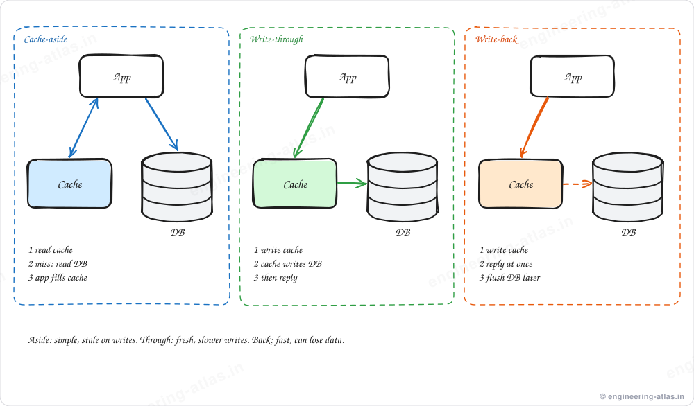

> [!TIP]
> **The 30-second answer.** Start with cache-aside and a TTL: read the cache, on a miss read the database and fill the cache. On writes, update the database and delete the cache key. Add write-through only where reads must be fresh, and protect hot keys with request coalescing.

| Topic | What it is, and why it matters | Free read |
|---|---|---|
| <a href="https://engineering-atlas.in/system-design/caching/caching-101/?utm_source=github&utm_medium=roadmap&utm_campaign=caching-101">Caching 101</a> <picture><source media="(prefers-color-scheme: dark)" srcset="diagrams/tags/beginner-dark.svg"></picture> | Where caches live (browser, CDN, app memory, Redis, database buffer), what a hit ratio means, and why even a 90% hit ratio sends a tenth of traffic to the database. |  |
| <a href="https://engineering-atlas.in/system-design/caching/caching-strategies/?utm_source=github&utm_medium=roadmap&utm_campaign=caching-strategies">Caching strategies: cache-aside, read-through, write-through</a> <picture><source media="(prefers-color-scheme: dark)" srcset="diagrams/tags/intermediate-dark.svg"></picture> | Who loads the cache and who writes the database. Cache-aside is the default; write-through keeps the cache fresh; write-back is fastest but can lose writes if the cache dies. | <a href="https://aws.amazon.com/builders-library/caching-challenges-and-strategies/">AWS Builders' Library: Caching challenges and strategies</a> |
| <a href="https://engineering-atlas.in/system-design/caching/cache-eviction-policies/?utm_source=github&utm_medium=roadmap&utm_campaign=cache-eviction-policies">Cache eviction policies</a> <picture><source media="(prefers-color-scheme: dark)" srcset="diagrams/tags/beginner-dark.svg"></picture> | When the cache is full, something must go. LRU drops the least recently used item, LFU the least frequently used, and TTLs expire items on a clock. Match the policy to the access pattern. |  |
| <a href="https://engineering-atlas.in/system-design/caching/distributed-caching/?utm_source=github&utm_medium=roadmap&utm_campaign=distributed-caching">Distributed caching</a> <picture><source media="(prefers-color-scheme: dark)" srcset="diagrams/tags/intermediate-dark.svg"></picture> | Spread a cache across nodes with consistent hashing, so it holds more and survives a node loss. Watch for the thundering herd when a node restarts empty. |  |
| <a href="https://engineering-atlas.in/system-design/caching/hot-keys-and-cache-stampede/?utm_source=github&utm_medium=roadmap&utm_campaign=hot-keys-and-cache-stampede">Hot keys, cache stampede and invalidation</a> <picture><source media="(prefers-color-scheme: dark)" srcset="diagrams/tags/advanced-dark.svg"></picture> | One celebrity key can overload a single cache node. One expired key can send thousands of identical misses to the database at once. Coalescing, jittered TTLs and early refresh are the fixes. | <a href="https://www.usenix.org/conference/nsdi13/technical-sessions/presentation/nishtala">Facebook: Scaling Memcache at Facebook (NSDI 2013)</a> |
| Redis <picture><source media="(prefers-color-scheme: dark)" srcset="diagrams/tags/intermediate-dark.svg"></picture> | The default cache and much more: counters, leaderboards with sorted sets, rate limiters, locks and queues. Know its single-threaded model and its persistence options. | <a href="https://redis.io/docs/latest/develop/data-types/">Redis docs: Data types</a> |

#### Explained: where caches live

A request can be answered from a cache at five layers. The closer to the user, the faster the hit, and the harder it is to take back a stale answer.

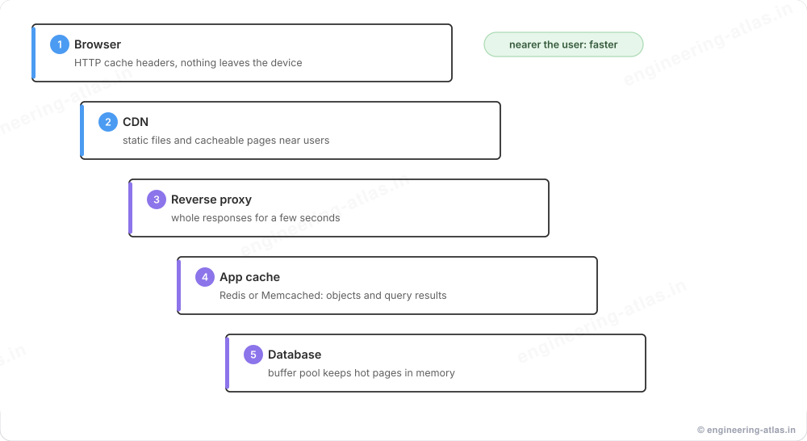

At the application layer, you can cache **query results** (key: the query and its parameters) or **objects** (key: the entity, like `user:42`). Object caching is usually better: when a user changes, you delete one key, instead of hunting for every query that touched them.

Besides cache-aside, write-through and write-back, there is **refresh-ahead**: the cache reloads a popular key shortly before it expires, so readers never wait on a miss. It works well when you can predict which keys stay hot, and wastes work when you can't.

Go deeper: [Full lesson on Engineering Atlas](https://engineering-atlas.in/system-design/caching/caching-101/?utm_source=github&utm_medium=roadmap&utm_campaign=caching-101)

#### Deep dive: cache stampede

A popular key expires. In the next 50 ms, a thousand requests miss the cache at the same time, and all of them go to the database to rebuild the same value. The database slows down, rebuilding takes longer, more requests pile up. This is a **cache stampede** (also called thundering herd or dog-piling), and it can take down a database that handles normal load easily.

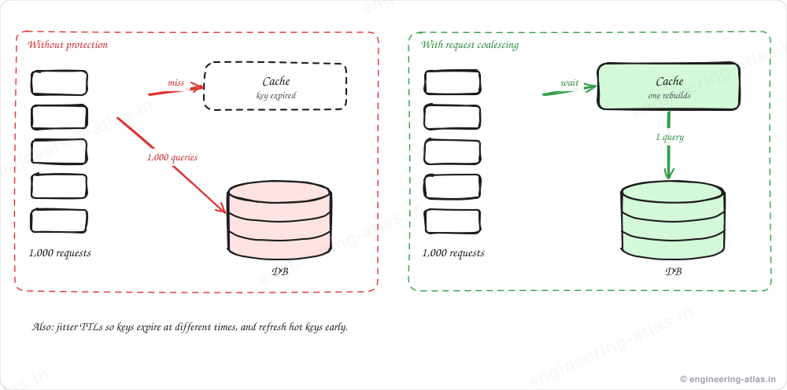

Three fixes, usually combined:

- **Request coalescing.** The first request that misses takes a short lock and rebuilds the value; the others wait a few milliseconds and read the fresh value.
- **Jittered TTLs.** Add a random few seconds to each expiry so related keys don't all expire at the same moment.
- **Refresh early.** For the hottest keys, refresh in the background a little before expiry, so they never really expire under traffic.

> [!WARNING]
> **Where candidates slip.** Saying "we'll cache it" and moving on. The follow-up is almost always "what happens when that key expires at peak?" Have the answer ready.

### 16. Content Delivery Networks

<picture><source media="(prefers-color-scheme: dark)" srcset="diagrams/banners/ch-16-dark.svg"></picture>

<a href="https://engineering-atlas.in/system-design/caching/cdn/?utm_source=github&utm_medium=roadmap&utm_campaign=cdn"><picture><source media="(prefers-color-scheme: dark)" srcset="diagrams/banners/btn-chapter-dark.svg"></picture></a>

| | |
|---|---|
| **Why know this** | Physics wins: a user in Pune is about 100 ms or more from a server in Virginia. A CDN puts static files, and sometimes dynamic responses, a few milliseconds from users and shields your origin from traffic spikes. |
| **What interviewers test** | Do you know what goes on a CDN, how it gets invalidated, and how the origin is protected? |
| **What you will cover** | Content delivery network (CDN) |
| **Try this** | Serve one image from a CDN and from your origin. Compare time to first byte from two different regions. |
| **Ready to move on when** | You can say what you would put on a CDN for a video site, how a new deploy invalidates old files, and what an origin shield is for. |

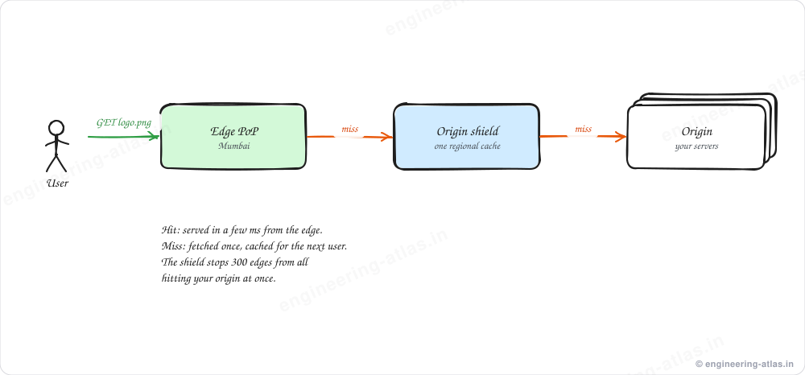

| Topic | What it is, and why it matters | Free read |
|---|---|---|
| <a href="https://engineering-atlas.in/system-design/caching/cdn/?utm_source=github&utm_medium=roadmap&utm_campaign=cdn">Content delivery network (CDN)</a> <picture><source media="(prefers-color-scheme: dark)" srcset="diagrams/tags/beginner-dark.svg"></picture> | Edge servers cache content close to users. Pull CDNs fetch on the first miss; push CDNs get files uploaded ahead of time. Versioned file names make invalidation simple. | <a href="https://www.cloudflare.com/learning/cdn/what-is-a-cdn/">Cloudflare Learning: What is a CDN?</a> |

#### Explained: push CDN vs pull CDN

- **Pull CDN:** the edge fetches a file from your origin the first time someone asks, then caches it for its TTL. Nothing to upload, and only requested files use edge storage. The first user in each region waits for the origin. This is the default for most sites.
- **Push CDN:** you upload files to the CDN ahead of time, and you decide when they change. Good for large files that rarely change and must be fast from the first request, like video segments or game patches. You manage uploads and storage yourself.

Either way, put a version or content hash in file names (`app.3f9c2.js`). A new deploy then produces new URLs, and you never need to purge old ones.

Go deeper: [Full lesson on Engineering Atlas](https://engineering-atlas.in/system-design/caching/cdn/?utm_source=github&utm_medium=roadmap&utm_campaign=cdn)

### 17. Database Scaling

<picture><source media="(prefers-color-scheme: dark)" srcset="diagrams/banners/ch-17-dark.svg"></picture>

<a href="https://engineering-atlas.in/system-design/database-fundamentals/?utm_source=github&utm_medium=roadmap&utm_campaign=database-fundamentals"><picture><source media="(prefers-color-scheme: dark)" srcset="diagrams/banners/btn-chapter-dark.svg"></picture></a>

| | |
|---|---|
| **Why know this** | One database server eventually runs out of CPU, memory, connections or disk. The order you reach for fixes (indexes, then replicas, then partitioning, then sharding) and what each costs is a core interview signal. |
| **What interviewers test** | Can you scale a database in the right order, pick a shard key, and handle replication lag? |
| **What you will cover** | Data replication: leaders, followers and lag · Database sharding · Table partitioning · Query plans: index scan vs full scan · The N+1 query problem · Choosing and scaling a database |
| **Try this** | Shard a <code>posts</code> table by <code>user_id</code> across four databases. Then find the hot key a celebrity user creates and fix it. |
| **Ready to move on when** | You can explain replication lag and what it breaks, choose a shard key for an orders table, and say what goes wrong with a bad one. |

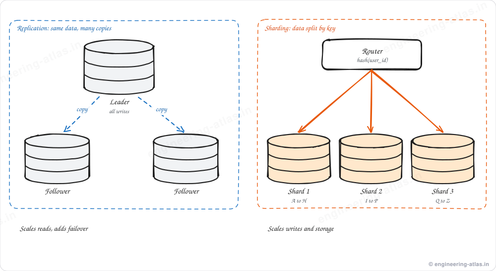

> [!WARNING]
> **Where candidates slip.** Sharding on day one. A tuned single PostgreSQL with read replicas carries most products a long way. Shard when writes or data size truly outgrow one machine, and say which number tells you so.

| Topic | What it is, and why it matters | Free read |
|---|---|---|
| <a href="https://engineering-atlas.in/system-design/database-fundamentals/data-replication/?utm_source=github&utm_medium=roadmap&utm_campaign=data-replication">Data replication: leaders, followers and lag</a> <picture><source media="(prefers-color-scheme: dark)" srcset="diagrams/tags/intermediate-dark.svg"></picture> | Copies of the data on other machines, for read scale and failover. Asynchronous replicas lag behind, so a read right after a write can miss it. | <a href="https://www.postgresql.org/docs/current/high-availability.html">PostgreSQL docs: High availability and replication</a> |
| <a href="https://engineering-atlas.in/system-design/databases/sharding/?utm_source=github&utm_medium=roadmap&utm_campaign=sharding">Database sharding</a> <picture><source media="(prefers-color-scheme: dark)" srcset="diagrams/tags/advanced-dark.svg"></picture> | Split rows across databases by a shard key. A good key spreads load evenly and keeps each query on one shard. Cross-shard joins, hot shards and resharding are the costs. |  |
| <a href="https://engineering-atlas.in/system-design/database-fundamentals/table-partitioning/?utm_source=github&utm_medium=roadmap&utm_campaign=table-partitioning">Table partitioning</a> <picture><source media="(prefers-color-scheme: dark)" srcset="diagrams/tags/intermediate-dark.svg"></picture> | Split one big table into parts inside the same database, usually by time. Old partitions drop in a second instead of a slow delete, and queries skip parts they don't need. |  |
| <a href="https://engineering-atlas.in/system-design/database-fundamentals/query-execution-plans/?utm_source=github&utm_medium=roadmap&utm_campaign=query-execution-plans">Query plans: index scan vs full scan</a> <picture><source media="(prefers-color-scheme: dark)" srcset="diagrams/tags/intermediate-dark.svg"></picture> | `EXPLAIN` shows how the database will run a query. Reading it is how you prove an index is used, and how you find the scan that makes a page slow. |  |
| <a href="https://engineering-atlas.in/system-design/database-fundamentals/n-plus-one-queries/?utm_source=github&utm_medium=roadmap&utm_campaign=n-plus-one-queries">The N+1 query problem</a> <picture><source media="(prefers-color-scheme: dark)" srcset="diagrams/tags/beginner-dark.svg"></picture> | One query for a list, then one more per row. Fine with 10 rows, a disaster with 1,000. Batch or join instead. |  |
| <a href="https://engineering-atlas.in/system-design/databases/?utm_source=github&utm_medium=roadmap&utm_campaign=databases">Choosing and scaling a database</a> <picture><source media="(prefers-color-scheme: dark)" srcset="diagrams/tags/intermediate-dark.svg"></picture> | The long-form guide: engines, indexes, isolation, replication and sharding in one place, with the decisions in order. |  |

#### Explained: leader-follower vs multi-leader replication

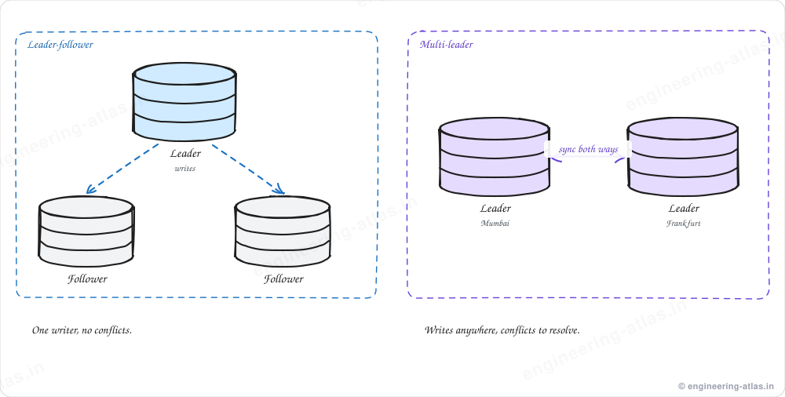

**Leader-follower** (older docs say master-slave): one node takes all writes and streams them to followers, which serve reads. There is never a write conflict, and failover means promoting a follower. Writes are limited to what one leader can handle, and async followers can lag or lose the last few writes when the leader dies.

**Multi-leader** (master-master): two or more nodes accept writes and replicate to each other. Useful across regions, so users write to a nearby leader, or for offline clients. The cost is **write conflicts**: two leaders change the same row, and you need rules to settle it (last write wins, merge, or ask the user).

#### Explained: federation

Federation splits one database into several **by function**: users in one, orders in another, the catalogue in a third. Each is smaller, has less write traffic, and can be tuned and scaled on its own.

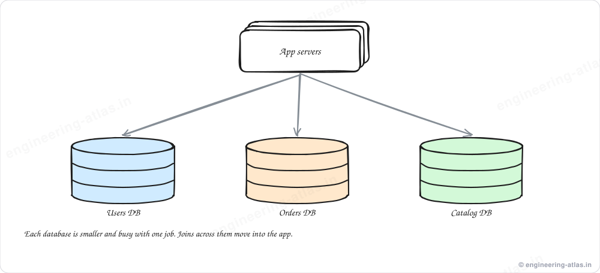

It is a natural first split, often before sharding, and it lines up with service boundaries. The cost: you can no longer join across databases, so those joins move into application code, and transactions across them need the patterns from chapter 27.

Go deeper: [Full lesson on Engineering Atlas](https://engineering-atlas.in/system-design/database-fundamentals/data-replication/?utm_source=github&utm_medium=roadmap&utm_campaign=data-replication)

#### Deep dive: choosing a shard key

The shard key decides which machine holds each row, so it decides whether load spreads evenly and whether your queries stay on one shard. It is also the hardest decision to change later, because changing it means moving almost all the data.

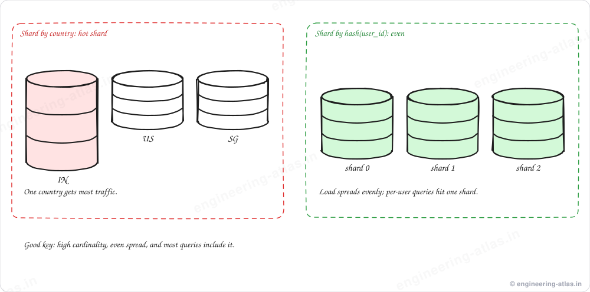

A good shard key has three properties:

1. **High cardinality.** Many distinct values, so data can spread across many shards. Country has about 200 values; user ID has millions.
2. **Even load.** No single value gets most of the traffic. Sharding by country puts most of an Indian app's traffic on one shard.
3. **Matches your queries.** Most queries include the key, so they go to one shard instead of asking all of them.

For an orders table, `hash(user_id)` usually wins: a user's orders live together, so "my orders" is one shard. The cost: "all orders for seller X" now asks every shard, so you add a secondary index or a separate read model for that query.

### 18. Storage Systems

<picture><source media="(prefers-color-scheme: dark)" srcset="diagrams/banners/ch-18-dark.svg"></picture>

<a href="https://engineering-atlas.in/system-design/key-technologies/blob-storage-s3/?utm_source=github&utm_medium=roadmap&utm_campaign=blob-storage-s3"><picture><source media="(prefers-color-scheme: dark)" srcset="diagrams/banners/btn-chapter-dark.svg"></picture></a>

| | |
|---|---|
| **Why know this** | Photos, videos, backups and logs don't belong in a database. Knowing object, block and file storage, and how to upload large files safely, is required for any media or data design. |
| **What interviewers test** | Do you keep large files out of the database and out of your app servers, using direct uploads? |
| **What you will cover** | Object, block and file storage · Blob storage (Amazon S3) · Distributed file systems (GFS, HDFS) · Large file uploads |
| **Try this** | Decide where each lives and why: user profiles, uploaded videos, server logs, a 10 GB shared config file. |
| **Ready to move on when** | You can design a photo upload that never sends bytes through your app servers, and say why. |

| Topic | What it is, and why it matters | Free read |
|---|---|---|
| Object, block and file storage <picture><source media="(prefers-color-scheme: dark)" srcset="diagrams/tags/beginner-dark.svg"></picture> | Block storage is a raw disk for one machine (databases). File storage is a shared folder tree. Object storage is a flat key-to-blob store over HTTP, cheap and nearly unlimited. | <a href="https://aws.amazon.com/compare/the-difference-between-block-file-object-storage/">AWS: Object vs file vs block storage</a> |
| <a href="https://engineering-atlas.in/system-design/key-technologies/blob-storage-s3/?utm_source=github&utm_medium=roadmap&utm_campaign=blob-storage-s3">Blob storage (Amazon S3)</a> <picture><source media="(prefers-color-scheme: dark)" srcset="diagrams/tags/beginner-dark.svg"></picture> | The default home for large files. Pre-signed URLs let clients upload and download directly, so your servers only handle metadata. | <a href="https://docs.aws.amazon.com/AmazonS3/latest/userguide/PresignedUrlUploadObject.html">AWS docs: Uploading objects with presigned URLs</a> |
| Distributed file systems (GFS, HDFS) <picture><source media="(prefers-color-scheme: dark)" srcset="diagrams/tags/advanced-dark.svg"></picture> | Large files split into big chunks, each copied to several machines, with a master tracking where chunks live. The design behind most big-data storage. | <a href="https://research.google/pubs/the-google-file-system/">Google: The Google File System (SOSP 2003)</a> |
| Large file uploads <picture><source media="(prefers-color-scheme: dark)" srcset="diagrams/tags/intermediate-dark.svg"></picture> | Multipart and resumable uploads split a 2 GB file into parts that retry on their own, so a dropped connection costs one part, not the whole file. |  |

### 19. Message Queues and Streams

<picture><source media="(prefers-color-scheme: dark)" srcset="diagrams/banners/ch-19-dark.svg"></picture>

<a href="https://engineering-atlas.in/system-design/async/?utm_source=github&utm_medium=roadmap&utm_campaign=async"><picture><source media="(prefers-color-scheme: dark)" srcset="diagrams/banners/btn-chapter-dark.svg"></picture></a>

| | |
|---|---|
| **Why know this** | Queues decouple services in time: the producer can finish before the consumer starts. That absorbs spikes and failures, and it brings its own problems: duplicates, ordering and back pressure. |
| **What interviewers test** | Can you choose a queue, pub/sub or log, and handle duplicates, ordering and backlog? |
| **What you will cover** | Message queues · Publish/subscribe · Kafka and the log · Delivery guarantees and dead-letter queues · Message ordering · Backpressure and load shedding · Idempotent consumers and the inbox pattern · AWS SQS |
| **Try this** | Build a producer and two consumers on a queue. Crash one consumer mid-message and confirm the message is not lost. |
| **Ready to move on when** | You can choose between a queue, pub/sub and a log for a given flow, and explain why "exactly once" usually means "at least once plus idempotent consumers". |

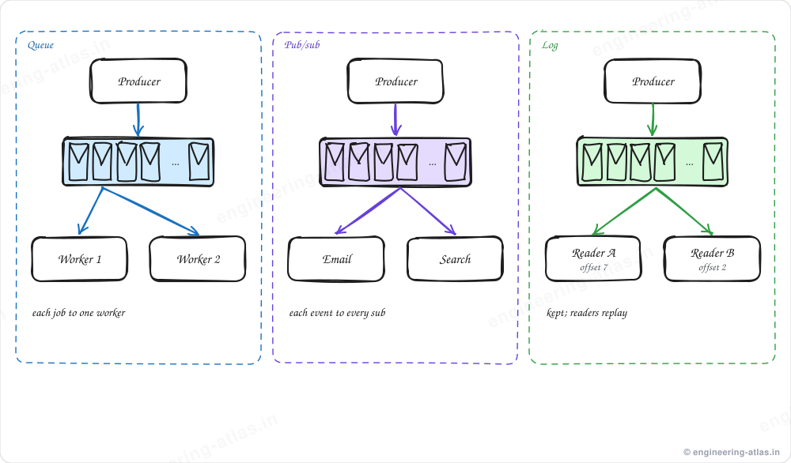

| Topic | What it is, and why it matters | Free read |
|---|---|---|
| <a href="https://engineering-atlas.in/system-design/async/message-queues/?utm_source=github&utm_medium=roadmap&utm_campaign=message-queues">Message queues</a> <picture><source media="(prefers-color-scheme: dark)" srcset="diagrams/tags/beginner-dark.svg"></picture> | Producers put jobs in, workers take them out, each job goes to one worker. Add workers to drain faster; the queue holds the backlog when they fall behind. |  |
| <a href="https://engineering-atlas.in/system-design/async/pub-sub/?utm_source=github&utm_medium=roadmap&utm_campaign=pub-sub">Publish/subscribe</a> <picture><source media="(prefers-color-scheme: dark)" srcset="diagrams/tags/beginner-dark.svg"></picture> | One event, many independent subscribers. The order service publishes "order placed", and email, search and analytics each react without the order service knowing them. |  |
| Kafka and the log <picture><source media="(prefers-color-scheme: dark)" srcset="diagrams/tags/intermediate-dark.svg"></picture> | Kafka keeps events in an append-only log, split into partitions, for days. Consumers track their own offset, so they can replay history or join late. | <a href="https://kafka.apache.org/documentation/#design">Apache Kafka docs: Design</a> |
| <a href="https://engineering-atlas.in/system-design/async/delivery-guarantees/?utm_source=github&utm_medium=roadmap&utm_campaign=delivery-guarantees">Delivery guarantees and dead-letter queues</a> <picture><source media="(prefers-color-scheme: dark)" srcset="diagrams/tags/intermediate-dark.svg"></picture> | At-most-once can lose messages, at-least-once can duplicate them. Messages that keep failing go to a dead-letter queue so they don't block the rest. |  |
| <a href="https://engineering-atlas.in/system-design/async/message-ordering/?utm_source=github&utm_medium=roadmap&utm_campaign=message-ordering">Message ordering</a> <picture><source media="(prefers-color-scheme: dark)" srcset="diagrams/tags/advanced-dark.svg"></picture> | Global order is expensive; per-key order is usually enough. Route all events for one order ID to one partition and they stay in order. |  |
| <a href="https://engineering-atlas.in/system-design/async/backpressure/?utm_source=github&utm_medium=roadmap&utm_campaign=backpressure">Backpressure and load shedding</a> <picture><source media="(prefers-color-scheme: dark)" srcset="diagrams/tags/advanced-dark.svg"></picture> | When consumers can't keep up, something must give: slow the producer, buffer with a limit, or drop low-value work on purpose. Unbounded queues only move the outage. |  |
| <a href="https://engineering-atlas.in/system-design/async/idempotent-consumers/?utm_source=github&utm_medium=roadmap&utm_campaign=idempotent-consumers">Idempotent consumers and the inbox pattern</a> <picture><source media="(prefers-color-scheme: dark)" srcset="diagrams/tags/advanced-dark.svg"></picture> | Record each processed message ID and skip repeats. That turns at-least-once delivery into effectively-once processing. |  |
| <a href="https://engineering-atlas.in/system-design/key-technologies/aws-sqs/?utm_source=github&utm_medium=roadmap&utm_campaign=aws-sqs">AWS SQS</a> <picture><source media="(prefers-color-scheme: dark)" srcset="diagrams/tags/beginner-dark.svg"></picture> | A managed queue with visibility timeouts and dead-letter queues. A good default when you need a simple work queue and not a replayable log. | <a href="https://docs.aws.amazon.com/AWSSimpleQueueService/latest/SQSDeveloperGuide/sqs-visibility-timeout.html">AWS docs: Amazon SQS visibility timeout</a> |

#### Explained: task queues and back pressure

A **message queue** carries messages; a **task queue** carries jobs to run, like "resize this image" or "send this email", with workers that pick them up, retry on failure and report results. Celery, Sidekiq and SQS with workers are common examples. They let a web request return in milliseconds while slow work happens in the background.

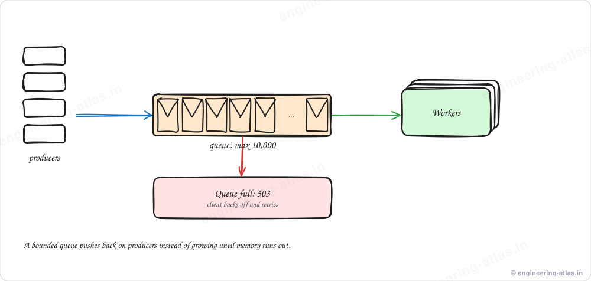

A queue only helps if it can drain. If producers add work faster than workers finish it, the queue grows until memory runs out or every job is hours late. **Back pressure** is the fix: cap the queue, and when it is full, reject new work (HTTP 503 or 429) so clients back off and retry later. It feels harsh, and it keeps the system alive.

Go deeper: [Full lesson on Engineering Atlas](https://engineering-atlas.in/system-design/async/backpressure/?utm_source=github&utm_medium=roadmap&utm_campaign=backpressure)

#### Deep dive: Kafka partitions and consumer groups

A Kafka topic is split into **partitions**. Each partition is an ordered, append-only log, and messages with the same key always land in the same partition. That one rule gives you ordering where it matters (all events for one order, in order) without paying for global ordering.

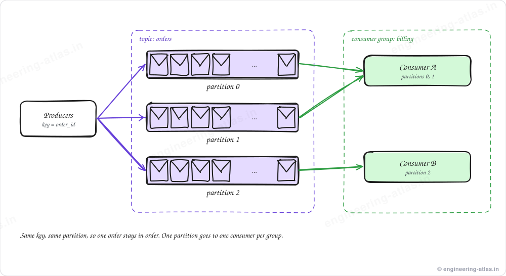

A **consumer group** is a set of consumers sharing the work. Each partition is read by exactly one consumer in the group, and each consumer tracks its position (offset) per partition. Two consequences that come up in interviews:

- **Partitions cap parallelism.** With 3 partitions, a group can use at most 3 busy consumers. Plan the partition count for future scale.
- **Different groups read independently.** Billing and analytics can each read the full stream at their own pace, and a new group can replay history from the start.

> [!TIP]
> **In the interview.** Say the key: "I'll key order events by `order_id`, so each order's events stay in order, and use 12 partitions so we can scale to 12 consumers."

### 20. API Design in Practice

<picture><source media="(prefers-color-scheme: dark)" srcset="diagrams/banners/ch-20-dark.svg"></picture>

<a href="https://engineering-atlas.in/system-design/api-design/?utm_source=github&utm_medium=roadmap&utm_campaign=api-design"><picture><source media="(prefers-color-scheme: dark)" srcset="diagrams/banners/btn-chapter-dark.svg"></picture></a>

| | |
|---|---|
| **Why know this** | The details decide whether an API survives real clients: retried payments, a million-row list, a new field that breaks an old app. These are exactly the follow-ups interviewers ask after the high-level design. |
| **What interviewers test** | Can you design pagination, safe retries with idempotency keys, and changes that don't break old clients? |
| **What you will cover** | Pagination: offset vs cursor · Filtering and sorting · Serialization and schema evolution · API versioning · Webhooks · Idempotency · API composition: BFF and federation · HTTP API gotchas |
| **Try this** | Design a paginated <code>GET /orders</code> with cursor pagination and an idempotent <code>POST /payments</code>. Write both request and response. |
| **Ready to move on when** | You can design a paginated list endpoint and a "charge card" endpoint that is safe to retry. |

| Topic | What it is, and why it matters | Free read |
|---|---|---|
| <a href="https://engineering-atlas.in/system-design/networking/pagination/?utm_source=github&utm_medium=roadmap&utm_campaign=pagination">Pagination: offset vs cursor</a> <picture><source media="(prefers-color-scheme: dark)" srcset="diagrams/tags/intermediate-dark.svg"></picture> | Offset pagination is simple but slow and skips or repeats rows when data changes. Cursor pagination passes "start after this key" and stays fast and stable. |  |
| <a href="https://engineering-atlas.in/system-design/networking/filtering-and-sorting/?utm_source=github&utm_medium=roadmap&utm_campaign=filtering-and-sorting">Filtering and sorting</a> <picture><source media="(prefers-color-scheme: dark)" srcset="diagrams/tags/beginner-dark.svg"></picture> | Let clients narrow and order results through query parameters, and back each allowed filter with an index, or one clever query becomes a full table scan. |  |
| <a href="https://engineering-atlas.in/system-design/networking/schema-evolution/?utm_source=github&utm_medium=roadmap&utm_campaign=schema-evolution">Serialization and schema evolution</a> <picture><source media="(prefers-color-scheme: dark)" srcset="diagrams/tags/intermediate-dark.svg"></picture> | JSON, Protobuf and Avro trade readability for size and speed. Adding optional fields and never reusing field numbers keeps old clients working. | <a href="https://protobuf.dev/programming-guides/proto3/#updating">Protocol Buffers docs: Updating a message type</a> |
| API versioning <picture><source media="(prefers-color-scheme: dark)" srcset="diagrams/tags/intermediate-dark.svg"></picture> | URL versions (`/v2/`), headers or additive-only changes. Most teams avoid breaking changes so they rarely need a new version. |  |
| <a href="https://engineering-atlas.in/system-design/networking/webhooks/?utm_source=github&utm_medium=roadmap&utm_campaign=webhooks">Webhooks</a> <picture><source media="(prefers-color-scheme: dark)" srcset="diagrams/tags/intermediate-dark.svg"></picture> | Your server calls theirs when something happens. Sign the payload, retry with backoff, and expect duplicates and out-of-order delivery. | <a href="https://docs.stripe.com/webhooks">Stripe docs: Receive webhook events</a> |
| <a href="https://engineering-atlas.in/system-design/networking/idempotency/?utm_source=github&utm_medium=roadmap&utm_campaign=idempotency">Idempotency</a> <picture><source media="(prefers-color-scheme: dark)" srcset="diagrams/tags/intermediate-dark.svg"></picture> | The client sends a unique key with a request; the server stores the result and returns it on a retry. The reason a double tap on "Pay" charges once. | <a href="https://docs.stripe.com/api/idempotent_requests">Stripe docs: Idempotent requests</a> |
| <a href="https://engineering-atlas.in/system-design/networking/api-composition/?utm_source=github&utm_medium=roadmap&utm_campaign=api-composition">API composition: BFF and federation</a> <picture><source media="(prefers-color-scheme: dark)" srcset="diagrams/tags/intermediate-dark.svg"></picture> | When one screen needs data from five services, a backend-for-frontend or GraphQL federation assembles it, so the phone makes one call instead of five. |  |
| <a href="https://engineering-atlas.in/system-design/networking/http-api-gotchas/?utm_source=github&utm_medium=roadmap&utm_campaign=http-api-gotchas">HTTP API gotchas</a> <picture><source media="(prefers-color-scheme: dark)" srcset="diagrams/tags/intermediate-dark.svg"></picture> | Timeouts, status codes, retries on non-idempotent methods, large payloads. Small mistakes here cause real incidents. |  |

#### Deep dive: idempotency keys

The client sends "charge Rs 500". The server charges the card, then the network drops the reply. The client can't tell whether the charge happened, so it retries. Without protection, the customer pays twice.

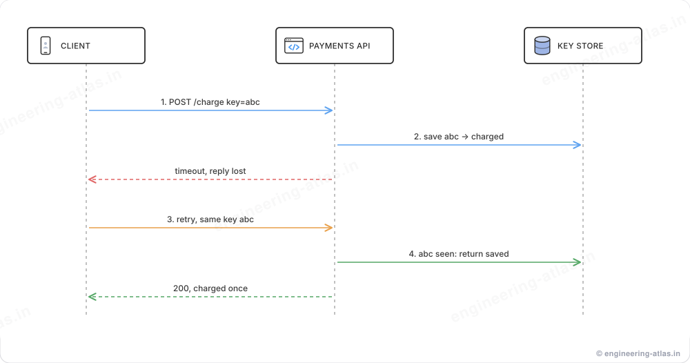

The fix is an **idempotency key**: a unique ID the client creates once per action and sends with every retry. The server stores the key with the result. If the same key arrives again, the server returns the saved result instead of doing the work again.

Details that matter:

- **Store the key and the result together**, ideally in the same transaction as the charge, so a crash can't save one without the other.
- **Handle the in-flight case.** If a retry arrives while the first request is still running, make it wait or return "in progress", not run in parallel.
- **Expire old keys** after a sensible window, such as 24 hours.

### 21. Rate Limiting

<picture><source media="(prefers-color-scheme: dark)" srcset="diagrams/banners/ch-21-dark.svg"></picture>

<a href="https://engineering-atlas.in/system-design/networking/rate-limiting/?utm_source=github&utm_medium=roadmap&utm_campaign=rate-limiting"><picture><source media="(prefers-color-scheme: dark)" srcset="diagrams/banners/btn-chapter-dark.svg"></picture></a>

| | |
|---|---|
| **Why know this** | Rate limits protect your system from abuse, bugs and one noisy customer. "Design a rate limiter" is also a classic interview problem in its own right. |
| **What interviewers test** | Can you compare limiting algorithms and run a shared limiter across many servers? |
| **What you will cover** | Rate limiting algorithms |
| **Try this** | Implement a token bucket that allows 10 requests per second per user, then make it work across two servers with Redis. |
| **Ready to move on when** | You can compare token bucket and sliding window, and say where the counters live when you run 50 API servers. |

| Topic | What it is, and why it matters | Free read |
|---|---|---|
| <a href="https://engineering-atlas.in/system-design/networking/rate-limiting/?utm_source=github&utm_medium=roadmap&utm_campaign=rate-limiting">Rate limiting algorithms</a> <picture><source media="(prefers-color-scheme: dark)" srcset="diagrams/tags/intermediate-dark.svg"></picture> | Token bucket allows short bursts up to a cap. Leaky bucket smooths output. Fixed windows are simple but allow double bursts at the edges; sliding windows fix that at some cost. | <a href="https://stripe.com/blog/rate-limiters">Stripe: Scaling your API with rate limiters</a> |

#### Deep dive: token bucket

Picture a bucket that holds up to 20 tokens and gets 10 new tokens every second. Each request takes one token. If a token is there, the request goes through; if the bucket is empty, the request is rejected with HTTP 429.

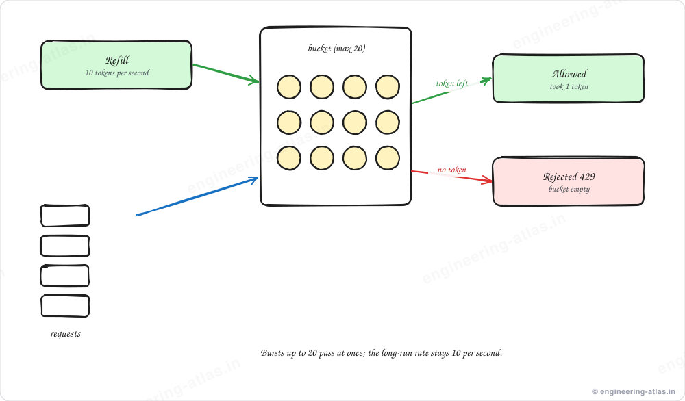

Why it is the most common choice: it allows **short bursts** (up to the bucket size) while holding the **long-run rate** (the refill rate). That matches real users, who click a few times quickly and then pause.

You don't need a timer to refill. Store two numbers per user, tokens and last-refill time, and on each request add `elapsed seconds x rate` tokens (capped at the maximum) before taking one. In Redis, do that read-and-update in one Lua script so two API servers can't both take the last token.

> [!TIP]
> **In the interview.** Say what happens when Redis is slow or down: fail open (allow traffic, risk abuse) or fail closed (reject traffic, risk an outage). Most public APIs fail open with a local fallback limit.

### 22. Search Systems

<picture><source media="(prefers-color-scheme: dark)" srcset="diagrams/banners/ch-22-dark.svg"></picture>

<a href="https://engineering-atlas.in/system-design/search/search-end-to-end/?utm_source=github&utm_medium=roadmap&utm_campaign=search-end-to-end"><picture><source media="(prefers-color-scheme: dark)" srcset="diagrams/banners/btn-chapter-dark.svg"></picture></a>

| | |
|---|---|
| **Why know this** | "Search for products" or "search posts" appears in many designs. A database `LIKE '%term%'` won't do: you need an inverted index, a ranking function and a pipeline that keeps the index fresh. |
| **What interviewers test** | Can you explain an inverted index and how new data reaches search? |
| **What you will cover** | How search engines work (inverted index, BM25) · Search end to end · How Elasticsearch works · Types of search · Choosing a search engine |
| **Try this** | Build an inverted index over 100 short documents by hand in code, and answer a two-word query with it. |
| **Ready to move on when** | You can explain an inverted index, how new data reaches the index, and why search results can lag the database by seconds. |

| Topic | What it is, and why it matters | Free read |
|---|---|---|
| <a href="https://engineering-atlas.in/system-design/search/how-search-engines-work/?utm_source=github&utm_medium=roadmap&utm_campaign=how-search-engines-work">How search engines work (inverted index, BM25)</a> <picture><source media="(prefers-color-scheme: dark)" srcset="diagrams/tags/intermediate-dark.svg"></picture> | Text is broken into terms; each term points to the documents containing it. BM25 ranks matches by how rare and how frequent the terms are. | <a href="https://www.elastic.co/guide/en/elasticsearch/reference/current/full-text-search.html">Elasticsearch docs: How full-text search works</a> |
| <a href="https://engineering-atlas.in/system-design/search/search-end-to-end/?utm_source=github&utm_medium=roadmap&utm_campaign=search-end-to-end">Search end to end</a> <picture><source media="(prefers-color-scheme: dark)" srcset="diagrams/tags/beginner-dark.svg"></picture> | The full journey of a query: parsing, retrieval, ranking, and the indexing pipeline that feeds it. |  |
| <a href="https://engineering-atlas.in/system-design/search/elasticsearch/?utm_source=github&utm_medium=roadmap&utm_campaign=elasticsearch">How Elasticsearch works</a> <picture><source media="(prefers-color-scheme: dark)" srcset="diagrams/tags/advanced-dark.svg"></picture> | Shards, replicas, the refresh interval that makes new documents searchable, and the write and read paths through a cluster. |  |
| <a href="https://engineering-atlas.in/system-design/search/types-of-search/?utm_source=github&utm_medium=roadmap&utm_campaign=types-of-search">Types of search</a> <picture><source media="(prefers-color-scheme: dark)" srcset="diagrams/tags/intermediate-dark.svg"></picture> | Autocomplete, fuzzy, phrase, geo, faceted and vector search each need different index structures. |  |
| <a href="https://engineering-atlas.in/system-design/search/choosing-a-search-engine/?utm_source=github&utm_medium=roadmap&utm_campaign=choosing-a-search-engine">Choosing a search engine</a> <picture><source media="(prefers-color-scheme: dark)" srcset="diagrams/tags/intermediate-dark.svg"></picture> | Elasticsearch, OpenSearch, PostgreSQL full-text or Redis: when the database you already have is enough, and when it is not. |  |

### 23. Distributed Scheduling and Workflows

<picture><source media="(prefers-color-scheme: dark)" srcset="diagrams/banners/ch-23-dark.svg"></picture>

<a href="https://engineering-atlas.in/system-design/common-patterns/?utm_source=github&utm_medium=roadmap&utm_campaign=common-patterns"><picture><source media="(prefers-color-scheme: dark)" srcset="diagrams/banners/btn-chapter-dark.svg"></picture></a>

| | |
|---|---|
| **Why know this** | Reports, reminders, retries and video processing all run later or run long. Doing that reliably across many machines, without running a job twice or never, is its own design problem. |
| **What interviewers test** | Can you run delayed and long jobs reliably, without losing them or running them twice? |
| **What you will cover** | Long-running jobs · Workflow engines (Temporal) · Delayed and recurring jobs |
| **Try this** | Design a job that sends 1 million emails at 9 AM, survives a worker crash, and never sends one twice. |
| **Ready to move on when** | You can design "send a reminder 24 hours before the booking" for 10 million bookings, and say what happens if a worker dies mid-job. |

| Topic | What it is, and why it matters | Free read |
|---|---|---|
| Long-running jobs <picture><source media="(prefers-color-scheme: dark)" srcset="diagrams/tags/intermediate-dark.svg"></picture> | Accept the request, return a job ID, do the work in the background, report progress. The client polls or gets a callback instead of holding a connection open. |  |
| Workflow engines (Temporal) <picture><source media="(prefers-color-scheme: dark)" srcset="diagrams/tags/advanced-dark.svg"></picture> | Durable code that survives crashes: every step is recorded, so a workflow resumes where it stopped. Good for multi-step business processes with retries and timers. | <a href="https://docs.temporal.io/temporal">Temporal docs: What is Temporal?</a> |
| Delayed and recurring jobs <picture><source media="(prefers-color-scheme: dark)" srcset="diagrams/tags/intermediate-dark.svg"></picture> | A time-ordered store of due jobs, polled by workers that claim each job with a lease. Cron at scale is mostly about safe claiming and retries. |  |

### 24. Real-time Communication

<picture><source media="(prefers-color-scheme: dark)" srcset="diagrams/banners/ch-24-dark.svg"></picture>

<a href="https://engineering-atlas.in/system-design/networking/websockets/?utm_source=github&utm_medium=roadmap&utm_campaign=websockets"><picture><source media="(prefers-color-scheme: dark)" srcset="diagrams/banners/btn-chapter-dark.svg"></picture></a>

| | |
|---|---|
| **Why know this** | Chat, live scores, ride tracking and collaborative editing push data to users the moment it changes. Picking the transport and keeping millions of connections alive is a different problem from request-response. |
| **What interviewers test** | Can you pick a real-time transport and route a message to the server holding the user's connection? |
| **What you will cover** | Long polling, SSE and WebSockets · Real-time updates at scale · Presence (online/offline) |
| **Try this** | Build a tiny chat with WebSockets. Then explain what breaks when you run two servers and how you route messages between them. |
| **Ready to move on when** | You can pick between long polling, SSE and WebSockets for chat, a live score and a stock ticker, and say how a message finds the server holding the right connection. |

| Topic | What it is, and why it matters | Free read |
|---|---|---|
| <a href="https://engineering-atlas.in/system-design/networking/websockets/?utm_source=github&utm_medium=roadmap&utm_campaign=websockets">Long polling, SSE and WebSockets</a> <picture><source media="(prefers-color-scheme: dark)" srcset="diagrams/tags/beginner-dark.svg"></picture> | Long polling holds a request open until there is news. Server-sent events stream one way over HTTP. WebSockets give a full two-way channel. Choose the simplest that fits. | <a href="https://developer.mozilla.org/en-US/docs/Web/API/WebSockets_API">MDN: The WebSocket API</a> |
| <a href="https://engineering-atlas.in/system-design/common-patterns/real-time-updates/?utm_source=github&utm_medium=roadmap&utm_campaign=real-time-updates">Real-time updates at scale</a> <picture><source media="(prefers-color-scheme: dark)" srcset="diagrams/tags/intermediate-dark.svg"></picture> | Connections live on gateway servers; a pub/sub layer routes each update to the gateway holding the user's connection. |  |
| Presence (online/offline) <picture><source media="(prefers-color-scheme: dark)" srcset="diagrams/tags/intermediate-dark.svg"></picture> | Heartbeats from clients, a short TTL in a fast store, and fan-out of status changes only to people who care. |  |

### 24b. IDs, Location and Time-series

<picture><source media="(prefers-color-scheme: dark)" srcset="diagrams/banners/ch-24b-dark.svg"></picture>

| | |
|---|---|
| **Why know this** | Three small topics that show up inside many bigger designs: unique IDs without a single counter, "find what is near me", and storing metrics over time. |
| **What interviewers test** | Can you generate unique IDs without coordination and find things near a location? |
| **What you will cover** | Unique ID generation · Geospatial indexes: geohash, quadtrees, S2, H3 · Proximity search · Time-series storage |
| **Try this** | Generate IDs with a Snowflake layout and check they sort by time. Then encode three coordinates as geohashes and compare prefixes. |
| **Ready to move on when** | You can explain how a Snowflake-style ID is built, and how a geohash finds nearby drivers. |

| Topic | What it is, and why it matters | Free read |
|---|---|---|
| <a href="https://engineering-atlas.in/system-design/infrastructure/design-a-unique-id-generator/?utm_source=github&utm_medium=roadmap&utm_campaign=design-a-unique-id-generator">Unique ID generation</a> <picture><source media="(prefers-color-scheme: dark)" srcset="diagrams/tags/intermediate-dark.svg"></picture> | Time-ordered IDs built from a timestamp, a machine ID and a sequence number, generated on each server with no coordination. | <a href="https://discord.com/developers/docs/reference#snowflakes">Discord docs: Snowflakes</a> |
| <a href="https://engineering-atlas.in/system-design/database-fundamentals/geospatial-indexes/?utm_source=github&utm_medium=roadmap&utm_campaign=geospatial-indexes">Geospatial indexes: geohash, quadtrees, S2, H3</a> <picture><source media="(prefers-color-scheme: dark)" srcset="diagrams/tags/intermediate-dark.svg"></picture> | Turn a 2D location into keys that keep nearby places close, so "within 2 km" becomes a few index lookups instead of a scan. | <a href="https://www.uber.com/blog/h3/">Uber Engineering: H3, Uber's hexagonal hierarchical spatial index</a> |
| <a href="https://engineering-atlas.in/system-design/common-patterns/proximity-search/?utm_source=github&utm_medium=roadmap&utm_campaign=proximity-search">Proximity search</a> <picture><source media="(prefers-color-scheme: dark)" srcset="diagrams/tags/intermediate-dark.svg"></picture> | The pattern behind "drivers near me": index locations, query neighbouring cells, then filter by exact distance. |  |
| Time-series storage <picture><source media="(prefers-color-scheme: dark)" srcset="diagrams/tags/intermediate-dark.svg"></picture> | Append-mostly data keyed by time: compress hard, downsample old points, drop by time range. Purpose-built stores do this far better than a general database. |  |

### Can you answer these?

1. Users see stale prices for a minute after a price change. Which caching strategy caused it, and how would you fix it without losing the cache?
2. A celebrity posts and one Redis node melts. What is happening, and what are two fixes?
3. Pick a shard key for an orders table in an online store. What query becomes hard with your choice?
4. A payment message is delivered twice. How do you make sure the customer is charged once?
5. Design rate limiting for an API served by 50 servers. Where do the counters live, and what happens if that store is slow?
6. Users upload 2 GB videos. Trace the upload path so your app servers never touch the bytes.

> [!TIP]
> **Unlocked: you can now solve** <a href="https://engineering-atlas.in/system-design/infrastructure/design-a-rate-limiter/?utm_source=github&utm_medium=roadmap&utm_campaign=design-a-rate-limiter">Rate limiter</a> · <a href="https://engineering-atlas.in/system-design/search-discovery/design-typeahead/?utm_source=github&utm_medium=roadmap&utm_campaign=design-typeahead">Typeahead</a> · <a href="https://engineering-atlas.in/system-design/search-discovery/design-web-crawler/?utm_source=github&utm_medium=roadmap&utm_campaign=design-web-crawler">Web crawler</a> · <a href="https://engineering-atlas.in/system-design/infrastructure/design-a-distributed-cache/?utm_source=github&utm_medium=roadmap&utm_campaign=design-a-distributed-cache">Distributed cache</a> · <a href="https://engineering-atlas.in/system-design/storage-media/design-dropbox-google-drive/?utm_source=github&utm_medium=roadmap&utm_campaign=design-dropbox-google-drive">Dropbox</a> · <a href="https://engineering-atlas.in/system-design/storage-media/design-youtube/?utm_source=github&utm_medium=roadmap&utm_campaign=design-youtube">YouTube</a> · <a href="https://engineering-atlas.in/system-design/real-time/design-a-live-leaderboard/?utm_source=github&utm_medium=roadmap&utm_campaign=design-a-live-leaderboard">Live leaderboard</a> · <a href="https://engineering-atlas.in/system-design/infrastructure/design-a-cdn/?utm_source=github&utm_medium=roadmap&utm_campaign=design-a-cdn">CDN like Cloudflare</a>

> [!NOTE]
> **Prep progress.** Finish this part and you are about **45%** of the way to interview ready.
>
> 

**Continue learning on Engineering Atlas:** [Caching module](https://engineering-atlas.in/system-design/caching/?utm_source=github&utm_medium=roadmap&utm_campaign=caching) · [Messaging and streams module](https://engineering-atlas.in/system-design/async/?utm_source=github&utm_medium=roadmap&utm_campaign=async) · [HLD roadmap](https://engineering-atlas.in/system-design/roadmap/?utm_source=github&utm_medium=roadmap&utm_campaign=roadmap)

<a href="#contents">Back to contents ↑</a>

## Part IV: Distributed systems engineering

<picture><source media="(prefers-color-scheme: dark)" srcset="diagrams/banners/part-4-dark.svg">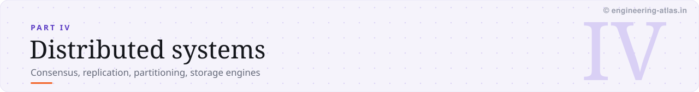</picture>

*What happens below the boxes.* Part III taught you which components to draw. This part explains how they agree, copy data and survive when machines disagree. It is what senior and staff rounds probe once the high-level design is on the board.

### 25. Distributed Coordination

<picture><source media="(prefers-color-scheme: dark)" srcset="diagrams/banners/ch-25-dark.svg"></picture>

<a href="https://engineering-atlas.in/system-design/distributed-systems/?utm_source=github&utm_medium=roadmap&utm_campaign=distributed-systems"><picture><source media="(prefers-color-scheme: dark)" srcset="diagrams/banners/btn-chapter-dark.svg"></picture></a>

| | |
|---|---|
| **Why know this** | Some jobs must happen exactly once across many machines: one leader, one holder of a lock, one owner of a shard. Getting that wrong gives you two primaries writing at once, which is one of the worst failures a system can have. |
| **What interviewers test** | Do you know why a simple lock is unsafe across machines, and what makes it safe? |
| **What you will cover** | Distributed locking · ZooKeeper and etcd |
| **Try this** | Use a lease with a fencing token to protect a shared file. Show what goes wrong without the token after a long GC pause. |
| **Ready to move on when** | You can explain why a Redis lock with a timeout is not safe on its own, and what a fencing token adds. |

| Topic | What it is, and why it matters | Free read |
|---|---|---|
| <a href="https://engineering-atlas.in/system-design/distributed-systems/distributed-locking/?utm_source=github&utm_medium=roadmap&utm_campaign=distributed-locking">Distributed locking</a> <picture><source media="(prefers-color-scheme: dark)" srcset="diagrams/tags/advanced-dark.svg"></picture> | A distributed lock lets only one process across many machines work on a resource at a time. It matters because a paused or slow holder can lose its lock without knowing, so safe designs pair the lock with a fencing token that the storage layer checks. | <a href="https://martin.kleppmann.com/2016/02/08/how-to-do-distributed-locking.html">Martin Kleppmann: How to do distributed locking</a> |
| ZooKeeper and etcd <picture><source media="(prefers-color-scheme: dark)" srcset="diagrams/tags/advanced-dark.svg"></picture> | Coordination services: small, strongly consistent key-value stores built on consensus. They matter because leader election, service config and locks need one source of truth that survives node failures, and these give it to you instead of you building it. | <a href="https://etcd.io/docs/latest/">etcd docs: What is etcd?</a> |

### 26. Consensus

<picture><source media="(prefers-color-scheme: dark)" srcset="diagrams/banners/ch-26-dark.svg"></picture>

<a href="https://engineering-atlas.in/system-design/distributed-systems/consensus-algorithms/?utm_source=github&utm_medium=roadmap&utm_campaign=consensus-algorithms"><picture><source media="(prefers-color-scheme: dark)" srcset="diagrams/banners/btn-chapter-dark.svg"></picture></a>

| | |
|---|---|
| **Why know this** | Consensus is how a group of machines agrees on one value, such as who the leader is or what the next log entry says, even when some of them crash. Replicated databases, Kafka's controller and Kubernetes' etcd all depend on it. |
| **What interviewers test** | Can you explain quorums, leader election and what happens to writes while there is no leader? |
| **What you will cover** | Consensus and leader election (Raft, Paxos) |
| **Try this** | Play Raft by hand with five nodes on paper: elect a leader, replicate one entry, then kill the leader and elect again. |
| **Ready to move on when** | You can explain why a 5-node cluster survives 2 failures but not 3, and what happens to writes during a leader election. |

| Topic | What it is, and why it matters | Free read |
|---|---|---|
| <a href="https://engineering-atlas.in/system-design/distributed-systems/consensus-algorithms/?utm_source=github&utm_medium=roadmap&utm_campaign=consensus-algorithms">Consensus and leader election (Raft, Paxos)</a> <picture><source media="(prefers-color-scheme: dark)" srcset="diagrams/tags/advanced-dark.svg"></picture> | Consensus algorithms make a majority of nodes agree on an ordered log of decisions. They matter because a majority (a quorum) can always overlap with the previous majority, so a decision once made is never lost, even across leader changes. | <a href="https://raft.github.io/raft.pdf">Ongaro and Ousterhout: In Search of an Understandable Consensus Algorithm (Raft paper)</a> |

### 27. Distributed Transactions

<picture><source media="(prefers-color-scheme: dark)" srcset="diagrams/banners/ch-27-dark.svg"></picture>

<a href="https://engineering-atlas.in/system-design/distributed-systems/distributed-transactions/?utm_source=github&utm_medium=roadmap&utm_campaign=distributed-transactions"><picture><source media="(prefers-color-scheme: dark)" srcset="diagrams/banners/btn-chapter-dark.svg"></picture></a>

| | |
|---|---|
| **Why know this** | An order touches payments, inventory and shipping, each with its own database. You can't wrap them in one ACID transaction, so you need another way to keep them consistent, and interviewers want to hear which one and why. |
| **What interviewers test** | Can you keep data consistent across services with sagas and the outbox, and name the compensations? |
| **What you will cover** | Two-phase commit vs sagas · Transactional outbox · Orchestration vs choreography |
| **Try this** | Write the steps of an order saga across order, payment and inventory, including the compensating action for each step. |
| **Ready to move on when** | You can design "place order" across three services with a saga, name the compensating steps, and explain why the outbox pattern is needed to publish events safely. |

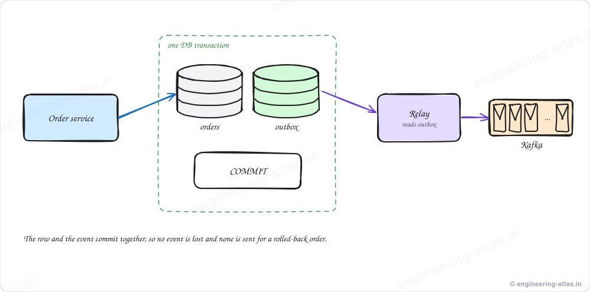

> [!WARNING]
> **Where candidates slip.** Writing to the database and then publishing to Kafka as two separate steps. If the service crashes between them, the order exists but nobody hears about it. The outbox closes that gap.

| Topic | What it is, and why it matters | Free read |
|---|---|---|
| <a href="https://engineering-atlas.in/system-design/distributed-systems/distributed-transactions/?utm_source=github&utm_medium=roadmap&utm_campaign=distributed-transactions">Two-phase commit vs sagas</a> <picture><source media="(prefers-color-scheme: dark)" srcset="diagrams/tags/advanced-dark.svg"></picture> | Two-phase commit asks every participant to prepare, then commits all or none. A saga runs local transactions one by one and undoes finished steps with compensating actions if a later step fails. 2PC gives atomicity but blocks when the coordinator fails; sagas stay available but are only eventually consistent. | <a href="https://www.cs.cornell.edu/andru/cs711/2002fa/reading/sagas.pdf">Garcia-Molina and Salem: Sagas (1987)</a> |
| <a href="https://engineering-atlas.in/system-design/async/transactional-outbox/?utm_source=github&utm_medium=roadmap&utm_campaign=transactional-outbox">Transactional outbox</a> <picture><source media="(prefers-color-scheme: dark)" srcset="diagrams/tags/advanced-dark.svg"></picture> | The outbox pattern writes the business row and an event row in the same local transaction, then a separate relay publishes the event. It matters because it removes the "saved but never announced" bug without needing a distributed transaction. | <a href="https://microservices.io/patterns/data/transactional-outbox.html">microservices.io: Transactional outbox</a> |
| <a href="https://engineering-atlas.in/system-design/common-patterns/multi-step-workflows/?utm_source=github&utm_medium=roadmap&utm_campaign=multi-step-workflows">Orchestration vs choreography</a> <picture><source media="(prefers-color-scheme: dark)" srcset="diagrams/tags/advanced-dark.svg"></picture> | Orchestration has one coordinator tell each service what to do next. Choreography lets services react to each other's events. Orchestration is easier to follow and debug; choreography couples services less but hides the overall flow. |  |

#### Deep dive: a saga, step by step

Placing an order touches three services: orders, payments and inventory. Each has its own database, so there is no single transaction across them. A **saga** runs each service's local transaction in order, and if a later step fails, it runs **compensating actions** to undo the earlier ones.

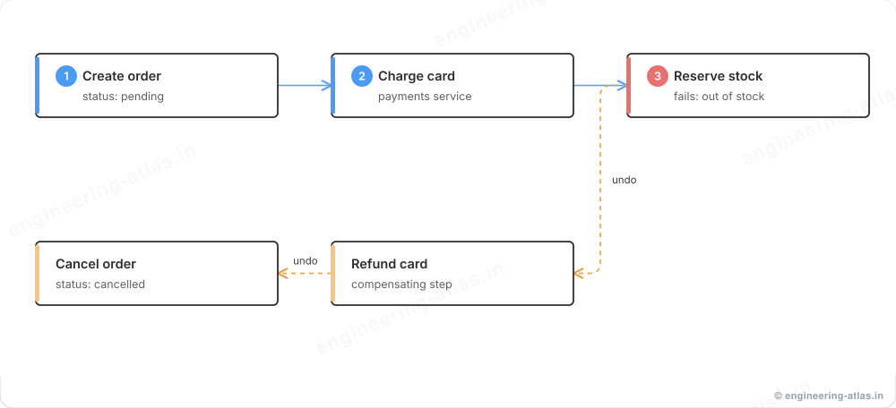

Here, the order is created and the card is charged, then stock reservation fails. The saga refunds the card and cancels the order. The customer briefly sees a pending order, which is the price of not locking three databases together.

Two things make sagas safe in practice:

- **Every step and every compensation must be idempotent**, because messages can be delivered twice.
- **Compensation is a business action, not a rollback.** A refund is a new transaction with its own record; the original charge still happened.

### 28. Replication Internals

<picture><source media="(prefers-color-scheme: dark)" srcset="diagrams/banners/ch-28-dark.svg"></picture>

<a href="https://engineering-atlas.in/system-design/common-patterns/reliable-writes-at-scale/?utm_source=github&utm_medium=roadmap&utm_campaign=reliable-writes-at-scale"><picture><source media="(prefers-color-scheme: dark)" srcset="diagrams/banners/btn-chapter-dark.svg"></picture></a>

| | |
|---|---|
| **Why know this** | Chapter 17 introduced replicas. This chapter is about the promises: when is a write really safe, what happens to reads when replicas disagree, and how leaderless stores like Cassandra stay correct. |
| **What interviewers test** | Can you tune reads and writes with quorums and say when an acknowledged write is really safe? |
| **What you will cover** | Quorums and leaderless replication · Writes you can trust: durability and replication · Secondary indexes on sharded data |
| **Try this** | Set up a primary and a replica. Measure replication lag under a write burst, then fail over and count lost writes. |
| **Ready to move on when** | You can explain what R + W > N buys you, and why it still doesn't make a leaderless store linearizable. |

| Topic | What it is, and why it matters | Free read |
|---|---|---|
| <a href="https://engineering-atlas.in/system-design/database-fundamentals/quorums/?utm_source=github&utm_medium=roadmap&utm_campaign=quorums">Quorums and leaderless replication</a> <picture><source media="(prefers-color-scheme: dark)" srcset="diagrams/tags/advanced-dark.svg"></picture> | In a leaderless store, a write goes to W replicas and a read asks R replicas, out of N copies. When R + W > N the read set overlaps the write set, so a read normally sees the latest write. It matters because it lets you tune each request between speed and safety. | <a href="https://www.allthingsdistributed.com/files/amazon-dynamo-sosp2007.pdf">Amazon: Dynamo, Amazon's highly available key-value store (SOSP 2007)</a> |
| <a href="https://engineering-atlas.in/system-design/common-patterns/reliable-writes-at-scale/?utm_source=github&utm_medium=roadmap&utm_campaign=reliable-writes-at-scale">Writes you can trust: durability and replication</a> <picture><source media="(prefers-color-scheme: dark)" srcset="diagrams/tags/advanced-dark.svg"></picture> | A durable write is one that survives crashes: it is on disk, on enough replicas, or both, before the client hears "OK". It matters because "acknowledged" and "safe" are different things, and the gap is where data loss incidents come from. |  |
| <a href="https://engineering-atlas.in/system-design/database-fundamentals/secondary-indexes-sharded/?utm_source=github&utm_medium=roadmap&utm_campaign=secondary-indexes-sharded">Secondary indexes on sharded data</a> <picture><source media="(prefers-color-scheme: dark)" srcset="diagrams/tags/advanced-dark.svg"></picture> | A secondary index lets you search by a field other than the shard key. Local indexes live with each shard and force reads to ask every shard; global indexes are partitioned separately and make writes touch two places. It matters because "find orders by email" on a table sharded by user ID is a common follow-up. |  |

### 29. Distributed Consistency

<picture><source media="(prefers-color-scheme: dark)" srcset="diagrams/banners/ch-29-dark.svg"></picture>

<a href="https://engineering-atlas.in/system-design/distributed-systems/clocks-and-ordering/?utm_source=github&utm_medium=roadmap&utm_campaign=clocks-and-ordering"><picture><source media="(prefers-color-scheme: dark)" srcset="diagrams/banners/btn-chapter-dark.svg"></picture></a>

| | |
|---|---|
| **Why know this** | Machines don't share a clock, so "which write happened last?" has no easy answer. Last-write-wins silently drops data; vector clocks and CRDTs keep it. Collaborative apps and multi-region writes live or die on this. |
| **What interviewers test** | Do you know why wall clocks can't order events, and how conflicts get resolved? |
| **What you will cover** | Clocks, ordering and conflict resolution · CRDTs |
| **Try this** | With N=3, choose R and W so reads always see the latest write. Then pick values that favour write availability instead. |
| **Ready to move on when** | You can explain why wall-clock timestamps are unsafe for ordering, and what a CRDT lets two offline users do. |

| Topic | What it is, and why it matters | Free read |
|---|---|---|
| <a href="https://engineering-atlas.in/system-design/distributed-systems/clocks-and-ordering/?utm_source=github&utm_medium=roadmap&utm_campaign=clocks-and-ordering">Clocks, ordering and conflict resolution</a> <picture><source media="(prefers-color-scheme: dark)" srcset="diagrams/tags/advanced-dark.svg"></picture> | Physical clocks drift; logical clocks (Lamport, vector clocks) order events by cause instead of time. It matters because conflict resolution needs a correct "happened before", and wall clocks can't give one. | <a href="https://lamport.azurewebsites.net/pubs/time-clocks.pdf">Leslie Lamport: Time, Clocks, and the Ordering of Events (1978)</a> |
| CRDTs <picture><source media="(prefers-color-scheme: dark)" srcset="diagrams/tags/advanced-dark.svg"></picture> | Conflict-free replicated data types are data structures (counters, sets, text) that any replica can update on its own and that always merge to the same result. They matter because they let offline edits and multi-region writes merge without coordination. | <a href="https://crdt.tech/">crdt.tech: Resources on CRDTs</a> |

### 30. Partitioning Strategies

<picture><source media="(prefers-color-scheme: dark)" srcset="diagrams/banners/ch-30-dark.svg"></picture>

<a href="https://engineering-atlas.in/system-design/core-concepts/consistent-hashing/?utm_source=github&utm_medium=roadmap&utm_campaign=consistent-hashing"><picture><source media="(prefers-color-scheme: dark)" srcset="diagrams/banners/btn-chapter-dark.svg"></picture></a>

| | |
|---|---|
| **Why know this** | Every large store splits data across machines. How you split it decides whether load spreads evenly, whether range queries work, and how much data moves when you add a node. |
| **What interviewers test** | Can you choose a partitioning scheme and explain what moves when you add a node? |
| **What you will cover** | Consistent hashing and virtual nodes · Hash vs range partitioning |
| **Try this** | Compare hash and range partitioning for a time-ordered events table. Show which one creates a hot partition and why. |
| **Ready to move on when** | You can explain why `hash(key) % N` breaks when N changes, and how virtual nodes fix uneven load on a ring. |

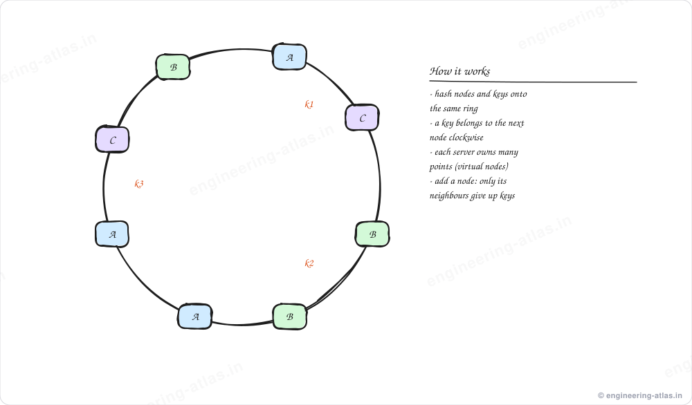

| Topic | What it is, and why it matters | Free read |
|---|---|---|
| <a href="https://engineering-atlas.in/system-design/core-concepts/consistent-hashing/?utm_source=github&utm_medium=roadmap&utm_campaign=consistent-hashing">Consistent hashing and virtual nodes</a> <picture><source media="(prefers-color-scheme: dark)" srcset="diagrams/tags/intermediate-dark.svg"></picture> | Consistent hashing places nodes and keys on a ring, and each key belongs to the next node clockwise. It matters because adding or removing one node only moves about 1/N of the keys, instead of nearly all of them with plain modulo hashing. | <a href="https://www.cs.princeton.edu/courses/archive/fall09/cos518/papers/chash.pdf">Karger et al.: Consistent Hashing and Random Trees (1997)</a> |
| Hash vs range partitioning <picture><source media="(prefers-color-scheme: dark)" srcset="diagrams/tags/intermediate-dark.svg"></picture> | Hash partitioning spreads keys evenly but scatters ranges; range partitioning keeps keys in order so scans are fast, but recent or popular ranges get hot. It matters because the choice decides which queries stay on one machine. |  |

#### Deep dive: why consistent hashing moves so few keys

With plain `hash(key) % N`, going from 4 to 5 servers changes the result for about 80% of keys, so nearly the whole cache goes cold at once.

Consistent hashing puts servers and keys on the same circle of hash values. A key belongs to the first server found clockwise from it. When a server joins, it only takes the keys between itself and the server before it; every other key stays put. On average only about 1/N of keys move.

With one point per server, the gaps on the circle are uneven, so some servers own far more keys than others. **Virtual nodes** fix that: each server is placed at many points (often 100 or more), which evens out the load and spreads a failed server's keys across all the others instead of dumping them on one neighbour.

### 31. Gossip Protocols

<picture><source media="(prefers-color-scheme: dark)" srcset="diagrams/banners/ch-31-dark.svg"></picture>

<a href="https://engineering-atlas.in/system-design/distributed-systems/gossip-protocol/?utm_source=github&utm_medium=roadmap&utm_campaign=gossip-protocol"><picture><source media="(prefers-color-scheme: dark)" srcset="diagrams/banners/btn-chapter-dark.svg"></picture></a>

| | |
|---|---|
| **Why know this** | In a cluster of hundreds of nodes, nobody can check everyone. Gossip spreads membership and failure news peer to peer, the way rumours spread, and it is how Cassandra and many service meshes know who is alive. |
| **What interviewers test** | Can you explain how large clusters track membership and detect failures without a coordinator? |
| **What you will cover** | Gossip protocol |
| **Try this** | Simulate gossip among 100 nodes in a short script and count rounds until all of them know about one failure. |
| **Ready to move on when** | You can explain why gossip reaches all N nodes in about log(N) rounds, and why it is eventually consistent. |

| Topic | What it is, and why it matters | Free read |
|---|---|---|
| <a href="https://engineering-atlas.in/system-design/distributed-systems/gossip-protocol/?utm_source=github&utm_medium=roadmap&utm_campaign=gossip-protocol">Gossip protocol</a> <picture><source media="(prefers-color-scheme: dark)" srcset="diagrams/tags/advanced-dark.svg"></picture> | Each node periodically shares what it knows with a few random peers, and the news spreads exponentially. It matters because it scales to large clusters with no central coordinator, at the cost of a short delay before everyone agrees. | <a href="https://www.cs.cornell.edu/projects/Quicksilver/public_pdfs/SWIM.pdf">Das, Gupta and Motivala: SWIM (2002)</a> |

### 32. Distributed Computing

<picture><source media="(prefers-color-scheme: dark)" srcset="diagrams/banners/ch-32-dark.svg"></picture>

<a href="https://engineering-atlas.in/system-design/key-technologies/mapreduce-and-spark/?utm_source=github&utm_medium=roadmap&utm_campaign=mapreduce-and-spark"><picture><source media="(prefers-color-scheme: dark)" srcset="diagrams/banners/btn-chapter-dark.svg"></picture></a>

| | |
|---|---|
| **Why know this** | When the data is bigger than one machine, you move the computation to the data instead. MapReduce and Spark are how analytics, ML features and nightly reports run over terabytes. |
| **What interviewers test** | Can you split a big batch job into map, shuffle and reduce and say where it is slow? |
| **What you will cover** | MapReduce and Spark |
| **Try this** | Write word count as map and reduce functions, then explain where the shuffle happens and why it is the expensive part. |
| **Ready to move on when** | You can describe map, shuffle and reduce for "count words in a petabyte of logs", and say where the time goes. |

| Topic | What it is, and why it matters | Free read |
|---|---|---|
| <a href="https://engineering-atlas.in/system-design/key-technologies/mapreduce-and-spark/?utm_source=github&utm_medium=roadmap&utm_campaign=mapreduce-and-spark">MapReduce and Spark</a> <picture><source media="(prefers-color-scheme: dark)" srcset="diagrams/tags/intermediate-dark.svg"></picture> | MapReduce splits a job into a map step that runs where the data lives and a reduce step that combines results after a shuffle. Spark keeps intermediate data in memory and chains many steps. It matters because data locality and the shuffle decide the cost of every big-data job. | <a href="https://research.google/pubs/mapreduce-simplified-data-processing-on-large-clusters/">Dean and Ghemawat: MapReduce (OSDI 2004)</a> |

### 33. Stream Processing

<picture><source media="(prefers-color-scheme: dark)" srcset="diagrams/banners/ch-33-dark.svg"></picture>

<a href="https://engineering-atlas.in/system-design/async/stream-processing/?utm_source=github&utm_medium=roadmap&utm_campaign=stream-processing"><picture><source media="(prefers-color-scheme: dark)" srcset="diagrams/banners/btn-chapter-dark.svg"></picture></a>

| | |
|---|---|
| **Why know this** | Fraud checks, live dashboards and trending topics need answers in seconds, not tomorrow. Stream processing computes over events as they arrive, and it brings hard questions about late data and double counting. |
| **What interviewers test** | Do you handle late and duplicate events correctly in streaming results? |
| **What you will cover** | Event time, windows and joins · Flink · Change data capture (CDC) |
| **Try this** | Count clicks per page in 1-minute tumbling windows from a stream, and decide how you handle an event that arrives 5 minutes late. |
| **Ready to move on when** | You can explain event time vs processing time, and what a watermark decides. |

| Topic | What it is, and why it matters | Free read |
|---|---|---|
| <a href="https://engineering-atlas.in/system-design/async/stream-processing/?utm_source=github&utm_medium=roadmap&utm_campaign=stream-processing">Event time, windows and joins</a> <picture><source media="(prefers-color-scheme: dark)" srcset="diagrams/tags/advanced-dark.svg"></picture> | Stream processors group endless events into windows (tumbling, sliding, session) by when they happened, not when they arrived. Watermarks say "no older events are coming", so a window can close. It matters because mobile and network delays make late events normal. | <a href="https://research.google/pubs/the-dataflow-model-a-practical-approach-to-balancing-correctness-latency-and-cost-in-massive-scale-unbounded-out-of-order-data-processing/">Akidau et al.: The Dataflow Model (VLDB 2015)</a> |
| <a href="https://engineering-atlas.in/system-design/key-technologies/flink-and-stream-processing/?utm_source=github&utm_medium=roadmap&utm_campaign=flink-and-stream-processing">Flink</a> <picture><source media="(prefers-color-scheme: dark)" srcset="diagrams/tags/advanced-dark.svg"></picture> | Apache Flink is a stream processor with managed state and checkpoints, giving exactly-once results inside the job. It matters because it is the common answer for "aggregate clicks per ad per minute, correctly". | <a href="https://nightlies.apache.org/flink/flink-docs-stable/docs/concepts/stateful-stream-processing/">Apache Flink docs: Stateful stream processing</a> |
| Change data capture (CDC) <picture><source media="(prefers-color-scheme: dark)" srcset="diagrams/tags/advanced-dark.svg"></picture> | CDC reads a database's change log and turns every insert, update and delete into an event. It matters because it keeps caches, search indexes and warehouses in sync with the database without dual writes from the app. | <a href="https://debezium.io/documentation/reference/stable/architecture.html">Debezium docs: Architecture</a> |

### 34. Storage Engines and Probabilistic Structures

<picture><source media="(prefers-color-scheme: dark)" srcset="diagrams/banners/ch-34-dark.svg"></picture>

<a href="https://engineering-atlas.in/system-design/search/reads-and-writes/?utm_source=github&utm_medium=roadmap&utm_campaign=reads-and-writes"><picture><source media="(prefers-color-scheme: dark)" srcset="diagrams/banners/btn-chapter-dark.svg"></picture></a>

| | |
|---|---|
| **Why know this** | "Why is Cassandra fast at writes and PostgreSQL good at reads?" is answered here. Knowing B-trees, LSM trees and the write-ahead log lets you pick stores for a reason, and the probabilistic structures solve "have I seen this?" in a few bytes. |
| **What interviewers test** | Can you explain why a store is fast at writes or reads from how it stores data? |
| **What you will cover** | WAL, B-trees and LSM trees · B-tree, LSM, Bloom filter, inverted index · MVCC, vacuum and bloat · Bloom filters · Count-min sketch and HyperLogLog |
| **Try this** | Add 1 million items to a Bloom filter sized for 1% false positives. Measure the real false-positive rate. |
| **Ready to move on when** | You can compare a B-tree and an LSM tree on write cost, read cost and space, and say when a Bloom filter saves a disk read. |

| Topic | What it is, and why it matters | Free read |
|---|---|---|
| <a href="https://engineering-atlas.in/system-design/search/reads-and-writes/?utm_source=github&utm_medium=roadmap&utm_campaign=reads-and-writes">WAL, B-trees and LSM trees</a> <picture><source media="(prefers-color-scheme: dark)" srcset="diagrams/tags/advanced-dark.svg"></picture> | A write-ahead log records every change before it is applied, so a crash can be replayed. B-trees update pages in place and read fast; LSM trees append to memory and sorted files, then merge them, which makes writes fast and reads a bit slower. It matters because it explains the read and write profile of every database you will pick. | <a href="https://www.cs.umb.edu/~poneil/lsmtree.pdf">O'Neil et al.: The Log-Structured Merge-Tree (1996)</a> |
| <a href="https://engineering-atlas.in/system-design/search/data-structures/?utm_source=github&utm_medium=roadmap&utm_campaign=data-structures">B-tree, LSM, Bloom filter, inverted index</a> <picture><source media="(prefers-color-scheme: dark)" srcset="diagrams/tags/advanced-dark.svg"></picture> | The four structures behind most databases and search engines, side by side. It matters because almost every storage question reduces to one of them. |  |
| <a href="https://engineering-atlas.in/system-design/database-fundamentals/mvcc/?utm_source=github&utm_medium=roadmap&utm_campaign=mvcc">MVCC, vacuum and bloat</a> <picture><source media="(prefers-color-scheme: dark)" srcset="diagrams/tags/advanced-dark.svg"></picture> | Multi-version concurrency control keeps old row versions so readers never block writers. It matters because those old versions pile up, and cleaning them (vacuum in PostgreSQL) is a real operational cost. | <a href="https://www.postgresql.org/docs/current/mvcc-intro.html">PostgreSQL docs: Concurrency control</a> |
| <a href="https://engineering-atlas.in/system-design/database-fundamentals/bloom-filters/?utm_source=github&utm_medium=roadmap&utm_campaign=bloom-filters">Bloom filters</a> <picture><source media="(prefers-color-scheme: dark)" srcset="diagrams/tags/intermediate-dark.svg"></picture> | A Bloom filter is a small bit array that answers "definitely not present" or "maybe present". It matters because one in-memory check can skip a disk read, which is why LSM stores keep one per file. |  |
| <a href="https://engineering-atlas.in/system-design/database-fundamentals/count-min-and-hyperloglog/?utm_source=github&utm_medium=roadmap&utm_campaign=count-min-and-hyperloglog">Count-min sketch and HyperLogLog</a> <picture><source media="(prefers-color-scheme: dark)" srcset="diagrams/tags/advanced-dark.svg"></picture> | Count-min sketch estimates how often each item appears; HyperLogLog estimates how many distinct items there are, using a few kilobytes. They matter because exact counts over billions of events cost too much memory, and a 1 to 2% error is usually fine. | <a href="https://redis.io/docs/latest/develop/data-types/probabilistic/hyperloglogs/">Redis docs: HyperLogLog</a> |

### Can you answer these?

1. A job must run on exactly one of 10 servers. Design leader election, and explain what happens when the leader pauses for 30 seconds.
2. Place an order across payments, inventory and shipping. Write the saga steps and the compensating actions.
3. Why does an `UPDATE` followed by `kafka.send()` lose events, and how does the outbox fix it?
4. With N = 3 replicas, choose R and W for a shopping cart and for a bank balance. Explain each choice.
5. You add a 5th cache node. With modulo hashing, how many keys move? With consistent hashing?
6. Why are LSM-tree stores good for write-heavy workloads, and what do they pay for it on reads?

> [!TIP]
> **Unlocked: you can now solve** <a href="https://engineering-atlas.in/system-design/infrastructure/design-a-key-value-store/?utm_source=github&utm_medium=roadmap&utm_campaign=design-a-key-value-store">Key-value store</a> · <a href="https://engineering-atlas.in/system-design/infrastructure/design-a-distributed-message-queue/?utm_source=github&utm_medium=roadmap&utm_campaign=design-a-distributed-message-queue">Distributed message queue (Kafka)</a> · <a href="https://engineering-atlas.in/system-design/payments/design-a-payment-system/?utm_source=github&utm_medium=roadmap&utm_campaign=design-a-payment-system">Payment system</a> · <a href="https://engineering-atlas.in/system-design/ecommerce/design-ticketmaster-bookmyshow/?utm_source=github&utm_medium=roadmap&utm_campaign=design-ticketmaster-bookmyshow">BookMyShow</a> · <a href="https://engineering-atlas.in/system-design/data-analytics/design-top-k-trending/?utm_source=github&utm_medium=roadmap&utm_campaign=design-top-k-trending">Top-K trending</a> · <a href="https://engineering-atlas.in/system-design/data-analytics/design-change-data-capture/?utm_source=github&utm_medium=roadmap&utm_campaign=design-change-data-capture">Change data capture</a>

> [!NOTE]
> **Prep progress.** Finish this part and you are about **55%** of the way to interview ready.
>
> 

**Continue learning on Engineering Atlas:** [Distributed systems module](https://engineering-atlas.in/system-design/distributed-systems/?utm_source=github&utm_medium=roadmap&utm_campaign=distributed-systems) · [HLD roadmap](https://engineering-atlas.in/system-design/roadmap/?utm_source=github&utm_medium=roadmap&utm_campaign=roadmap)

<a href="#contents">Back to contents ↑</a>

## Part V: Resilience, recovery and production

<picture><source media="(prefers-color-scheme: dark)" srcset="diagrams/banners/part-5-dark.svg">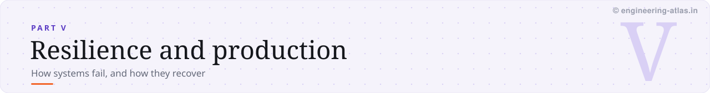</picture>

*How systems fail, and the habits that keep a bad hour from becoming a bad week.* Anyone can draw boxes. This part is what you learn from being on call: dependencies get slow, retries pile up, a region goes dark, a deploy goes wrong. Senior interviews spend a lot of time here, and so should you.

### 35. Failure Modes

<picture><source media="(prefers-color-scheme: dark)" srcset="diagrams/banners/ch-35-dark.svg"></picture>

<a href="https://engineering-atlas.in/distributed-systems/backend-failure-modes.html?utm_source=github&utm_medium=roadmap&utm_campaign=backend-failure-modes"><picture><source media="(prefers-color-scheme: dark)" srcset="diagrams/banners/btn-chapter-dark.svg"></picture></a>

| | |
|---|---|
| **Why know this** | Most outages are not one machine dying. They are a slow dependency that fills every thread pool, then every caller's thread pool, until the whole site is down. You can't defend against failures you can't name. |
| **What interviewers test** | Can you explain how one slow dependency takes down services that never call it? |
| **What you will cover** | Backend under load: eight failure modes · Blocked threads and resource anti-patterns · Cascading failure |
| **Try this** | Draw how one slow dependency at 10 seconds of latency exhausts a thread pool and takes down an unrelated endpoint. |
| **Ready to move on when** | You can explain how one slow database query can take down three services that never touch that database. |

| Topic | What it is, and why it matters | Free read |
|---|---|---|
| <a href="https://engineering-atlas.in/distributed-systems/backend-failure-modes.html?utm_source=github&utm_medium=roadmap&utm_campaign=backend-failure-modes">Backend under load: eight failure modes</a> <picture><source media="(prefers-color-scheme: dark)" srcset="diagrams/tags/intermediate-dark.svg"></picture> | A failure mode is a repeatable way a system breaks: overload, slow dependencies, retry storms, resource exhaustion and more. Knowing the list matters because each one has a known defence, and design reviews are mostly about checking you have them. |  |
| <a href="https://engineering-atlas.in/system-design/anti-patterns/thread-and-resource-anti-patterns/?utm_source=github&utm_medium=roadmap&utm_campaign=thread-and-resource-anti-patterns">Blocked threads and resource anti-patterns</a> <picture><source media="(prefers-color-scheme: dark)" srcset="diagrams/tags/intermediate-dark.svg"></picture> | Synchronous calls hold a thread while they wait. When a dependency slows down, threads pile up until none are free. It matters because thread and connection pools are where slowness turns into an outage. |  |
| Cascading failure <picture><source media="(prefers-color-scheme: dark)" srcset="diagrams/tags/advanced-dark.svg"></picture> | A cascading failure is one component's trouble spreading to others through shared load or dependencies. It matters because it turns a small incident into a full outage, and timeouts, load shedding and isolation are the brakes. | <a href="https://sre.google/sre-book/addressing-cascading-failures/">Google SRE book: Addressing cascading failures</a> |

### 36. Circuit Breakers

<picture><source media="(prefers-color-scheme: dark)" srcset="diagrams/banners/ch-36-dark.svg"></picture>

<a href="https://engineering-atlas.in/distributed-systems/distributed-systems-patterns.html?utm_source=github&utm_medium=roadmap&utm_campaign=distributed-systems-patterns#circuit-breaker"><picture><source media="(prefers-color-scheme: dark)" srcset="diagrams/banners/btn-chapter-dark.svg"></picture></a>

| | |
|---|---|
| **Why know this** | When a dependency is failing, calling it again only adds load and makes your users wait. A circuit breaker stops the calls for a while, fails fast, and checks back later. |
| **What interviewers test** | Can you stop calling a failing dependency and say what users get meanwhile? |
| **What you will cover** | Circuit breaker · Fail fast and fallbacks |
| **Try this** | Wrap a flaky call in a circuit breaker. Set thresholds, and show the closed, open and half-open states in logs. |
| **Ready to move on when** | You can draw the three states, and say what your service returns to users while the breaker is open. |

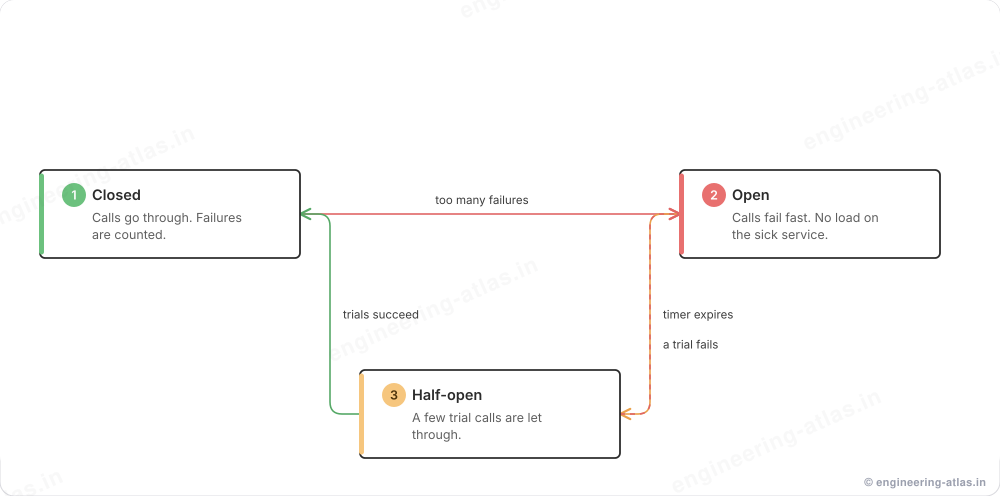

| Topic | What it is, and why it matters | Free read |
|---|---|---|
| <a href="https://engineering-atlas.in/distributed-systems/distributed-systems-patterns.html?utm_source=github&utm_medium=roadmap&utm_campaign=distributed-systems-patterns#circuit-breaker">Circuit breaker</a> <picture><source media="(prefers-color-scheme: dark)" srcset="diagrams/tags/intermediate-dark.svg"></picture> | A circuit breaker wraps calls to a dependency and counts failures. Past a threshold it opens and rejects calls at once; after a pause it lets a few trial calls through. It matters because it protects both the sick service and your own threads. | <a href="https://martinfowler.com/bliki/CircuitBreaker.html">Martin Fowler: CircuitBreaker</a> |
| <a href="https://engineering-atlas.in/distributed-systems/distributed-systems-patterns.html?utm_source=github&utm_medium=roadmap&utm_campaign=distributed-systems-patterns#fallback">Fail fast and fallbacks</a> <picture><source media="(prefers-color-scheme: dark)" srcset="diagrams/tags/intermediate-dark.svg"></picture> | Failing fast means returning an error quickly instead of waiting on a doomed call; a fallback is the smaller answer you return instead. It matters because a quick "recommendations unavailable" beats a page that hangs for 30 seconds. |  |

### 37. Retry Engineering

<picture><source media="(prefers-color-scheme: dark)" srcset="diagrams/banners/ch-37-dark.svg"></picture>

<a href="https://engineering-atlas.in/distributed-systems/distributed-systems-patterns.html?utm_source=github&utm_medium=roadmap&utm_campaign=distributed-systems-patterns#retry"><picture><source media="(prefers-color-scheme: dark)" srcset="diagrams/banners/btn-chapter-dark.svg"></picture></a>

| | |
|---|---|
| **Why know this** | Retries fix brief glitches and cause the worst outages. Retrying at every layer multiplies load on a struggling service, exactly when it can least take it. |
| **What interviewers test** | Do your retries help instead of hurt: one layer, backoff, jitter, budgets and idempotency? |
| **What you will cover** | Backoff and jitter · Retry storms and noisy neighbours · Timeouts |
| **Try this** | Retry a failing call with exponential backoff and full jitter. Compare the load spike against fixed-interval retries. |
| **Ready to move on when** | You can explain why jitter matters, where in a call chain retries should live, and which requests are safe to retry at all. |

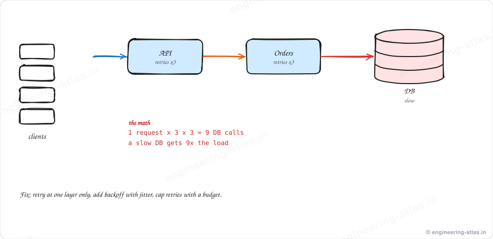

> [!TIP]
> **The 30-second answer.** Retry only idempotent requests, only at one layer, with exponential backoff plus random jitter, and a cap. Set timeouts shorter than the caller's timeout, and use a retry budget so retries never exceed a small share of traffic.

| Topic | What it is, and why it matters | Free read |
|---|---|---|
| <a href="https://engineering-atlas.in/distributed-systems/distributed-systems-patterns.html?utm_source=github&utm_medium=roadmap&utm_campaign=distributed-systems-patterns#backoff">Backoff and jitter</a> <picture><source media="(prefers-color-scheme: dark)" srcset="diagrams/tags/intermediate-dark.svg"></picture> | Exponential backoff waits longer after each failure (100 ms, 200 ms, 400 ms); jitter adds randomness so clients don't retry in sync. It matters because without jitter, thousands of clients hammer the server at the same instants. | <a href="https://aws.amazon.com/builders-library/timeouts-retries-and-backoff-with-jitter/">AWS Builders' Library: Timeouts, retries and backoff with jitter</a> |
| <a href="https://engineering-atlas.in/system-design/anti-patterns/retry-storms-and-noisy-neighbors/?utm_source=github&utm_medium=roadmap&utm_campaign=retry-storms-and-noisy-neighbors">Retry storms and noisy neighbours</a> <picture><source media="(prefers-color-scheme: dark)" srcset="diagrams/tags/advanced-dark.svg"></picture> | A retry storm is retries multiplying across layers until the extra load keeps the system down. A noisy neighbour is one tenant using up shared capacity. It matters because both turn a small problem into a long outage. |  |
| <a href="https://engineering-atlas.in/distributed-systems/distributed-systems-patterns.html?utm_source=github&utm_medium=roadmap&utm_campaign=distributed-systems-patterns#timeout">Timeouts</a> <picture><source media="(prefers-color-scheme: dark)" srcset="diagrams/tags/intermediate-dark.svg"></picture> | A timeout is the longest you will wait for a reply before giving up. It matters because a call with no timeout can hold a thread forever, and timeouts must shrink as you go deeper in the call chain. |  |

#### Deep dive: backoff with jitter

When a call fails, retrying immediately usually fails again, because whatever broke hasn't recovered. **Exponential backoff** waits longer after each failure: about 100 ms, then 200 ms, then 400 ms, up to a cap.

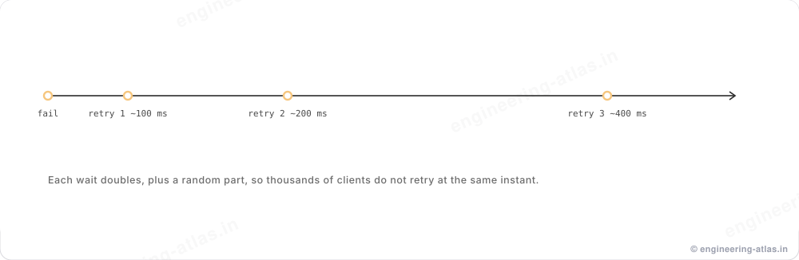

Backoff alone has a trap. If 10,000 clients failed at the same moment, they all wait exactly 100 ms and retry at the same moment, then again at 200 ms. The server sees synchronised waves. **Jitter** adds randomness to each wait, for example a random time between zero and the backoff value, so retries spread out and the server can recover.

Add a cap on attempts, retry only requests that are safe to repeat, and keep retries at one layer of the call chain.

### 38. Bulkheads and Isolation

<picture><source media="(prefers-color-scheme: dark)" srcset="diagrams/banners/ch-38-dark.svg"></picture>

<a href="https://engineering-atlas.in/distributed-systems/distributed-systems-patterns.html?utm_source=github&utm_medium=roadmap&utm_campaign=distributed-systems-patterns#bulkhead"><picture><source media="(prefers-color-scheme: dark)" srcset="diagrams/banners/btn-chapter-dark.svg"></picture></a>

| | |
|---|---|
| **Why know this** | A ship has watertight compartments so one leak doesn't sink it. Bulkheads do the same for software: separate pools for separate dependencies, so one slow partner can't use every thread. |
| **What interviewers test** | Can you isolate dependencies so one slow partner can't use all your capacity? |
| **What you will cover** | Bulkheads · Hedged requests |
| **Try this** | Give two downstream calls separate thread pools. Make one hang and show the other still serves traffic. |
| **Ready to move on when** | You can design thread or connection pools so that a slow recommendations service can't stop checkout. |

| Topic | What it is, and why it matters | Free read |
|---|---|---|
| <a href="https://engineering-atlas.in/distributed-systems/distributed-systems-patterns.html?utm_source=github&utm_medium=roadmap&utm_campaign=distributed-systems-patterns#bulkhead">Bulkheads</a> <picture><source media="(prefers-color-scheme: dark)" srcset="diagrams/tags/advanced-dark.svg"></picture> | A bulkhead gives each dependency or customer group its own limited pool of threads, connections or capacity. It matters because it caps how much damage any one failure can do. | <a href="https://aws.amazon.com/builders-library/workload-isolation-using-shuffle-sharding/">AWS Builders' Library: Workload isolation using shuffle sharding</a> |
| <a href="https://engineering-atlas.in/distributed-systems/distributed-systems-patterns.html?utm_source=github&utm_medium=roadmap&utm_campaign=distributed-systems-patterns#hedged">Hedged requests</a> <picture><source media="(prefers-color-scheme: dark)" srcset="diagrams/tags/advanced-dark.svg"></picture> | A hedged request sends a second copy of a slow request to another replica and takes whichever answers first. It matters because it cuts tail latency a lot for a small amount of extra load, if the request is safe to repeat. |  |

### 39. Health Checks Done Right

<picture><source media="(prefers-color-scheme: dark)" srcset="diagrams/banners/ch-39-dark.svg"></picture>

| | |
|---|---|
| **Why know this** | Load balancers and orchestrators route traffic and restart containers based on health checks. A bad health check either hides a broken server or kills healthy ones during a database blip, taking the whole fleet down. |
| **What interviewers test** | Do you know the difference between liveness and readiness, and why deep checks are risky? |
| **What you will cover** | Health checks done right |
| **Try this** | Write a liveness and a readiness check for a service with a database. Explain why the database check belongs in only one of them. |
| **Ready to move on when** | You can explain liveness vs readiness, and why a health check should not fail only because a dependency is down. |

| Topic | What it is, and why it matters | Free read |
|---|---|---|
| Health checks done right <picture><source media="(prefers-color-scheme: dark)" srcset="diagrams/tags/intermediate-dark.svg"></picture> | A health check is an endpoint that tells infrastructure whether an instance should get traffic (readiness) or be restarted (liveness). It matters because checks that are too deep make every instance fail together, and checks that are too shallow miss real breakage. | <a href="https://aws.amazon.com/builders-library/implementing-health-checks/">AWS Builders' Library: Implementing health checks</a> |

### 40. Disaster Recovery

<picture><source media="(prefers-color-scheme: dark)" srcset="diagrams/banners/ch-40-dark.svg"></picture>

<a href="https://engineering-atlas.in/system-design/production/disaster-recovery/?utm_source=github&utm_medium=roadmap&utm_campaign=disaster-recovery"><picture><source media="(prefers-color-scheme: dark)" srcset="diagrams/banners/btn-chapter-dark.svg"></picture></a>

| | |
|---|---|
| **Why know this** | Regions fail, someone runs `DROP TABLE` in production, ransomware happens. Disaster recovery is the plan for getting data and service back, and it is only real if you have tested the restore. |
| **What interviewers test** | Can you state RPO and RTO and design backups and replication to meet them? |
| **What you will cover** | Disaster recovery: RPO, RTO, backups |
| **Try this** | For one service, write the RPO and RTO you would promise, and the backup and restore plan that meets them. Then test the restore. |
| **Ready to move on when** | You can define RPO and RTO, and pick a backup and replication setup for an RPO of 5 minutes and an RTO of 1 hour. |

| Topic | What it is, and why it matters | Free read |
|---|---|---|
| <a href="https://engineering-atlas.in/system-design/production/disaster-recovery/?utm_source=github&utm_medium=roadmap&utm_campaign=disaster-recovery">Disaster recovery: RPO, RTO, backups</a> <picture><source media="(prefers-color-scheme: dark)" srcset="diagrams/tags/intermediate-dark.svg"></picture> | RPO (recovery point objective) is how much data you can afford to lose; RTO (recovery time objective) is how long you can be down. They matter because they decide the setup, from nightly backups to a hot standby region, and the cost rises steeply as both shrink. | <a href="https://docs.aws.amazon.com/whitepapers/latest/disaster-recovery-workloads-on-aws/disaster-recovery-options-in-the-cloud.html">AWS whitepaper: Disaster recovery options in the cloud</a> |

### 41. Multi-region and Active-Active

<picture><source media="(prefers-color-scheme: dark)" srcset="diagrams/banners/ch-41-dark.svg"></picture>

<a href="https://engineering-atlas.in/system-design/production/multi-region/?utm_source=github&utm_medium=roadmap&utm_campaign=multi-region"><picture><source media="(prefers-color-scheme: dark)" srcset="diagrams/banners/btn-chapter-dark.svg"></picture></a>

| | |
|---|---|
| **Why know this** | Running in more than one region protects you from a regional outage and puts servers closer to users. It also brings the hardest data problems in this roadmap: replication lag across continents and conflicting writes. |
| **What interviewers test** | Can you compare active-passive and active-active, and handle writes in two regions? |
| **What you will cover** | Multi-region and active-active |
| **Try this** | Two regions both accept writes to the same user profile. Describe one conflict and how last-write-wins and a CRDT each resolve it. |
| **Ready to move on when** | You can compare active-passive and active-active, and explain how you would handle the same user writing in two regions. |

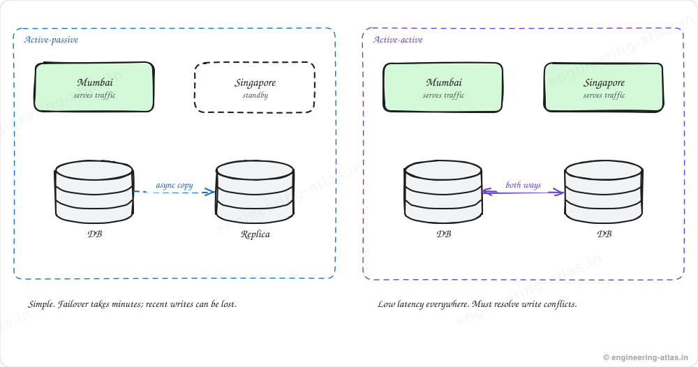

| Topic | What it is, and why it matters | Free read |
|---|---|---|
| <a href="https://engineering-atlas.in/system-design/production/multi-region/?utm_source=github&utm_medium=roadmap&utm_campaign=multi-region">Multi-region and active-active</a> <picture><source media="(prefers-color-scheme: dark)" srcset="diagrams/tags/advanced-dark.svg"></picture> | Active-passive serves from one region and fails over to a standby; active-active serves from several regions at once. Active-active gives lower latency and faster recovery, but every region can accept writes, so you need conflict rules or a home region per user. | <a href="https://docs.aws.amazon.com/whitepapers/latest/disaster-recovery-workloads-on-aws/disaster-recovery-options-in-the-cloud.html">AWS whitepaper: Disaster recovery options in the cloud (multi-site active/active)</a> |

### 42. Cell-based Architecture

<picture><source media="(prefers-color-scheme: dark)" srcset="diagrams/banners/ch-42-dark.svg"></picture>

<a href="https://engineering-atlas.in/system-design/production/cell-based-architecture/?utm_source=github&utm_medium=roadmap&utm_campaign=cell-based-architecture"><picture><source media="(prefers-color-scheme: dark)" srcset="diagrams/banners/btn-chapter-dark.svg"></picture></a>

| | |
|---|---|
| **Why know this** | Even with many regions, one bad deploy or one poison request can hit every customer. Cells split the system into independent copies, each serving a slice of customers, so a failure stays inside one cell. |
| **What interviewers test** | Can you limit the blast radius of a bad deploy or a noisy customer? |
| **What you will cover** | Cells, deployment stamps and geodes |
| **Try this** | Split 10 million users into cells. Decide the cell size, how a user is routed, and what happens when one cell fails. |
| **Ready to move on when** | You can explain blast radius, what the cell router must do, and why it must stay very simple. |

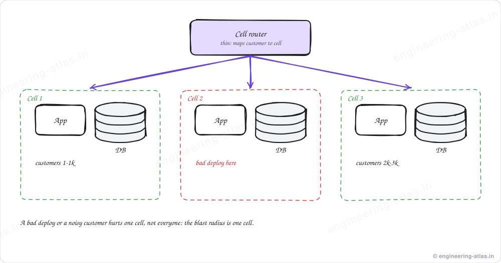

| Topic | What it is, and why it matters | Free read |
|---|---|---|
| <a href="https://engineering-atlas.in/system-design/production/cell-based-architecture/?utm_source=github&utm_medium=roadmap&utm_campaign=cell-based-architecture">Cells, deployment stamps and geodes</a> <picture><source media="(prefers-color-scheme: dark)" srcset="diagrams/tags/advanced-dark.svg"></picture> | A cell is a complete, isolated copy of the service stack that serves a fixed group of customers. It matters because it caps the blast radius of bad deploys, overloads and bugs, and lets you roll out changes one cell at a time. | <a href="https://docs.aws.amazon.com/wellarchitected/latest/reducing-scope-of-impact-with-cell-based-architecture/reducing-scope-of-impact-with-cell-based-architecture.html">AWS whitepaper: Reducing the scope of impact with cell-based architecture</a> |

### 43. Observability

<picture><source media="(prefers-color-scheme: dark)" srcset="diagrams/banners/ch-43-dark.svg"></picture>

| | |
|---|---|
| **Why know this** | You can't fix what you can't see. Logs, metrics and traces are how you learn that something is wrong, where, and why, ideally before users tell you. |
| **What interviewers test** | Do you know what to log, measure, trace and alert on to find a problem fast? |
| **What you will cover** | Logs, metrics and traces · How to read logs in large systems · Logging at scale |
| **Try this** | Add one metric, one structured log line and one trace span to an endpoint. Then use them to find an injected 300 ms delay. |
| **Ready to move on when** | You can say what you would alert on for a checkout service, and how a trace ID helps you find one slow request among millions. |

| Topic | What it is, and why it matters | Free read |
|---|---|---|
| Logs, metrics and traces <picture><source media="(prefers-color-scheme: dark)" srcset="diagrams/tags/beginner-dark.svg"></picture> | Logs record individual events, metrics count and time things cheaply, and traces follow one request across services. Each answers a different question, and you need all three to debug a distributed system. | <a href="https://opentelemetry.io/docs/concepts/observability-primer/">OpenTelemetry docs: Observability primer</a> |
| <a href="https://engineering-atlas.in/system-design/reading-logs/?utm_source=github&utm_medium=roadmap&utm_campaign=reading-logs">How to read logs in large systems</a> <picture><source media="(prefers-color-scheme: dark)" srcset="diagrams/tags/beginner-dark.svg"></picture> | Reading logs well means filtering by request ID, time window and severity until the story of one failure appears. It matters because the first hour of most incidents is spent in logs. |  |
| <a href="https://engineering-atlas.in/system-design/logging-at-scale/?utm_source=github&utm_medium=roadmap&utm_campaign=logging-at-scale">Logging at scale</a> <picture><source media="(prefers-color-scheme: dark)" srcset="diagrams/tags/intermediate-dark.svg"></picture> | Large companies ship billions of log lines a day through agents, queues and indexed stores. It matters because logging itself can become a cost and reliability problem if you don't design it. |  |

### 44. Capacity Planning and Autoscaling

<picture><source media="(prefers-color-scheme: dark)" srcset="diagrams/banners/ch-44-dark.svg"></picture>

<a href="https://engineering-atlas.in/system-design/production/capacity-planning/?utm_source=github&utm_medium=roadmap&utm_campaign=capacity-planning"><picture><source media="(prefers-color-scheme: dark)" srcset="diagrams/banners/btn-chapter-dark.svg"></picture></a>

| | |
|---|---|
| **Why know this** | Too little capacity means outages on sale day; too much means burning money every day. Capacity planning and autoscaling keep you between the two, with headroom for spikes and failures. |
| **What interviewers test** | Can you size a system for peak with headroom, and know what autoscaling can't fix? |
| **What you will cover** | Capacity planning · Load testing · Autoscaling done right · Autoscaling in Kubernetes · Autoscaling databases · Autoscaling queue workers · Cost-aware design |
| **Try this** | Given 2,000 RPS peak and 150 RPS per instance, size the fleet with headroom for losing one zone of three. |
| **Ready to move on when** | You can size a service for a 5x sale-day peak, and explain why autoscaling alone won't save you from a sudden spike. |

| Topic | What it is, and why it matters | Free read |
|---|---|---|
| <a href="https://engineering-atlas.in/system-design/production/capacity-planning/?utm_source=github&utm_medium=roadmap&utm_campaign=capacity-planning">Capacity planning</a> <picture><source media="(prefers-color-scheme: dark)" srcset="diagrams/tags/intermediate-dark.svg"></picture> | Capacity planning is forecasting load and making sure you have enough servers, storage and limits for it, plus headroom. It matters because some capacity (database size, quotas, reserved instances) takes days or weeks to add. |  |
| Load testing <picture><source media="(prefers-color-scheme: dark)" srcset="diagrams/tags/intermediate-dark.svg"></picture> | Load testing sends realistic traffic at a system to find where it breaks before users do. It matters because the bottleneck is almost never where the team expects. |  |
| <a href="https://engineering-atlas.in/system-design/production/autoscaling/?utm_source=github&utm_medium=roadmap&utm_campaign=autoscaling">Autoscaling done right</a> <picture><source media="(prefers-color-scheme: dark)" srcset="diagrams/tags/intermediate-dark.svg"></picture> | Autoscaling adds and removes instances based on a signal like CPU or queue depth. It matters because the signal, the cooldown and the minimum size decide whether it helps or flaps. |  |
| <a href="https://engineering-atlas.in/system-design/production/autoscaling-kubernetes/?utm_source=github&utm_medium=roadmap&utm_campaign=autoscaling-kubernetes">Autoscaling in Kubernetes</a> <picture><source media="(prefers-color-scheme: dark)" srcset="diagrams/tags/intermediate-dark.svg"></picture> | Pods scale with the Horizontal Pod Autoscaler; nodes scale with the cluster autoscaler. Both need room to work: new nodes take minutes. |  |
| <a href="https://engineering-atlas.in/system-design/production/autoscaling-databases/?utm_source=github&utm_medium=roadmap&utm_campaign=autoscaling-databases">Autoscaling databases</a> <picture><source media="(prefers-color-scheme: dark)" srcset="diagrams/tags/advanced-dark.svg"></picture> | Read replicas and storage scale fairly easily; write capacity and connections do not. It matters because the database is usually the part autoscaling can't fix quickly. |  |
| <a href="https://engineering-atlas.in/system-design/production/autoscaling-queue-workers/?utm_source=github&utm_medium=roadmap&utm_campaign=autoscaling-queue-workers">Autoscaling queue workers</a> <picture><source media="(prefers-color-scheme: dark)" srcset="diagrams/tags/intermediate-dark.svg"></picture> | Scale workers on queue depth or message age, not CPU. It matters because a backlog can grow while CPU looks calm. |  |
| Cost-aware design <picture><source media="(prefers-color-scheme: dark)" srcset="diagrams/tags/intermediate-dark.svg"></picture> | Cost is a design requirement like latency. Storage tiers, egress, idle capacity and chatty calls are where cloud bills grow. |  |

### 45. Security Architecture

<picture><source media="(prefers-color-scheme: dark)" srcset="diagrams/banners/ch-45-dark.svg"></picture>

<a href="https://engineering-atlas.in/system-design/security/?utm_source=github&utm_medium=roadmap&utm_campaign=security"><picture><source media="(prefers-color-scheme: dark)" srcset="diagrams/banners/btn-chapter-dark.svg"></picture></a>

| | |
|---|---|
| **Why know this** | Every design handles user data, and interviewers expect you to say where traffic is encrypted, how services prove who they are, and where secrets live. |
| **What interviewers test** | Can you show where data is encrypted, how services prove identity and where secrets live? |
| **What you will cover** | Auth at the edge · Service-to-service auth and mTLS · Encryption and key management · Secrets management · Zero trust |
| **Try this** | Draw the trust boundaries of a login flow and mark where you validate tokens, encrypt data and store secrets. |
| **Ready to move on when** | You can explain where TLS ends, how service A proves its identity to service B, and how you would rotate a leaked key. |

| Topic | What it is, and why it matters | Free read |
|---|---|---|
| <a href="https://engineering-atlas.in/system-design/security/auth-at-the-edge/?utm_source=github&utm_medium=roadmap&utm_campaign=auth-at-the-edge">Auth at the edge</a> <picture><source media="(prefers-color-scheme: dark)" srcset="diagrams/tags/intermediate-dark.svg"></picture> | Checking tokens at the gateway or CDN, before traffic reaches services. It matters because it stops bad requests early and keeps auth logic in one place. |  |
| <a href="https://engineering-atlas.in/system-design/security/service-auth-mtls/?utm_source=github&utm_medium=roadmap&utm_campaign=service-auth-mtls">Service-to-service auth and mTLS</a> <picture><source media="(prefers-color-scheme: dark)" srcset="diagrams/tags/advanced-dark.svg"></picture> | Mutual TLS makes both sides of a connection present certificates, so services prove their identity to each other. It matters because "inside the network" is not proof of trust. |  |
| <a href="https://engineering-atlas.in/system-design/security/encryption-and-keys/?utm_source=github&utm_medium=roadmap&utm_campaign=encryption-and-keys">Encryption and key management</a> <picture><source media="(prefers-color-scheme: dark)" srcset="diagrams/tags/advanced-dark.svg"></picture> | Encrypt data in transit (TLS) and at rest, and keep keys in a key management service, with envelope encryption for large data. It matters because the key, not the data, is what you really protect. | <a href="https://docs.aws.amazon.com/kms/latest/developerguide/kms-cryptography.html">AWS docs: KMS concepts (envelope encryption)</a> |
| Secrets management <picture><source media="(prefers-color-scheme: dark)" srcset="diagrams/tags/intermediate-dark.svg"></picture> | Passwords, API keys and certificates live in a secrets manager, not in code or config files, and rotate on a schedule. |  |
| Zero trust <picture><source media="(prefers-color-scheme: dark)" srcset="diagrams/tags/advanced-dark.svg"></picture> | Every request is authenticated and authorised, wherever it comes from. Network location grants nothing. | <a href="https://csrc.nist.gov/pubs/sp/800/207/final">NIST SP 800-207: Zero Trust Architecture</a> |

### 46. Deployment Architecture

<picture><source media="(prefers-color-scheme: dark)" srcset="diagrams/banners/ch-46-dark.svg"></picture>

| | |
|---|---|
| **Why know this** | Many outages start with a deploy. How you release code (all at once, gradually, behind a flag) decides how many users see a bug and how fast you can undo it. |
| **What interviewers test** | Can you release safely, roll back fast and change a schema without downtime? |
| **What you will cover** | Canary, blue-green and feature flags · Online schema and data migrations · Strangler fig and legacy migration |
| **Try this** | Write a canary rollout plan: traffic steps, the metrics that stop it, and how you roll back in under five minutes. |
| **Ready to move on when** | You can compare blue-green and canary, and explain how to change a database column without downtime. |

| Topic | What it is, and why it matters | Free read |
|---|---|---|
| Canary, blue-green and feature flags <picture><source media="(prefers-color-scheme: dark)" srcset="diagrams/tags/intermediate-dark.svg"></picture> | Blue-green switches all traffic between two identical environments; a canary sends a small share to the new version first; feature flags turn code on without a deploy. They matter because they turn "deploy" into a reversible step. | <a href="https://sre.google/workbook/canarying-releases/">Google SRE workbook: Canarying releases</a> |
| Online schema and data migrations <picture><source media="(prefers-color-scheme: dark)" srcset="diagrams/tags/advanced-dark.svg"></picture> | Change a schema in small steps (expand, migrate, contract) so old and new code both work during the rollout. |  |
| <a href="https://engineering-atlas.in/system-design/production/legacy-migration/?utm_source=github&utm_medium=roadmap&utm_campaign=legacy-migration">Strangler fig and legacy migration</a> <picture><source media="(prefers-color-scheme: dark)" srcset="diagrams/tags/intermediate-dark.svg"></picture> | Replace an old system piece by piece behind a routing layer, instead of a big-bang rewrite. It matters because big rewrites are where projects go to die. | <a href="https://martinfowler.com/bliki/StranglerFigApplication.html">Martin Fowler: Strangler fig application</a> |

### Can you answer these?

1. A recommendations service gets slow and checkout goes down. Explain how, and name three defences.
2. Where in a call chain of client, gateway, API and database should retries live, and with what settings?
3. Your RPO is 5 minutes and RTO is 1 hour. Design backups and replication to meet both.
4. The same user writes in Mumbai and Singapore at the same time. How does an active-active design resolve it?
5. A bad config push reaches production. How do cells and canaries each limit the damage?
6. What would you alert on for a payments API, and what goes on its dashboard?

> [!TIP]
> **Unlocked: you can now solve** <a href="https://engineering-atlas.in/system-design/location/design-uber/?utm_source=github&utm_medium=roadmap&utm_campaign=design-uber">Uber</a> · <a href="https://engineering-atlas.in/system-design/location/design-food-delivery/?utm_source=github&utm_medium=roadmap&utm_campaign=design-food-delivery">Food delivery</a> · <a href="https://engineering-atlas.in/system-design/data-analytics/design-an-ad-click-aggregator/?utm_source=github&utm_medium=roadmap&utm_campaign=design-an-ad-click-aggregator">Ad click aggregator</a> · <a href="https://engineering-atlas.in/system-design/data-analytics/design-a-distributed-logging-system/?utm_source=github&utm_medium=roadmap&utm_campaign=design-a-distributed-logging-system">Distributed logging system</a> · <a href="https://engineering-atlas.in/system-design/payments/design-a-stock-trading-app/?utm_source=github&utm_medium=roadmap&utm_campaign=design-a-stock-trading-app">Stock trading app</a>

> [!NOTE]
> **Prep progress.** Finish this part and you are about **70%** of the way to interview ready.
>
> 

**Continue learning on Engineering Atlas:** [Running in production module](https://engineering-atlas.in/system-design/production/?utm_source=github&utm_medium=roadmap&utm_campaign=production) · [Security module](https://engineering-atlas.in/system-design/security/?utm_source=github&utm_medium=roadmap&utm_campaign=security) · [HLD roadmap](https://engineering-atlas.in/system-design/roadmap/?utm_source=github&utm_medium=roadmap&utm_campaign=roadmap)

<a href="#contents">Back to contents ↑</a>

## Part VI: Architecture patterns

<picture><source media="(prefers-color-scheme: dark)" srcset="diagrams/banners/part-6-dark.svg">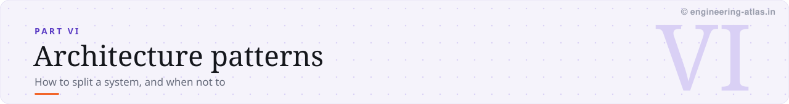</picture>

*How to split a system into services, and when not to.* Architecture style is a business decision as much as a technical one: team size, release speed and the cost of change all matter. Interviewers want to hear you pick a style for reasons, not by fashion.

### 47. Monolith and Modular Monolith

<picture><source media="(prefers-color-scheme: dark)" srcset="diagrams/banners/ch-47-dark.svg"></picture>

<a href="https://engineering-atlas.in/system-design/architecture/microservices/?utm_source=github&utm_medium=roadmap&utm_campaign=microservices"><picture><source media="(prefers-color-scheme: dark)" srcset="diagrams/banners/btn-chapter-dark.svg"></picture></a>

| | |
|---|---|
| **Why know this** | Most successful products start as a monolith, and many stay one. Knowing when a monolith is the right answer, and how to keep it modular, is a sign of judgment. |
| **What interviewers test** | Can you say when a monolith is the right call and when to split it? |
| **What you will cover** | Monolith vs microservices · Choosing an architecture style |
| **Try this** | Take a monolith with users, orders and payments. Draw module boundaries and list which calls cross them. |
| **Ready to move on when** | You can name two signals that a monolith should be split, and two reasons not to split yet. |

| Topic | What it is, and why it matters | Free read |
|---|---|---|
| <a href="https://engineering-atlas.in/system-design/architecture/microservices/?utm_source=github&utm_medium=roadmap&utm_campaign=microservices">Monolith vs microservices</a> <picture><source media="(prefers-color-scheme: dark)" srcset="diagrams/tags/beginner-dark.svg"></picture> | A monolith is one deployable application; microservices are many small services that deploy on their own. A monolith is simpler to build, test and run; microservices let many teams ship independently, at the price of network calls, distributed data and more operations work. | <a href="https://martinfowler.com/bliki/MonolithFirst.html">Martin Fowler: Monolith first</a> |
| Choosing an architecture style <picture><source media="(prefers-color-scheme: dark)" srcset="diagrams/tags/intermediate-dark.svg"></picture> | Layered, modular monolith, microservices, event-driven or serverless: a short decision guide based on team size, scale and how often parts change. |  |

### 48. Microservices

<picture><source media="(prefers-color-scheme: dark)" srcset="diagrams/banners/ch-48-dark.svg"></picture>

| | |
|---|---|
| **Why know this** | If you split, the hard part is where. Bad boundaries create services that must always change and deploy together, which is the worst of both worlds. |
| **What interviewers test** | Can you draw service boundaries around the data each service owns? |
| **What you will cover** | Finding service boundaries with DDD · API composition across services |
| **Try this** | Pick one module from the previous exercise to extract into a service. List what you gain and the new failure modes you add. |
| **Ready to move on when** | You can split an online store into services and defend each boundary by the data it owns. |

| Topic | What it is, and why it matters | Free read |
|---|---|---|
| Finding service boundaries with DDD <picture><source media="(prefers-color-scheme: dark)" srcset="diagrams/tags/advanced-dark.svg"></picture> | Domain-driven design draws service boundaries around business capabilities and the data they own (bounded contexts). It matters because services that own their data can change on their own. | <a href="https://martinfowler.com/bliki/BoundedContext.html">Martin Fowler: BoundedContext</a> |
| <a href="https://engineering-atlas.in/system-design/networking/api-composition/?utm_source=github&utm_medium=roadmap&utm_campaign=api-composition">API composition across services</a> <picture><source media="(prefers-color-scheme: dark)" srcset="diagrams/tags/intermediate-dark.svg"></picture> | When a page needs data from many services, a composition layer gathers it. It matters because without it, clients make many calls and learn too much about your internals. |  |

### 49. Event-driven Architecture

<picture><source media="(prefers-color-scheme: dark)" srcset="diagrams/banners/ch-49-dark.svg"></picture>

<a href="https://engineering-atlas.in/system-design/architecture/event-driven/?utm_source=github&utm_medium=roadmap&utm_campaign=event-driven"><picture><source media="(prefers-color-scheme: dark)" srcset="diagrams/banners/btn-chapter-dark.svg"></picture></a>

| | |
|---|---|
| **Why know this** | Events let services react to changes without calling each other directly. That decoupling is powerful, and it makes flows harder to see and debug. |
| **What interviewers test** | Do you know what events buy you, and how you would debug a flow across many consumers? |
| **What you will cover** | Event-driven architecture |
| **Try this** | Use the outbox pattern so that saving an order and publishing <code>OrderPlaced</code> can never disagree. |
| **Ready to move on when** | You can explain the difference between an event and a command, and how you would trace one order through five event consumers. |

| Topic | What it is, and why it matters | Free read |
|---|---|---|
| <a href="https://engineering-atlas.in/system-design/architecture/event-driven/?utm_source=github&utm_medium=roadmap&utm_campaign=event-driven">Event-driven architecture</a> <picture><source media="(prefers-color-scheme: dark)" srcset="diagrams/tags/intermediate-dark.svg"></picture> | In an event-driven system, services publish facts ("order placed") and others subscribe. It matters because new features can be added as new subscribers without touching the publisher. | <a href="https://martinfowler.com/articles/201701-event-driven.html">Martin Fowler: What do you mean by "Event-Driven"?</a> |

### 50. CQRS and Event Sourcing

<picture><source media="(prefers-color-scheme: dark)" srcset="diagrams/banners/ch-50-dark.svg"></picture>

<a href="https://engineering-atlas.in/system-design/async/event-sourcing-and-cqrs/?utm_source=github&utm_medium=roadmap&utm_campaign=event-sourcing-and-cqrs"><picture><source media="(prefers-color-scheme: dark)" srcset="diagrams/banners/btn-chapter-dark.svg"></picture></a>

| | |
|---|---|
| **Why know this** | Some systems read data in very different shapes from how they write it, or must keep a full history of every change. CQRS and event sourcing handle both, at a real cost in complexity. |
| **What interviewers test** | Can you explain read models and replay, and when event sourcing is worth its cost? |
| **What you will cover** | Event sourcing and CQRS · Read models and fan-out |
| **Try this** | Model a bank account as an event stream. Rebuild the balance from events, then add a read model for "last 10 transactions". |
| **Ready to move on when** | You can explain how a read model is rebuilt from events, and name one system where event sourcing is worth it and one where it is not. |

| Topic | What it is, and why it matters | Free read |
|---|---|---|
| <a href="https://engineering-atlas.in/system-design/async/event-sourcing-and-cqrs/?utm_source=github&utm_medium=roadmap&utm_campaign=event-sourcing-and-cqrs">Event sourcing and CQRS</a> <picture><source media="(prefers-color-scheme: dark)" srcset="diagrams/tags/advanced-dark.svg"></picture> | Event sourcing stores every change as an event and derives current state by replaying them. CQRS (command query responsibility segregation) uses separate models for writes and reads. They matter for audit-heavy domains like ledgers, but add eventual consistency and replay work. | <a href="https://martinfowler.com/eaaDev/EventSourcing.html">Martin Fowler: Event sourcing</a> |
| <a href="https://engineering-atlas.in/system-design/common-patterns/read-models-and-fan-out/?utm_source=github&utm_medium=roadmap&utm_campaign=read-models-and-fan-out">Read models and fan-out</a> <picture><source media="(prefers-color-scheme: dark)" srcset="diagrams/tags/advanced-dark.svg"></picture> | A read model is a copy of data shaped for one query, kept up to date from events. It matters because it is how feeds and dashboards stay fast without slowing the write path. |  |

### 51. Serverless

<picture><source media="(prefers-color-scheme: dark)" srcset="diagrams/banners/ch-51-dark.svg"></picture>

<a href="https://engineering-atlas.in/system-design/architecture/serverless/?utm_source=github&utm_medium=roadmap&utm_campaign=serverless"><picture><source media="(prefers-color-scheme: dark)" srcset="diagrams/banners/btn-chapter-dark.svg"></picture></a>

| | |
|---|---|
| **Why know this** | Serverless lets you run code without managing servers and pay only per request. It is great for spiky, event-driven work and awkward for long-running or latency-critical paths. |
| **What interviewers test** | Do you know which workloads fit serverless, and what cold starts and limits cost? |
| **What you will cover** | Serverless architecture |
| **Try this** | Write one function triggered by an upload that makes a thumbnail. Measure its cold start and decide if it is fine for this job. |
| **Ready to move on when** | You can name two workloads that fit serverless and two that don't, and explain cold starts. |

| Topic | What it is, and why it matters | Free read |
|---|---|---|
| <a href="https://engineering-atlas.in/system-design/architecture/serverless/?utm_source=github&utm_medium=roadmap&utm_campaign=serverless">Serverless architecture</a> <picture><source media="(prefers-color-scheme: dark)" srcset="diagrams/tags/intermediate-dark.svg"></picture> | Functions run on demand in response to events, and the platform scales them to zero when idle. It matters because it changes the cost model and removes server operations, but adds cold starts, time limits and vendor lock-in. | <a href="https://docs.aws.amazon.com/lambda/latest/dg/concepts-basics.html">AWS Lambda docs: How Lambda works</a> |

### 52. Service Mesh

<picture><source media="(prefers-color-scheme: dark)" srcset="diagrams/banners/ch-52-dark.svg"></picture>

| | |
|---|---|
| **Why know this** | With hundreds of services, every team re-implementing retries, mTLS and metrics in code doesn't scale. A service mesh moves that into the network layer. |
| **What interviewers test** | Can you explain sidecars, the data plane and the control plane, and what a mesh costs? |
| **What you will cover** | Sidecar, ambassador and service mesh |
| **Try this** | List the features a service mesh gives you (mTLS, retries, traffic splits) and which of them you could do in a library instead. |
| **Ready to move on when** | You can explain the sidecar, the data plane and the control plane, and what a mesh costs you. |

| Topic | What it is, and why it matters | Free read |
|---|---|---|
| Sidecar, ambassador and service mesh <picture><source media="(prefers-color-scheme: dark)" srcset="diagrams/tags/advanced-dark.svg"></picture> | A sidecar is a helper process next to each service; a mesh is many sidecars (the data plane) managed by a control plane. It matters because retries, mTLS and telemetry become config instead of code. | <a href="https://istio.io/latest/docs/ops/deployment/architecture/">Istio docs: Architecture</a> |

### 53. Multi-tenancy

<picture><source media="(prefers-color-scheme: dark)" srcset="diagrams/banners/ch-53-dark.svg"></picture>

<a href="https://engineering-atlas.in/system-design/multi-tenancy/?utm_source=github&utm_medium=roadmap&utm_campaign=multi-tenancy"><picture><source media="(prefers-color-scheme: dark)" srcset="diagrams/banners/btn-chapter-dark.svg"></picture></a>

| | |
|---|---|
| **Why know this** | Every SaaS product serves many customers on shared infrastructure. How you isolate their data, performance and bills is a design question with legal and business stakes. |
| **What interviewers test** | Can you isolate tenants' data and performance, and bill them correctly? |
| **What you will cover** | Tenancy models: silo, pool, bridge · Control plane vs data plane · Routing and isolating tenant data · Noisy neighbours and fairness · Metering and usage-based billing · Peer-to-peer architecture |
| **Try this** | Design tenant isolation for a SaaS app: shared tables with <code>tenant_id</code> versus one schema per tenant. Pick one for 10,000 small tenants. |
| **Ready to move on when** | You can compare silo and pool models and say how you would stop one big tenant from slowing everyone else. |

| Topic | What it is, and why it matters | Free read |
|---|---|---|
| <a href="https://engineering-atlas.in/system-design/multi-tenancy/tenancy-models/?utm_source=github&utm_medium=roadmap&utm_campaign=tenancy-models">Tenancy models: silo, pool, bridge</a> <picture><source media="(prefers-color-scheme: dark)" srcset="diagrams/tags/intermediate-dark.svg"></picture> | Silo gives each tenant its own stack, pool shares everything, bridge mixes both. It matters because the model decides isolation, cost per tenant and how hard upgrades are. | <a href="https://docs.aws.amazon.com/whitepapers/latest/saas-tenant-isolation-strategies/saas-tenant-isolation-strategies.html">AWS whitepaper: SaaS tenant isolation strategies</a> |
| <a href="https://engineering-atlas.in/system-design/multi-tenancy/control-plane/?utm_source=github&utm_medium=roadmap&utm_campaign=control-plane">Control plane vs data plane</a> <picture><source media="(prefers-color-scheme: dark)" srcset="diagrams/tags/intermediate-dark.svg"></picture> | The control plane manages tenants (sign-up, config, billing); the data plane serves their traffic. It matters because keeping them apart means a control plane outage doesn't stop customers' traffic. |  |
| <a href="https://engineering-atlas.in/system-design/multi-tenancy/multi-tenant-data/?utm_source=github&utm_medium=roadmap&utm_campaign=multi-tenant-data">Routing and isolating tenant data</a> <picture><source media="(prefers-color-scheme: dark)" srcset="diagrams/tags/advanced-dark.svg"></picture> | Every request carries a tenant ID, and every query is scoped by it. It matters because one missing filter is a data leak between customers. |  |
| <a href="https://engineering-atlas.in/system-design/multi-tenancy/tenant-fairness/?utm_source=github&utm_medium=roadmap&utm_campaign=tenant-fairness">Noisy neighbours and fairness</a> <picture><source media="(prefers-color-scheme: dark)" srcset="diagrams/tags/advanced-dark.svg"></picture> | Per-tenant quotas, rate limits and queues stop one tenant from using everyone's capacity. It matters because your biggest customer is often your biggest risk. |  |
| <a href="https://engineering-atlas.in/system-design/multi-tenancy/metering/?utm_source=github&utm_medium=roadmap&utm_campaign=metering">Metering and usage-based billing</a> <picture><source media="(prefers-color-scheme: dark)" srcset="diagrams/tags/intermediate-dark.svg"></picture> | Counting each tenant's usage accurately enough to bill them. It matters because billing errors cost money and trust, and usage events must not be lost or double counted. |  |
| Peer-to-peer architecture <picture><source media="(prefers-color-scheme: dark)" srcset="diagrams/tags/intermediate-dark.svg"></picture> | Peers share work and data directly, without a central server. It matters for file distribution and some real-time systems, where central bandwidth would be too costly. |  |

### Can you answer these?

1. A 10-person startup asks if they should use microservices. What do you tell them?
2. Split an online store into services. Which service owns the stock count, and why?
3. When is event sourcing worth its cost? Give one domain where it is and one where it isn't.
4. Which parts of a photo app would you build as serverless functions, and which not?
5. A large tenant's batch job slows down every other tenant. Name three fixes at different layers.

> [!TIP]
> **Unlocked: you can now solve** <a href="https://engineering-atlas.in/system-design/infrastructure/design-a-workflow-engine/?utm_source=github&utm_medium=roadmap&utm_campaign=design-a-workflow-engine">Workflow engine (Temporal)</a> · <a href="https://engineering-atlas.in/system-design/payments/design-a-kyc-system/?utm_source=github&utm_medium=roadmap&utm_campaign=design-a-kyc-system">KYC system</a> · <a href="https://engineering-atlas.in/system-design/real-time/design-a-realtime-updates-platform/?utm_source=github&utm_medium=roadmap&utm_campaign=design-a-realtime-updates-platform">Real-time updates platform</a> · <a href="https://engineering-atlas.in/system-design/storage-media/design-gta-6/?utm_source=github&utm_medium=roadmap&utm_campaign=design-gta-6">GTA 6</a>

> [!NOTE]
> **Prep progress.** Finish this part and you are about **75%** of the way to interview ready.
>
> 

**Continue learning on Engineering Atlas:** [Architecture styles module](https://engineering-atlas.in/system-design/architecture/?utm_source=github&utm_medium=roadmap&utm_campaign=architecture) · [Multi-tenancy module](https://engineering-atlas.in/system-design/multi-tenancy/?utm_source=github&utm_medium=roadmap&utm_campaign=multi-tenancy) · [HLD roadmap](https://engineering-atlas.in/system-design/roadmap/?utm_source=github&utm_medium=roadmap&utm_campaign=roadmap)

<a href="#contents">Back to contents ↑</a>

## Part VII: System design interview questions with solutions

<picture><source media="(prefers-color-scheme: dark)" srcset="diagrams/banners/part-7-dark.svg"></picture>

*Every HLD design problem on Engineering Atlas, grouped by the kind of system.* Each one is worth reading for a different reason, which is the line next to it. Before opening a solution, spend 30 minutes on your own design with the six steps in [How to answer a design interview question](#how-to-answer-a-design-interview-question), then compare.

> [!TIP]
> **Not sure where to start?** Do these ten in order: URL shortener, rate limiter, key-value store, typeahead, web crawler, Dropbox, live leaderboard, BookMyShow, payment system, Uber. Together they touch every building block in Part III.

### What a full solution looks like: Design Uber

Every solved problem on Engineering Atlas ends with an interview board: the whole design on one sheet. Here is the one for Uber.

**The interview board.** The whole design on one sheet, the way you'd leave it on Excalidraw at the end of a real round: black ink, estimates and the API in the margins, the data model on the right, and a label on every arrow. Study it for a minute, close it, and try to redraw it from memory. If you can get it back in about five minutes, you own the design.

<a href="diagrams/uber-interview-board.svg">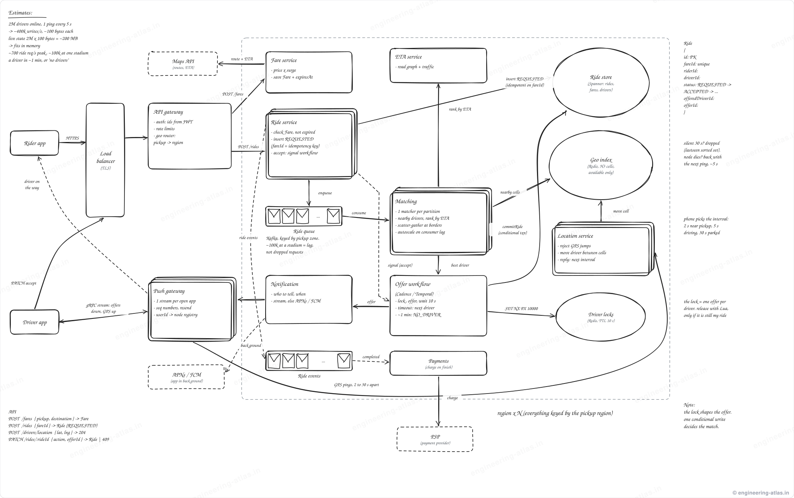</a>

The full walkthrough, one requirement at a time with the deep dives behind every box: <a href="https://engineering-atlas.in/system-design/location/design-uber/">Design?utm_source=github&utm_medium=roadmap&utm_campaign=">Design Uber on Engineering Atlas</a>

### Solution outlines for ten classic questions

Try each one on your own first. Then open the outline to check your direction, and the full solution for the walkthrough, diagrams and deep dives.

<b>URL shortener</b> &nbsp;·&nbsp; <a href="https://engineering-atlas.in/system-design/storage-media/design-a-url-shortener/?utm_source=github&utm_medium=roadmap&utm_campaign=design-a-url-shortener">Full solution →</a>

| | |
|---|---|
| **Requirements** | Shorten a long URL, redirect fast, optional custom alias and expiry. Reads outnumber writes by about 100 to 1. |
| **Core design** | An API writes `short_code -> long_url` to a key-value store; the redirect path reads it and returns a 301 or 302. |
| **Key decision** | How to make codes: a counter turned into base62, or a hash of the URL. Counters need a unique ID source; hashes need collision checks. |
| **Scale** | Cache hot codes in Redis and at the CDN. The store shards easily by code. |
| **Deep dives** | Custom aliases, expiry and cleanup, abuse and spam, and analytics without slowing redirects. |

<b>Rate limiter</b> &nbsp;·&nbsp; <a href="https://engineering-atlas.in/system-design/infrastructure/design-a-rate-limiter/?utm_source=github&utm_medium=roadmap&utm_campaign=design-a-rate-limiter">Full solution →</a>

| | |
|---|---|
| **Requirements** | Limit requests per user or API key, return 429 with a retry hint, add only a few milliseconds. |
| **Core design** | A limiter at the gateway checks a counter in Redis before each request is forwarded. |
| **Key decision** | Token bucket for bursty traffic, sliding window for strict per-minute limits. |
| **Scale** | One atomic Lua script per check, keys sharded across a Redis cluster, local fallback limits. |
| **Deep dives** | Fail open or closed when Redis is down, limits per tier, and distributed fairness. |

<b>Key-value store</b> &nbsp;·&nbsp; <a href="https://engineering-atlas.in/system-design/infrastructure/design-a-key-value-store/?utm_source=github&utm_medium=roadmap&utm_campaign=design-a-key-value-store">Full solution →</a>

| | |
|---|---|
| **Requirements** | `get` and `put` at very large scale, always writable, tunable consistency. |
| **Core design** | Consistent hashing places keys on nodes; each key is copied to N replicas. |
| **Key decision** | Quorum sizes: R + W > N for fresher reads, smaller R and W for speed. |
| **Scale** | Add nodes and only nearby key ranges move; virtual nodes even out load. |
| **Deep dives** | Conflict resolution with versions, hinted handoff, read repair and anti-entropy with Merkle trees. |

<b>Typeahead</b> &nbsp;·&nbsp; <a href="https://engineering-atlas.in/system-design/search-discovery/design-typeahead/?utm_source=github&utm_medium=roadmap&utm_campaign=design-typeahead">Full solution →</a>

| | |
|---|---|
| **Requirements** | Top suggestions for each prefix in under about 100 ms, updated from search logs. |
| **Core design** | Precompute top results per prefix offline; serve them from an in-memory store. |
| **Key decision** | A trie in memory or a prefix-to-results key-value table; the table is simpler to shard and cache. |
| **Scale** | Cache at the CDN and in the browser, debounce keystrokes on the client. |
| **Deep dives** | Freshness for trending terms, personalisation, filtering bad suggestions. |

<b>Web crawler</b> &nbsp;·&nbsp; <a href="https://engineering-atlas.in/system-design/search-discovery/design-web-crawler/?utm_source=github&utm_medium=roadmap&utm_campaign=design-web-crawler">Full solution →</a>

| | |
|---|---|
| **Requirements** | Fetch billions of pages, politely, without fetching the same page twice. |
| **Core design** | A URL frontier feeds fetcher workers; pages go to storage; links are extracted back into the frontier. |
| **Key decision** | A frontier with one queue per host so each site gets a polite request rate. |
| **Scale** | Bloom filters for seen URLs, content hashes for duplicate pages, workers scaled on queue depth. |
| **Deep dives** | robots.txt, traps and infinite URLs, recrawl priority by how often pages change. |

<b>Dropbox</b> &nbsp;·&nbsp; <a href="https://engineering-atlas.in/system-design/storage-media/design-dropbox-google-drive/?utm_source=github&utm_medium=roadmap&utm_campaign=design-dropbox-google-drive">Full solution →</a>

| | |
|---|---|
| **Requirements** | Upload, download and sync files across devices; share them; never lose data. |
| **Core design** | Files are split into chunks stored in object storage; a metadata service tracks files, versions and chunks. |
| **Key decision** | Content-addressed chunks: identical chunks upload once, and only changed chunks sync. |
| **Scale** | Clients upload chunks directly to storage with pre-signed URLs; a notification channel tells devices to sync. |
| **Deep dives** | Conflicts when two devices edit offline, resumable uploads, sharing permissions. |

<b>Live leaderboard</b> &nbsp;·&nbsp; <a href="https://engineering-atlas.in/system-design/real-time/design-a-live-leaderboard/?utm_source=github&utm_medium=roadmap&utm_campaign=design-a-live-leaderboard">Full solution →</a>

| | |
|---|---|
| **Requirements** | Update scores live, show top 100 and any player's rank, for millions of players. |
| **Core design** | A Redis sorted set holds scores; `ZINCRBY` updates, `ZREVRANK` and `ZREVRANGE` read ranks. |
| **Key decision** | One big sorted set vs sharded sets; sharding needs a merge step for global rank. |
| **Scale** | Push changes over WebSockets, batch score updates, persist to a database for recovery. |
| **Deep dives** | Ties, time-windowed boards (daily, weekly), and cheating checks. |

<b>BookMyShow</b> &nbsp;·&nbsp; <a href="https://engineering-atlas.in/system-design/ecommerce/design-ticketmaster-bookmyshow/?utm_source=github&utm_medium=roadmap&utm_campaign=design-ticketmaster-bookmyshow">Full solution →</a>

| | |
|---|---|
| **Requirements** | Browse shows, hold seats for a few minutes, pay, and never sell one seat twice. |
| **Core design** | A booking service with seat holds in a fast store with a TTL, confirmed into a relational database. |
| **Key decision** | How to stop double booking: conditional updates or row locks on the seat, plus idempotent payment. |
| **Scale** | A virtual waiting room for big releases, cached show and seat maps, queued payment confirmations. |
| **Deep dives** | Hold expiry, payment failures after a hold, and fairness during a rush. |

<b>Payment system</b> &nbsp;·&nbsp; <a href="https://engineering-atlas.in/system-design/payments/design-a-payment-system/?utm_source=github&utm_medium=roadmap&utm_campaign=design-a-payment-system">Full solution →</a>

| | |
|---|---|
| **Requirements** | Charge customers through payment providers, pay out sellers, never lose or double money. |
| **Core design** | A payment service records each payment with a state machine and calls the provider; a ledger records every money movement. |
| **Key decision** | Idempotency keys on every call, and a double-entry ledger so every movement balances. |
| **Scale** | Async webhooks from providers, retries with the same key, and daily reconciliation against provider reports. |
| **Deep dives** | Unknown outcomes after timeouts, refunds and chargebacks, and reconciliation mismatches. |

<b>Uber</b> &nbsp;·&nbsp; <a href="https://engineering-atlas.in/system-design/location/design-uber/?utm_source=github&utm_medium=roadmap&utm_campaign=design-uber">Full solution →</a>

| | |
|---|---|
| **Requirements** | Riders request trips, nearby drivers get offers, both see live location, one driver per trip. |
| **Core design** | Drivers send locations every few seconds to a location service indexed by geohash or H3 cells; a matching service picks drivers. |
| **Key decision** | Keep live locations in memory by cell, and use a lock or conditional update so a driver accepts only one trip. |
| **Scale** | Shard the location index by region, push updates over WebSockets, keep trips in a durable store. |
| **Deep dives** | Hot zones at events, surge pricing, and what happens when a driver loses network mid-trip. |

### Infrastructure

| Problem | Why read it | Level |
|---|---|---|
| <a href="https://engineering-atlas.in/system-design/infrastructure/design-a-rate-limiter/?utm_source=github&utm_medium=roadmap&utm_campaign=design-a-rate-limiter">Rate limiter</a> | The best first problem: one small component, a clear algorithm choice, and a real question about what happens when Redis is slow. | <picture><source media="(prefers-color-scheme: dark)" srcset="diagrams/tags/easy-dark.svg"></picture> |
| <a href="https://engineering-atlas.in/system-design/infrastructure/design-a-key-value-store/?utm_source=github&utm_medium=roadmap&utm_campaign=design-a-key-value-store">Key-value store</a> | A small Dynamo. Read it to see partitioning, replication, quorums and conflict resolution fit together in one design. | <picture><source media="(prefers-color-scheme: dark)" srcset="diagrams/tags/medium-dark.svg"></picture> |
| <a href="https://engineering-atlas.in/system-design/infrastructure/design-a-unique-id-generator/?utm_source=github&utm_medium=roadmap&utm_campaign=design-a-unique-id-generator">Unique ID generator</a> | Short and deep: how to make sortable IDs on many machines without a central counter, and what clock skew breaks. | <picture><source media="(prefers-color-scheme: dark)" srcset="diagrams/tags/easy-dark.svg"></picture> |
| <a href="https://engineering-atlas.in/system-design/infrastructure/design-a-distributed-cache/?utm_source=github&utm_medium=roadmap&utm_campaign=design-a-distributed-cache">Distributed cache</a> | Builds Redis-style caching from scratch: consistent hashing, eviction, replication and the hot key problem. | <picture><source media="(prefers-color-scheme: dark)" srcset="diagrams/tags/medium-dark.svg"></picture> |
| <a href="https://engineering-atlas.in/system-design/infrastructure/design-a-cdn/?utm_source=github&utm_medium=roadmap&utm_campaign=design-a-cdn">CDN like Cloudflare</a> | How requests reach the nearest edge, how edges cache, and how one purge reaches hundreds of locations. | <picture><source media="(prefers-color-scheme: dark)" srcset="diagrams/tags/medium-dark.svg"></picture> |
| <a href="https://engineering-atlas.in/system-design/infrastructure/design-a-distributed-message-queue/?utm_source=github&utm_medium=roadmap&utm_campaign=design-a-distributed-message-queue">Distributed message queue (Kafka)</a> | Read it to understand the log: partitions, replication, consumer groups and why Kafka is fast. | <picture><source media="(prefers-color-scheme: dark)" srcset="diagrams/tags/hard-dark.svg"></picture> |
| <a href="https://engineering-atlas.in/system-design/infrastructure/design-a-workflow-engine/?utm_source=github&utm_medium=roadmap&utm_campaign=design-a-workflow-engine">Workflow engine (Temporal)</a> | Durable execution explained: how a multi-step process survives crashes, retries and timers that last days. | <picture><source media="(prefers-color-scheme: dark)" srcset="diagrams/tags/hard-dark.svg"></picture> |
| Job scheduler | Delayed and recurring jobs at scale, and how to run each job once even when workers die. | <picture><source media="(prefers-color-scheme: dark)" srcset="diagrams/tags/medium-dark.svg"></picture> |
| Notification system | Fan-out through queues to email, SMS and push, with retries, preferences and rate limits per channel. | <picture><source media="(prefers-color-scheme: dark)" srcset="diagrams/tags/easy-dark.svg"></picture> |
| Distributed lock | Why a lock with a timeout is not enough, and what leases and fencing tokens add. | <picture><source media="(prefers-color-scheme: dark)" srcset="diagrams/tags/hard-dark.svg"></picture> |

### Search and discovery

| Problem | Why read it | Level |
|---|---|---|
| <a href="https://engineering-atlas.in/system-design/search-discovery/design-typeahead/?utm_source=github&utm_medium=roadmap&utm_campaign=design-typeahead">Typeahead (autocomplete)</a> | Suggestions in under 100 ms as you type: prefix indexes, precomputed top results and caching at every layer. | <picture><source media="(prefers-color-scheme: dark)" srcset="diagrams/tags/easy-dark.svg"></picture> |
| <a href="https://engineering-atlas.in/system-design/search-discovery/design-web-crawler/?utm_source=github&utm_medium=roadmap&utm_campaign=design-web-crawler">Web crawler</a> | A great first data pipeline: a URL frontier, politeness per site, deduplication and Bloom filters. | <picture><source media="(prefers-color-scheme: dark)" srcset="diagrams/tags/medium-dark.svg"></picture> |
| <a href="https://engineering-atlas.in/system-design/search-discovery/design-product-search/?utm_source=github&utm_medium=roadmap&utm_campaign=design-product-search">Product search for an online store</a> | Search with filters, facets and ranking, plus the pipeline that keeps the index in sync with the catalogue. | <picture><source media="(prefers-color-scheme: dark)" srcset="diagrams/tags/medium-dark.svg"></picture> |
| Search engine like Google | Crawling, indexing and ranking at web scale, and how a query is answered from thousands of index shards. | <picture><source media="(prefers-color-scheme: dark)" srcset="diagrams/tags/hard-dark.svg"></picture> |
| Post search (Twitter / Facebook) | Search over a firehose of new posts, where freshness matters as much as relevance. | <picture><source media="(prefers-color-scheme: dark)" srcset="diagrams/tags/medium-dark.svg"></picture> |
| News aggregator (Google News) | Crawling sources, grouping stories about the same event, and ranking by freshness. | <picture><source media="(prefers-color-scheme: dark)" srcset="diagrams/tags/medium-dark.svg"></picture> |

### Storage and media

| Problem | Why read it | Level |
|---|---|---|
| <a href="https://engineering-atlas.in/system-design/storage-media/design-a-url-shortener/?utm_source=github&utm_medium=roadmap&utm_campaign=design-a-url-shortener">URL shortener (and Pastebin)</a> | The classic first problem: a key-value data model, ID generation and a read-heavy cache. | <picture><source media="(prefers-color-scheme: dark)" srcset="diagrams/tags/easy-dark.svg"></picture> |
| <a href="https://engineering-atlas.in/system-design/storage-media/design-dropbox-google-drive/?utm_source=github&utm_medium=roadmap&utm_campaign=design-dropbox-google-drive">Dropbox / Google Drive</a> | File sync done right: chunked uploads, deduplication, sync between devices and conflicts. | <picture><source media="(prefers-color-scheme: dark)" srcset="diagrams/tags/medium-dark.svg"></picture> |
| <a href="https://engineering-atlas.in/system-design/storage-media/design-youtube/?utm_source=github&utm_medium=roadmap&utm_campaign=design-youtube">YouTube</a> | The upload and transcoding pipeline, adaptive bitrate streaming, and why video lives on CDNs. | <picture><source media="(prefers-color-scheme: dark)" srcset="diagrams/tags/medium-dark.svg"></picture> |
| <a href="https://engineering-atlas.in/system-design/storage-media/design-spotify/?utm_source=github&utm_medium=roadmap&utm_campaign=design-spotify">Spotify</a> | Audio streaming, catalogue search and offline downloads for hundreds of millions of users. | <picture><source media="(prefers-color-scheme: dark)" srcset="diagrams/tags/medium-dark.svg"></picture> |
| <a href="https://engineering-atlas.in/system-design/storage-media/design-gta-6/?utm_source=github&utm_medium=roadmap&utm_campaign=design-gta-6">GTA 6</a> | A game backend at launch-day scale: game servers, state sync, matchmaking and the login rush. | <picture><source media="(prefers-color-scheme: dark)" srcset="diagrams/tags/hard-dark.svg"></picture> |
| Netflix | Content placed at the edge before anyone asks for it, and the playback path behind the play button. | <picture><source media="(prefers-color-scheme: dark)" srcset="diagrams/tags/medium-dark.svg"></picture> |
| Object store like S3 | Metadata vs data, erasure coding, and how a store promises eleven nines of durability. | <picture><source media="(prefers-color-scheme: dark)" srcset="diagrams/tags/hard-dark.svg"></picture> |

### Social and feeds

| Problem | Why read it | Level |
|---|---|---|
| <a href="https://engineering-atlas.in/system-design/social-feeds/design-live-comments/?utm_source=github&utm_medium=roadmap&utm_campaign=design-live-comments">Live comments</a> | Pushing a fast stream of comments to millions of people watching the same video. | <picture><source media="(prefers-color-scheme: dark)" srcset="diagrams/tags/medium-dark.svg"></picture> |
| News feed | The core feed trade-off: fan-out on write vs on read, and the celebrity problem. | <picture><source media="(prefers-color-scheme: dark)" srcset="diagrams/tags/medium-dark.svg"></picture> |
| Twitter | Timelines, follows and trends together, with very uneven follower counts. | <picture><source media="(prefers-color-scheme: dark)" srcset="diagrams/tags/medium-dark.svg"></picture> |
| Instagram | Photo uploads, a feed and stories, with media served through CDNs. | <picture><source media="(prefers-color-scheme: dark)" srcset="diagrams/tags/medium-dark.svg"></picture> |
| TikTok | A feed driven by recommendations instead of follows, and short video at scale. | <picture><source media="(prefers-color-scheme: dark)" srcset="diagrams/tags/hard-dark.svg"></picture> |
| Reddit | Threaded comments, voting and ranking that changes as votes arrive. | <picture><source media="(prefers-color-scheme: dark)" srcset="diagrams/tags/medium-dark.svg"></picture> |
| Tinder | Location-based matching, a swipe queue per user and mutual-match detection. | <picture><source media="(prefers-color-scheme: dark)" srcset="diagrams/tags/medium-dark.svg"></picture> |
| People You May Know | Graph-based recommendations computed offline and served fast. | <picture><source media="(prefers-color-scheme: dark)" srcset="diagrams/tags/hard-dark.svg"></picture> |

### Real-time and collaboration

| Problem | Why read it | Level |
|---|---|---|
| <a href="https://engineering-atlas.in/system-design/real-time/design-a-live-leaderboard/?utm_source=github&utm_medium=roadmap&utm_campaign=design-a-live-leaderboard">Live leaderboard</a> | Sorted sets, rank queries for millions of players, and pushing rank changes live. | <picture><source media="(prefers-color-scheme: dark)" srcset="diagrams/tags/medium-dark.svg"></picture> |
| <a href="https://engineering-atlas.in/system-design/real-time/design-a-realtime-updates-platform/?utm_source=github&utm_medium=roadmap&utm_campaign=design-a-realtime-updates-platform">Real-time updates platform (Ably / Pusher)</a> | Millions of open connections, channel fan-out and delivery guarantees, as a product. | <picture><source media="(prefers-color-scheme: dark)" srcset="diagrams/tags/hard-dark.svg"></picture> |
| WhatsApp | WebSocket gateways, message ordering, delivery receipts and offline delivery. | <picture><source media="(prefers-color-scheme: dark)" srcset="diagrams/tags/medium-dark.svg"></picture> |
| Slack / Discord | Channels with many members, presence, and message history search. | <picture><source media="(prefers-color-scheme: dark)" srcset="diagrams/tags/medium-dark.svg"></picture> |
| Zoom | Real-time audio and video: media servers, UDP and adapting to bad networks. | <picture><source media="(prefers-color-scheme: dark)" srcset="diagrams/tags/hard-dark.svg"></picture> |
| Google Docs | Many people editing one document: operational transforms or CRDTs, and presence. | <picture><source media="(prefers-color-scheme: dark)" srcset="diagrams/tags/hard-dark.svg"></picture> |
| Email service (Gmail) | Sending, receiving, storing and searching mail for billions of mailboxes. | <picture><source media="(prefers-color-scheme: dark)" srcset="diagrams/tags/medium-dark.svg"></picture> |
| Online chess game | Matchmaking, game state, clocks and reconnecting a dropped player. | <picture><source media="(prefers-color-scheme: dark)" srcset="diagrams/tags/medium-dark.svg"></picture> |

### Location and maps

| Problem | Why read it | Level |
|---|---|---|
| <a href="https://engineering-atlas.in/system-design/location/design-uber/?utm_source=github&utm_medium=roadmap&utm_campaign=design-uber">Uber</a> | Live driver locations, geospatial matching and making sure one driver gets one ride. | <picture><source media="(prefers-color-scheme: dark)" srcset="diagrams/tags/hard-dark.svg"></picture> |
| <a href="https://engineering-atlas.in/system-design/location/design-food-delivery/?utm_source=github&utm_medium=roadmap&utm_campaign=design-food-delivery">Food delivery (DoorDash / Swiggy)</a> | A three-sided marketplace: customers, restaurants and riders, with order state machines. | <picture><source media="(prefers-color-scheme: dark)" srcset="diagrams/tags/hard-dark.svg"></picture> |
| <a href="https://engineering-atlas.in/system-design/location/design-strava/?utm_source=github&utm_medium=roadmap&utm_campaign=design-strava">Strava</a> | GPS track ingestion, segment matching and leaderboards. | <picture><source media="(prefers-color-scheme: dark)" srcset="diagrams/tags/medium-dark.svg"></picture> |
| Nearby places search (Yelp) | The classic geospatial index problem: find places within a radius, fast. | <picture><source media="(prefers-color-scheme: dark)" srcset="diagrams/tags/medium-dark.svg"></picture> |
| Google Maps | Map tiles, routing over a road graph and live traffic. | <picture><source media="(prefers-color-scheme: dark)" srcset="diagrams/tags/hard-dark.svg"></picture> |
| Nearby Friends | Moving users near moving users, with location updates fanned out to friends. | <picture><source media="(prefers-color-scheme: dark)" srcset="diagrams/tags/medium-dark.svg"></picture> |

### E-commerce and booking

| Problem | Why read it | Level |
|---|---|---|
| <a href="https://engineering-atlas.in/system-design/ecommerce/design-ticketmaster-bookmyshow/?utm_source=github&utm_medium=roadmap&utm_campaign=design-ticketmaster-bookmyshow">BookMyShow (Ticketmaster)</a> | Seat holds, double booking and surviving a ticket rush when a big show opens. | <picture><source media="(prefers-color-scheme: dark)" srcset="diagrams/tags/medium-dark.svg"></picture> |
| <a href="https://engineering-atlas.in/system-design/ecommerce/design-a-hotel-booking-system/?utm_source=github&utm_medium=roadmap&utm_campaign=design-a-hotel-booking-system">Hotel booking (Airbnb)</a> | Availability search over date ranges and booking consistency. | <picture><source media="(prefers-color-scheme: dark)" srcset="diagrams/tags/medium-dark.svg"></picture> |
| Online store (Amazon) | Catalogue, cart, checkout and inventory as separate services. | <picture><source media="(prefers-color-scheme: dark)" srcset="diagrams/tags/medium-dark.svg"></picture> |
| Checkout and cart | The money path of a store: cart state, pricing, payment and order creation. | <picture><source media="(prefers-color-scheme: dark)" srcset="diagrams/tags/medium-dark.svg"></picture> |
| Flash sale | A million buyers for a thousand items: queues, inventory locks and fairness. | <picture><source media="(prefers-color-scheme: dark)" srcset="diagrams/tags/hard-dark.svg"></picture> |
| Online auction (eBay) | Bids that race each other near the deadline, and who really won. | <picture><source media="(prefers-color-scheme: dark)" srcset="diagrams/tags/medium-dark.svg"></picture> |
| Price tracker | Periodic scraping, change detection and alerts. | <picture><source media="(prefers-color-scheme: dark)" srcset="diagrams/tags/easy-dark.svg"></picture> |

### Payments and fintech

| Problem | Why read it | Level |
|---|---|---|
| <a href="https://engineering-atlas.in/system-design/payments/design-a-payment-system/?utm_source=github&utm_medium=roadmap&utm_campaign=design-a-payment-system">Payment system</a> | Idempotency, double-entry records and reconciliation: where correctness beats speed. | <picture><source media="(prefers-color-scheme: dark)" srcset="diagrams/tags/hard-dark.svg"></picture> |
| <a href="https://engineering-atlas.in/system-design/payments/design-a-stock-trading-app/?utm_source=github&utm_medium=roadmap&utm_campaign=design-a-stock-trading-app">Stock trading app (Zerodha, Groww, Robinhood)</a> | Order flow, market data fan-out, and the spike at market open. | <picture><source media="(prefers-color-scheme: dark)" srcset="diagrams/tags/hard-dark.svg"></picture> |
| <a href="https://engineering-atlas.in/system-design/payments/design-a-kyc-system/?utm_source=github&utm_medium=roadmap&utm_campaign=design-a-kyc-system">KYC system (Aadhaar, PAN, V-CIP)</a> | Multi-step verification with third parties, retries and a full audit trail. | <picture><source media="(prefers-color-scheme: dark)" srcset="diagrams/tags/hard-dark.svg"></picture> |
| Double-entry ledger | The accounting core of every fintech: immutable entries that always balance. | <picture><source media="(prefers-color-scheme: dark)" srcset="diagrams/tags/hard-dark.svg"></picture> |
| Digital wallet | Balances, transfers between users and never spending the same rupee twice. | <picture><source media="(prefers-color-scheme: dark)" srcset="diagrams/tags/medium-dark.svg"></picture> |
| Stock exchange | Matching engines, strict sequencing and microsecond latency. | <picture><source media="(prefers-color-scheme: dark)" srcset="diagrams/tags/hard-dark.svg"></picture> |

### Data, analytics and monitoring

| Problem | Why read it | Level |
|---|---|---|
| <a href="https://engineering-atlas.in/system-design/data-analytics/design-an-ad-click-aggregator/?utm_source=github&utm_medium=roadmap&utm_campaign=design-an-ad-click-aggregator">Ad click aggregator</a> | Counting billions of clicks correctly in real time, then reconciling with batch. | <picture><source media="(prefers-color-scheme: dark)" srcset="diagrams/tags/hard-dark.svg"></picture> |
| <a href="https://engineering-atlas.in/system-design/data-analytics/design-top-k-trending/?utm_source=github&utm_medium=roadmap&utm_campaign=design-top-k-trending">Top-K trending</a> | Streaming counts, count-min sketch and time windows. | <picture><source media="(prefers-color-scheme: dark)" srcset="diagrams/tags/medium-dark.svg"></picture> |
| <a href="https://engineering-atlas.in/system-design/data-analytics/design-a-distributed-logging-system/?utm_source=github&utm_medium=roadmap&utm_campaign=design-a-distributed-logging-system">Distributed logging system</a> | High-volume ingestion, indexing and storage tiers for logs. | <picture><source media="(prefers-color-scheme: dark)" srcset="diagrams/tags/hard-dark.svg"></picture> |
| <a href="https://engineering-atlas.in/system-design/data-analytics/design-change-data-capture/?utm_source=github&utm_medium=roadmap&utm_campaign=design-change-data-capture">Change data capture (CDC)</a> | Turning database changes into events for caches, search and warehouses. | <picture><source media="(prefers-color-scheme: dark)" srcset="diagrams/tags/medium-dark.svg"></picture> |
| Web analytics (Google Analytics) | Event collection at the edge, then rollups for fast dashboards. | <picture><source media="(prefers-color-scheme: dark)" srcset="diagrams/tags/medium-dark.svg"></picture> |
| Recommendation feed | Candidate generation, ranking and serving personalised results quickly. | <picture><source media="(prefers-color-scheme: dark)" srcset="diagrams/tags/hard-dark.svg"></picture> |
| Metrics, monitoring and alerting | Time-series ingestion, downsampling and alerts that don't cry wolf. | <picture><source media="(prefers-color-scheme: dark)" srcset="diagrams/tags/hard-dark.svg"></picture> |

### Developer platforms

| Problem | Why read it | Level |
|---|---|---|
| Online judge (LeetCode) | Running untrusted code safely in sandboxes, with queues for contest spikes. | <picture><source media="(prefers-color-scheme: dark)" srcset="diagrams/tags/medium-dark.svg"></picture> |
| CI/CD deployment system | Build queues, artefacts and safe rollouts across many services. | <picture><source media="(prefers-color-scheme: dark)" srcset="diagrams/tags/hard-dark.svg"></picture> |
| Webhook delivery service | Reliable delivery to customer endpoints you don't control: retries, signing, back-off. | <picture><source media="(prefers-color-scheme: dark)" srcset="diagrams/tags/medium-dark.svg"></picture> |
| Multi-tenant SaaS platform | Tenant isolation, a control plane and fair sharing of one platform. | <picture><source media="(prefers-color-scheme: dark)" srcset="diagrams/tags/hard-dark.svg"></picture> |
| Usage metering and billing | Counting usage exactly enough to bill on, without losing or doubling events. | <picture><source media="(prefers-color-scheme: dark)" srcset="diagrams/tags/hard-dark.svg"></picture> |

### AI and LLM systems

| Problem | Why read it | Level |
|---|---|---|
| ChatGPT | Streaming LLM responses, GPU capacity and storing conversations. | <picture><source media="(prefers-color-scheme: dark)" srcset="diagrams/tags/hard-dark.svg"></picture> |
| RAG search over company documents | Embeddings, vector search and grounding answers in your own data. | <picture><source media="(prefers-color-scheme: dark)" srcset="diagrams/tags/hard-dark.svg"></picture> |
| LLM inference service | Batching, GPU scheduling and the trade between latency and cost. | <picture><source media="(prefers-color-scheme: dark)" srcset="diagrams/tags/hard-dark.svg"></picture> |
| LLM gateway | One front door to many model providers: routing, quotas, caching and fallbacks. | <picture><source media="(prefers-color-scheme: dark)" srcset="diagrams/tags/hard-dark.svg"></picture> |
| GPU job scheduler | Sharing scarce, expensive GPUs fairly across training and inference jobs. | <picture><source media="(prefers-color-scheme: dark)" srcset="diagrams/tags/hard-dark.svg"></picture> |
| AI agent platform | Long-running agents with tools, memory and safe limits. | <picture><source media="(prefers-color-scheme: dark)" srcset="diagrams/tags/hard-dark.svg"></picture> |

> [!NOTE]
> **Prep progress.** Finish this part and you are about **92%** of the way to interview ready.
>
> 

**Continue learning on Engineering Atlas:** [All HLD design problems](https://engineering-atlas.in/system-design/?utm_source=github&utm_medium=roadmap&utm_campaign=system-design) · [HLD roadmap](https://engineering-atlas.in/system-design/roadmap/?utm_source=github&utm_medium=roadmap&utm_campaign=roadmap)

<a href="#contents">Back to contents ↑</a>

## Part VIII: System design interview preparation

<picture><source media="(prefers-color-scheme: dark)" srcset="diagrams/banners/part-8-dark.svg">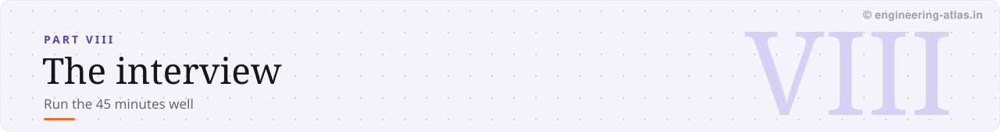</picture>

*How to run the 45 minutes.* Knowing the building blocks is half the job. The other half is using the time well: agreeing on scope, estimating only what matters, and spending most of the round on the parts that are actually hard.

### The interview round

<a href="https://engineering-atlas.in/system-design/interview/?utm_source=github&utm_medium=roadmap&utm_campaign=interview"><picture><source media="(prefers-color-scheme: dark)" srcset="diagrams/banners/btn-chapter-dark.svg"></picture></a>

| | |
|---|---|
| **Why know this** | Strong engineers fail design rounds by jumping into boxes before agreeing on requirements, or by spending 20 minutes on estimates nobody needed. A simple, repeatable structure fixes both. |
| **What interviewers test** | Can you run a full round on time, from requirements to failure scenarios? |
| **What you will cover** | How a system design interview works · The delivery framework · Functional vs non-functional requirements · API design for interviews · Databases for interviews · Common mistakes · Interview-ready checkpoint · Debugging and production-error rounds |
| **Ready to move on when** | You can run a full mock round on a problem you haven't seen, on time, and finish with failure scenarios. |

| Topic | What it is, and why it matters | Free read |
|---|---|---|
| <a href="https://engineering-atlas.in/system-design/interview/how-the-interview-works/?utm_source=github&utm_medium=roadmap&utm_campaign=how-the-interview-works">How a system design interview works</a> <picture><source media="(prefers-color-scheme: dark)" srcset="diagrams/tags/beginner-dark.svg"></picture> | A design interview is an open-ended conversation where you design a system with the interviewer, out loud. It matters to know what is being scored: structure, trade-offs, depth where it counts, and communication, not one "right" diagram. |  |
| <a href="https://engineering-atlas.in/system-design/interview/delivery-framework/?utm_source=github&utm_medium=roadmap&utm_campaign=delivery-framework">The delivery framework</a> <picture><source media="(prefers-color-scheme: dark)" srcset="diagrams/tags/beginner-dark.svg"></picture> | A step-by-step plan for the round, from requirements to deep dives, with a time budget for each step. It matters because a plan keeps you calm and leaves time for the deep dives where most of the signal is. |  |
| Functional vs non-functional requirements <picture><source media="(prefers-color-scheme: dark)" srcset="diagrams/tags/beginner-dark.svg"></picture> | Functional requirements say what the system does ("users can post a photo"); non-functional ones say how well (latency, availability, scale, consistency). It matters because the non-functional ones decide the architecture. |  |
| <a href="https://engineering-atlas.in/system-design/api-design/?utm_source=github&utm_medium=roadmap&utm_campaign=api-design">API design for interviews</a> <picture><source media="(prefers-color-scheme: dark)" srcset="diagrams/tags/intermediate-dark.svg"></picture> | Turning requirements into a handful of endpoints and the main data model. It matters because the API is the contract the rest of your design must serve. |  |
| <a href="https://engineering-atlas.in/system-design/databases/?utm_source=github&utm_medium=roadmap&utm_campaign=databases">Databases for interviews</a> <picture><source media="(prefers-color-scheme: dark)" srcset="diagrams/tags/intermediate-dark.svg"></picture> | How to choose and defend a database in a round, in the order interviewers push. It matters because "which database and why" comes up in almost every problem. |  |
| <a href="https://engineering-atlas.in/system-design/interview/common-mistakes/?utm_source=github&utm_medium=roadmap&utm_campaign=common-mistakes">Common mistakes</a> <picture><source media="(prefers-color-scheme: dark)" srcset="diagrams/tags/beginner-dark.svg"></picture> | The habits that sink otherwise strong candidates: no requirements, premature scaling, buzzwords without reasons, no failure talk. It matters because avoiding them is the cheapest score you can gain. |  |
| <a href="https://engineering-atlas.in/system-design/interview/interview-checkpoint/?utm_source=github&utm_medium=roadmap&utm_campaign=interview-checkpoint">Interview-ready checkpoint</a> <picture><source media="(prefers-color-scheme: dark)" srcset="diagrams/tags/intermediate-dark.svg"></picture> | A self-test of the whole HLD interview loop. It matters because practising the full round under time is different from knowing each part. |  |
| Debugging and production-error rounds <picture><source media="(prefers-color-scheme: dark)" srcset="diagrams/tags/intermediate-dark.svg"></picture> | Some companies ask you to find why a live system is slow or failing. It matters because it tests Part V in practice: read the symptoms, form a guess, check it. |  |

### Can you answer these?

1. You get "design Instagram". What do you ask in the first five minutes, and what do you leave out of scope?
2. Which numbers would you estimate for a chat app, and which would you skip? Why?
3. The interviewer says "the database is the bottleneck". Walk through your options in order.
4. You have 10 minutes left and haven't covered failures. What do you say?

> [!NOTE]
> **Prep progress.** Finish this part and you are about **100%** of the way to interview ready.
>
> 

**Continue learning on Engineering Atlas:** [Interview module](https://engineering-atlas.in/system-design/interview/?utm_source=github&utm_medium=roadmap&utm_campaign=interview) · [HLD roadmap](https://engineering-atlas.in/system-design/roadmap/?utm_source=github&utm_medium=roadmap&utm_campaign=roadmap)

<a href="#contents">Back to contents ↑</a>

---

## How to answer a design interview question

Use the same six steps every time. The structure isn't magic, but it keeps you from the two classic failures: designing before you understand the problem, and running out of time before the interesting part.

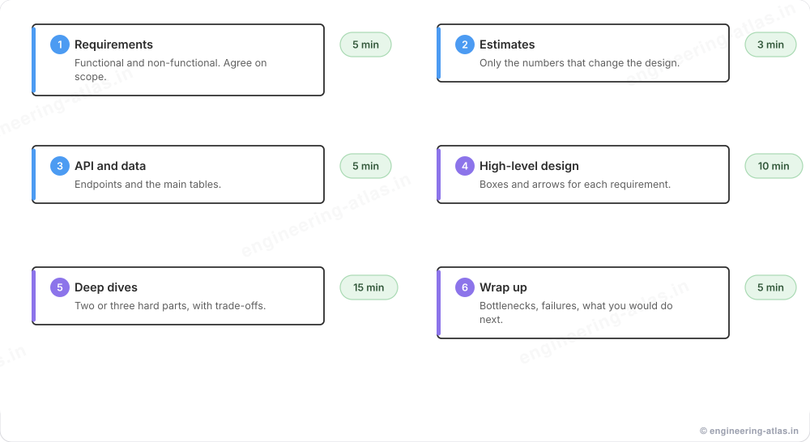

1. **Requirements (about 5 minutes).** Ask who uses it and for what. Write 3 to 5 functional requirements and the non-functional ones that matter: scale, latency, availability, consistency. Say what is out of scope.
2. **Estimates (about 3 minutes).** Only the numbers that change the design: requests per second at peak, storage per year, read-to-write ratio. Skip the rest.
3. **API and data model (about 5 minutes).** A few endpoints and the main tables or documents, with the key you look things up by.
4. **High-level design (about 10 minutes).** Draw the simplest design that meets each functional requirement, one at a time. Walk one request through it.
5. **Deep dives (about 15 minutes).** Pick the two or three hardest parts, usually what the non-functional requirements stress. Name options, trade-offs and your choice.
6. **Wrap up (about 5 minutes).** Bottlenecks, failure scenarios, monitoring, and what you would build next.

> [!TIP]
> **Create the edge.** Name the trade-off before the interviewer asks. "I'm choosing eventual consistency for the feed because a few seconds of staleness is fine here, but the payment ledger stays strongly consistent." Volunteering that line earns more than being led to it.

### The method in action: three worked examples

Short on purpose. Each one shows what you would say and draw in each step, not the full design. Try the question yourself first.

<b>Worked example 1: URL shortener</b>

| Step | What you say |
|---|---|
| **Requirements** | Create a short link for a long URL; redirect on visit; optional expiry. Out of scope: user accounts, analytics dashboards. Redirects must be fast (under 50 ms) and highly available. |
| **Estimates** | 100 million new links a month is about 40 writes per second. Reads are 100 times that: about 4,000 per second, peaking near 10,000. Each record is about 500 bytes, so 5 years is about 3 TB. |
| **API and data** | `POST /links {url} → {code}` and `GET /{code} → 301/302`. One table: `code (key), long_url, created_at, expires_at`. |
| **High-level design** | Client → load balancer → stateless app servers → cache → key-value store. A redirect reads the cache first and falls back to the store. |
| **Deep dives** | *Code generation:* a counter encoded in base62 gives 7 characters for 3.5 trillion links; hand out counter ranges to each server so they never collide. *Hot links:* cache them; a viral link is a read-heavy hot key, so the cache absorbs it. *301 vs 302:* 301 lets browsers cache, which cuts load but hides clicks from analytics. |
| **Wrap up** | Failure: if the store is down, cached links still redirect. Abuse: rate limit creation per IP. Next: click analytics through a queue, not on the redirect path. |

<b>Worked example 2: Chat (one-to-one and small groups)</b>

| Step | What you say |
|---|---|
| **Requirements** | Send and receive messages in real time, see history, delivery and read receipts, groups up to 100. Out of scope: voice, video, end-to-end encryption details. Messages must never be lost and must arrive in order within a chat. |
| **Estimates** | 50 million daily users, 40 messages each: 2 billion a day, about 25,000 per second on average and 3 times that at peak. At 200 bytes each, about 400 GB of new messages a day. |
| **API and data** | A WebSocket for live traffic; `GET /chats/{id}/messages?before=` for history. Messages table partitioned by `chat_id`, sorted by a time-ordered `message_id`. |
| **High-level design** | Client ↔ WebSocket gateway servers. A session store maps each online user to the gateway holding their connection. Sending writes the message to the store, then routes it to the recipient's gateway, or to push notifications if they are offline. |
| **Deep dives** | *Ordering:* a per-chat sequence number assigned on write, so clients sort correctly even if delivery reorders. *Delivery guarantee:* the client resends until it gets an ack, and the server deduplicates by a client-generated ID. *Storage:* a wide-column store keyed by `chat_id` keeps a chat's history on one partition and reads it with one range scan. |
| **Wrap up** | Failure: a gateway dies, clients reconnect to another and fetch missed messages since their last sequence number. Next: large groups fan out through a queue instead of inline. |

<b>Worked example 3: News feed</b>

| Step | What you say |
|---|---|
| **Requirements** | Users post; each user sees a feed of posts from people they follow, newest first. Out of scope: ranking models, ads. The feed must load in under 200 ms; a few seconds of staleness is fine. |
| **Estimates** | 300 million daily users opening the feed 10 times a day: about 35,000 feed reads per second on average. Posts are far fewer, about 1,000 per second. Reads dominate, so precompute. |
| **API and data** | `POST /posts` and `GET /feed?cursor=`. Tables: `posts`, `follows (follower, followee)`, and a feed cache per user holding recent post IDs. |
| **High-level design** | A post is saved, then a fan-out worker reads the author's followers from a queue and appends the post ID to each follower's cached feed. Reading the feed is one cache read plus a batch fetch of the posts. |
| **Deep dives** | *Fan-out on write vs on read:* writing to every follower is cheap for normal users but a celebrity with 50 million followers would flood the system. Use a hybrid: fan out for normal authors, and merge celebrity posts in at read time. *Feed size:* keep only the last few hundred IDs per user; older pages come from the database. |
| **Wrap up** | Failure: if fan-out lags, the feed is stale, not broken. Inactive users get no fan-out and their feed is built on login. Next: a ranking service that reorders the candidate posts. |

<a href="#contents">Back to contents ↑</a>

---

## Appendix: numbers cheat sheet

### Powers of two

| Power | Exact value | Roughly | Name |
|---|---|---|---|
| 2^10 | 1,024 | a thousand | 1 KB |
| 2^20 | 1,048,576 | a million | 1 MB |
| 2^30 | 1,073,741,824 | a billion | 1 GB |
| 2^40 | about 1.1 trillion | a trillion | 1 TB |
| 2^50 | about 1.1 quadrillion | a quadrillion | 1 PB |

Handy for estimates: a day has 86,400 seconds (call it 100,000), a month about 2.6 million, a year about 31.5 million. So 1 million requests a day is about 12 per second on average.

### Latency numbers to keep in your head

Orders of magnitude on modern hardware. The exact values change every few years; the ratios between them are what matter.

| Operation | About |
|---|---|
| L1 cache reference | 1 ns |
| Main memory reference | 100 ns |
| Read 1 MB sequentially from memory | a few microseconds |
| SSD random read | 10s of microseconds |
| Read 1 MB sequentially from SSD | about 50 microseconds |
| Round trip inside one datacenter | about 0.5 ms |
| Read 1 MB sequentially from spinning disk | about 1 ms |
| Spinning disk seek | a few ms |
| Round trip across continents | about 150 ms |

What to take away: memory is about 1,000 times faster than a network round trip in the same building, and a cross-continent round trip is about 300 times slower again. Design so the hot path stays in memory and in one region.

### Throughput rules of thumb

Rough capacity of one well-tuned node. Use them to decide how many machines you need, then add headroom.

| Component | Handles about |
|---|---|
| Web or app server (simple API) | 1,000 to 10,000 requests per second |
| Relational database (single primary) | 5,000 to 20,000 simple queries per second |
| Redis or Memcached | 100,000+ operations per second |
| Kafka broker | hundreds of MB per second |
| A 1 Gbps network link | about 125 MB per second |
| A 10 Gbps network link | about 1.25 GB per second |

### Typical sizes

| Item | About |
|---|---|
| A character (ASCII / UTF-8 common) | 1 byte |
| A UUID | 16 bytes (36 as text) |
| A 64-bit integer or timestamp | 8 bytes |
| A tweet-sized text post with metadata | 300 bytes to 1 KB |
| A user profile row | 1 KB |
| A compressed photo | 200 KB to 2 MB |
| One minute of HD video | 50 to 100 MB |

### Availability in downtime

| Availability | Down per year | Down per month |
|---|---|---|
| 99% | 3.65 days | 7.2 hours |
| 99.9% | 8.8 hours | 43 minutes |
| 99.99% | 53 minutes | 4.3 minutes |
| 99.999% | 5.3 minutes | 26 seconds |

Source: <a href="https://colin-scott.github.io/personal_website/research/interactive_latency.html">Colin Scott: Latency numbers every programmer should know (interactive)</a>

<a href="#contents">Back to contents ↑</a>

---

## Glossary

The terms you will hear in every design discussion, in one line each. Follow the arrow to the chapter that teaches it.

<a href="#glossary-a">A</a> · <a href="#glossary-b">B</a> · <a href="#glossary-c">C</a> · <a href="#glossary-e">E</a> · <a href="#glossary-f">F</a> · <a href="#glossary-g">G</a> · <a href="#glossary-h">H</a> · <a href="#glossary-i">I</a> · <a href="#glossary-j">J</a> · <a href="#glossary-l">L</a> · <a href="#glossary-o">O</a> · <a href="#glossary-p">P</a> · <a href="#glossary-q">Q</a> · <a href="#glossary-r">R</a> · <a href="#glossary-s">S</a> · <a href="#glossary-t">T</a> · <a href="#glossary-v">V</a> · <a href="#glossary-w">W</a> · <a href="#glossary-p">p</a>

| Term | Meaning | Learn it in |
|---|---|---|
| **ACID** | Atomicity, consistency, isolation and durability: the guarantees of a database transaction. | [Chapter 04 →](#04-database-fundamentals) |
| **Back pressure** | A slow consumer telling producers to slow down instead of being overwhelmed. | [Chapter 19 →](#19-message-queues-and-streams) |
| **Bloom filter** | A compact structure that says "definitely not present" or "maybe present". | [Chapter 34 →](#34-storage-engines-and-probabilistic-structures) |
| **Bulkhead** | Separate resource pools so one failing dependency cannot drain them all. | [Chapter 38 →](#38-bulkheads-and-isolation) |
| **CAP theorem** | During a network partition, a system must choose between consistency and availability. | [Chapter 11 →](#11-cap-and-pacelc) |
| **CDC (change data capture)** | Streaming every row change out of a database's log to other systems. | [Chapter 49 →](#49-event-driven-architecture) |
| **CDN** | Servers near users that cache and serve content so requests skip the origin. | [Chapter 16 →](#16-content-delivery-networks) |
| **Cell-based architecture** | Splitting a system into independent copies so a failure hits only one slice of users. | [Chapter 42 →](#42-cell-based-architecture) |
| **Circuit breaker** | Stops calling a failing dependency for a while so it can recover. | [Chapter 36 →](#36-circuit-breakers) |
| **Consensus** | Getting several nodes to agree on one value even when some fail. Raft and Paxos do this. | [Chapter 26 →](#26-consensus) |
| **Consistent hashing** | Placing keys and nodes on a ring so adding a node moves only a small share of keys. | [Chapter 30 →](#30-partitioning-strategies) |
| **CQRS** | Separate models for writing data and for reading it. | [Chapter 50 →](#50-cqrs-and-event-sourcing) |
| **CRDT** | A data type that merges concurrent edits without conflicts. | [Chapter 41 →](#41-multi-region-and-active-active) |
| **Event sourcing** | Storing every change as an event and rebuilding state by replaying them. | [Chapter 50 →](#50-cqrs-and-event-sourcing) |
| **Eventual consistency** | Replicas may disagree for a while but converge once writes stop. | [Chapter 10 →](#10-consistency-models) |
| **Fencing token** | An increasing number that lets storage reject writes from a stale lock holder. | [Chapter 25 →](#25-distributed-coordination) |
| **Gossip protocol** | Nodes share state by talking to random peers until everyone knows. | [Chapter 31 →](#31-gossip-protocols) |
| **Health check** | An endpoint that tells a load balancer or orchestrator whether to send traffic. | [Chapter 39 →](#39-health-checks-done-right) |
| **Horizontal scaling** | Adding more machines instead of a bigger one. | [Chapter 07 →](#07-scalability) |
| **Idempotency** | Doing the same operation twice has the same effect as doing it once. | [Chapter 20 →](#20-api-design-in-practice) |
| **Jitter** | Randomness added to retry delays so clients do not retry in lockstep. | [Chapter 37 →](#37-retry-engineering) |
| **Leader election** | Picking one node to coordinate, and picking a new one when it fails. | [Chapter 25 →](#25-distributed-coordination) |
| **Load balancer** | Spreads incoming requests across a pool of servers. | [Chapter 14 →](#14-load-balancing) |
| **LSM tree** | A write-optimised storage engine that buffers in memory and merges sorted files on disk. | [Chapter 34 →](#34-storage-engines-and-probabilistic-structures) |
| **Outbox pattern** | Writing an event to a table in the same transaction as the data, then publishing it. | [Chapter 49 →](#49-event-driven-architecture) |
| **PACELC** | Extends CAP: even without a partition, you trade latency against consistency. | [Chapter 11 →](#11-cap-and-pacelc) |
| **Partitioning (sharding)** | Splitting data across nodes so each holds only part of it. | [Chapter 17 →](#17-database-scaling) |
| **p99 latency** | The time within which 99% of requests finish. Tail latency is what users feel. | [Chapter 06 →](#06-performance-fundamentals) |
| **Quorum** | The minimum number of replicas that must answer a read or write for it to count. | [Chapter 29 →](#29-distributed-consistency) |
| **Rate limiting** | Capping how many requests a client can make in a time window. | [Chapter 21 →](#21-rate-limiting) |
| **Read replica** | A copy of the database that serves reads and follows the primary. | [Chapter 28 →](#28-replication-internals) |
| **RPO and RTO** | How much data you can lose, and how long you can be down, after a disaster. | [Chapter 40 →](#40-disaster-recovery) |
| **Saga** | A long transaction split into local steps, each with a compensating undo. | [Chapter 27 →](#27-distributed-transactions) |
| **Service mesh** | A proxy beside each service that handles retries, mTLS and traffic routing. | [Chapter 52 →](#52-service-mesh) |
| **SLI, SLO, SLA** | What you measure, the target you aim for, and the promise you make to customers. | [Chapter 08 →](#08-availability-and-reliability) |
| **Split brain** | Two nodes both believe they are the leader and accept conflicting writes. | [Chapter 35 →](#35-failure-modes) |
| **Thundering herd** | Many clients hitting a resource at once, often after a cache expiry or an outage. | [Chapter 15 →](#15-caching) |
| **Two-phase commit** | A coordinator asks all participants to prepare, then to commit, so all or none apply. | [Chapter 27 →](#27-distributed-transactions) |
| **Vector clock** | Per-node counters that show whether two events are ordered or concurrent. | [Chapter 12 →](#12-distributed-systems-fundamentals) |
| **WebSocket** | A long-lived two-way connection between browser and server. | [Chapter 24 →](#24-real-time-communication) |
| **Write-ahead log** | Recording a change durably before applying it, so a crash can be replayed. | [Chapter 04 →](#04-database-fundamentals) |

<a href="#contents">Back to contents ↑</a>

---

## Engineering blogs, explained

Company engineering blogs are where these ideas meet real load, but they are long, scattered and written for insiders. The [Engineering Atlas blog](https://engineering-atlas.in/blogs/?utm_source=github&utm_medium=roadmap&utm_campaign=blogs) picks the best ones and explains them in the same plain voice as this roadmap: what the company built, why, and what you can take into your own designs and interviews.

<a href="#contents">Back to contents ↑</a>

---

## Why Engineering Atlas

This roadmap is the map. [Engineering Atlas](https://engineering-atlas.in/?utm_source=github&utm_medium=roadmap&utm_campaign=readme) is where each stop becomes a full lesson.

- **Every chapter here is a lesson there,** written in the same plain voice, with diagrams drawn for that one idea.
- **Design problems are solved step by step,** one requirement at a time, with naive, solid and staff-level answers for each deep dive.
- **Each lesson ends with how to say it in the interview,** plus the follow-up questions interviewers really ask.
- **It goes past the interview:** failure modes, recovery and the production habits from Part V are taught the way you meet them on call.

Learning paths: [High-level design](https://engineering-atlas.in/system-design/?utm_source=github&utm_medium=roadmap&utm_campaign=system-design) · [Low-level design](https://engineering-atlas.in/lld/?utm_source=github&utm_medium=roadmap&utm_campaign=lld-lld) · [Java](https://engineering-atlas.in/java/?utm_source=github&utm_medium=roadmap&utm_campaign=java)

---

## Contributing and licence

Found a broken link, or a better free read for a topic? Open an issue or a pull request. A good free read is an original source (official docs, a paper or an engineering blog), free to read, and still relevant.

© 2026 Engineering Atlas. Content and diagrams are shared under [CC BY-NC-SA 4.0](https://creativecommons.org/licenses/by-nc-sa/4.0/). You may share and adapt them with credit and a link back, under the same licence, and not for commercial use. Courses, paid newsletters and company blogs need written permission. Diagrams are drawn for this guide. Maintained by the Engineering Atlas team ([LinkedIn](https://www.linkedin.com/company/engineering-atlas/)). Last verified: 26 Nov 2026.
